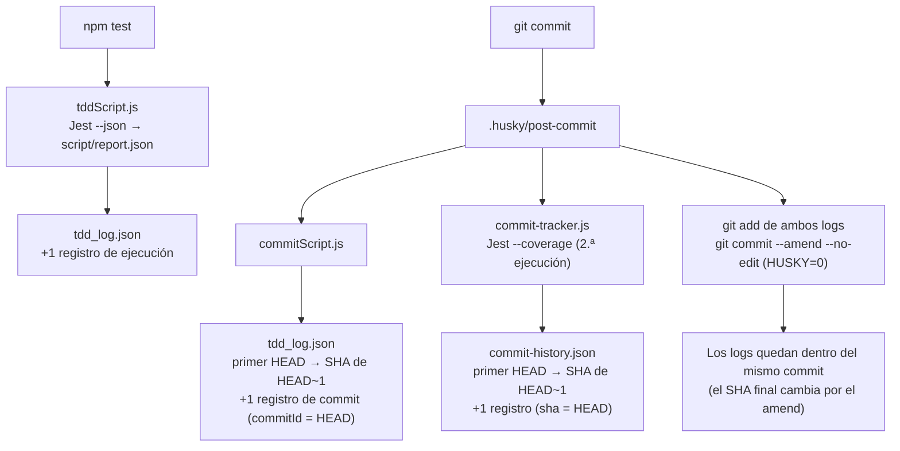
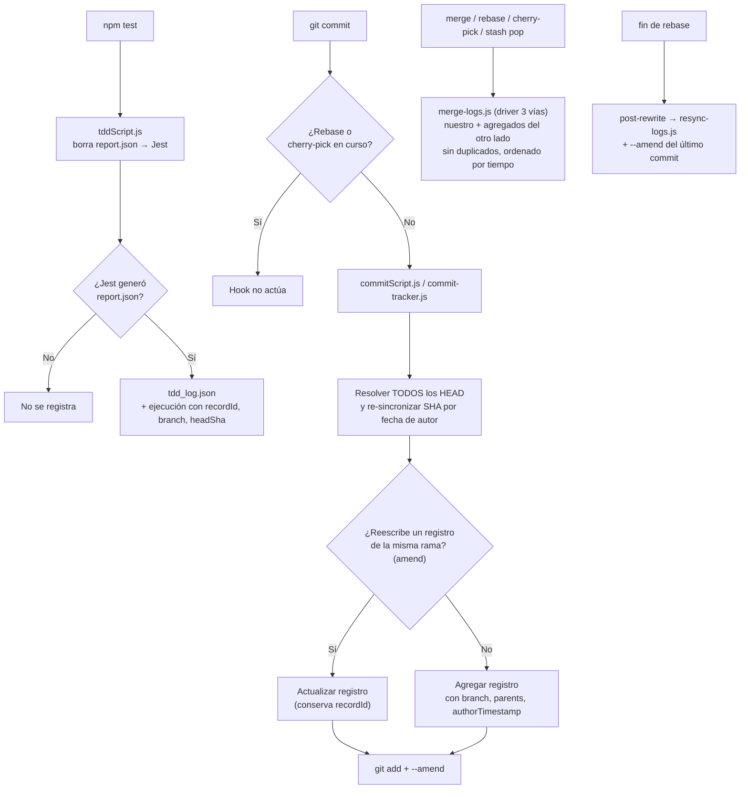

# 02 — Análisis de scripts y archivos log

**Objetivo de la HU:** analizar los scripts encargados de generar los archivos log y la estructura de información que almacenan, considerando el comportamiento del sistema al trabajar con diferentes ramas Git, para identificar qué modificaciones son necesarias para registrar y diferenciar correctamente la información de cada rama, evitando la pérdida, sobrescritura o duplicación de registros.

---

## 1. Resumen ejecutivo

1. Los logs se generan con **3 scripts**: `tddScript.js` (al ejecutar `npm test`) y `commitScript.js` + `commit-tracker.js` (en el hook `post-commit` de Husky). Escriben dos archivos: `script/tdd_log.json` y `script/commit-history.json`.
2. Ambos archivos **se versionan en Git**. El hook los agrega al mismo commit con `git commit --amend`, así que cada rama tiene su propia copia de los logs.
3. **No se registra la rama** en ningún archivo, y el SHA de cada commit se guarda **con retraso**: se escribe el marcador `"HEAD"` y se resuelve en el commit siguiente con `git rev-parse HEAD~1`, corrigiendo solo el **primer** `"HEAD"` del archivo.
4. En un flujo lineal en una sola rama todo funciona. Con ramas aparecen **pérdida, sobrescritura y duplicación** de registros. En la batería de 6 escenarios (sección 6.12), el código actual generó conflictos en 4 escenarios y dejó **4 de 10** registros de commit de `main` con un SHA equivocado, incluido un SHA duplicado. Además, el hook rompe los `rebase` y un fallo de Jest genera ejecuciones "verdes" falsas.
5. La **propuesta** (sección 8) agrega campos opcionales (`branch`, `recordId`, `headSha`, `parents`, `authorTimestamp`), reemplaza la resolución del marcador por una basada en la fecha de autor, incorpora un **driver de merge JSON de 3 vías** y protege el hook durante rebase y cherry-pick. Se validó con una **prueba de concepto**: los mismos 6 escenarios terminan **sin conflictos y con 0 registros incorrectos** en las 4 ramas, manteniendo compatibilidad con logs del formato antiguo.

---

## 2. Alcance y metodología

**Alcance:** el proyecto base que usan los estudiantes (`Cachuchines-TDDLabBaseProject`): scripts de `script/`, hooks de `.husky/`, configuración Git (`.gitattributes`, `.gitignore`), `package.json` y el workflow de CI. La lectura de los logs desde la plataforma TDDLab (`server/`, `Web Ui/`) ya está analizada en `05-arquitectura-backlog.md` y aquí solo se referencia.

**Metodología:**

1. **Revisión de código:** lectura completa de cada script y hook, y del flujo que los conecta.
2. **Pruebas reproducibles:** en una **copia aislada** del repositorio (no en la rama de trabajo), con `npm install` y los hooks de Husky activos, se ejecutaron commits y operaciones Git reales en cada escenario: cambio de rama, stash, merge local, merge estilo GitHub, amend, rebase, cherry-pick y fallo de Jest.
3. **Verificación automática:** un script (`verificar-logs.mjs`, Anexo B) compara cada registro de commit del log con la historia real de la rama.
4. **Prueba de concepto de la propuesta:** se aplicaron los cambios propuestos y se repitió **la misma batería** de escenarios para comparar el antes y el después.

**Herramientas:** Git 2.43, Node.js 22, Jest 29.7, Husky 9.1.6 (versiones del `package-lock.json` del proyecto).

---

## 3. Scripts que generan los archivos log *(criterio 1)*

### 3.1 Scripts y hooks

| Archivo | Disparador | Qué hace | Archivo que escribe |
|---|---|---|---|
| `script/tddScript.js` | `npm test` (`"test": "node ./script/tddScript.js"`) | Ejecuta `jest --json --outputFile=./script/report.json`, lee el reporte y agrega un registro de **ejecución de pruebas**. | `script/tdd_log.json` |
| `script/commitScript.js` | Hook `post-commit` | Agrega un registro de **commit** y resuelve el marcador `"HEAD"` anterior. | `script/tdd_log.json` |
| `script/commit-tracker.js` | Hook `post-commit` | Ejecuta Jest **otra vez** (`npx jest --coverage --json --passWithNoTests`) y agrega un registro con estadísticas del diff, cobertura y conclusión. Resuelve el marcador `"HEAD"` anterior. | `script/commit-history.json` |
| `script/id_execution_tests_commit.js` | Lo importan `tddScript.js` y `commitScript.js` | Calcula el `testId` del siguiente registro. Si el log no existe, lo crea con `[]`. | `script/tdd_log.json` (solo al crearlo) |
| `.husky/post-commit` | Después de cada `git commit` | Ejecuta `commitScript.js` y `commit-tracker.js`, hace `git add` de los dos logs y `git commit --amend --no-edit` con `HUSKY=0` para no volver a disparar los hooks. Se omite con `HUSKY_SKIP_TRACK=1`. | — |

### 3.2 Archivos relacionados

| Archivo | Relación con los logs |
|---|---|
| `package.json` | `"test"` ejecuta `tddScript.js`. `"postinstall": "git init && npx husky"` instala los hooks en cada `npm install`. |
| `.gitattributes` | Marca los dos logs como `-diff` (Git no muestra su diff y los cuenta como binarios en `--stat`) y `linguist-generated=true` (GitHub los colapsa en los PR). **No evita conflictos de merge.** |
| `.gitignore` | Ignora `report.json` (reporte temporal de Jest) y `.husky/.commit-state`. Los logs **no** están ignorados. |
| `.husky/commit-msg` + `semantic-commits.js` | Validan el mensaje con Conventional Commits (`feat`, `fix`, `docs`, `style`, `refactor`, `test`, `chore`, `perf`). Desactivado por defecto; se activa con `npm run semantic-commits-on` y el estado se guarda en `.husky/.commit-state`. |
| `.husky/pre-commit` | Sin efecto (`#npm run lint` comentado). |
| `.github/workflows/integrate.yml` | CI que ejecuta `npx jest --verbose --coverage` y publica la cobertura como comentario. Solo corre en `push` a `main` y en `pull_request` hacia `main`/`master`. |
| `script/VSCodeExtensionPrompt.json` | Prompt para el asistente de la extensión de VS Code. **No relacionado** con los logs. |

### 3.3 Flujo de generación



---

## 4. Cómo se generan y qué información almacenan *(criterio 2)*

### 4.1 Forma de escritura

Los tres scripts siguen el mismo patrón: **leen el archivo completo, agregan un elemento al arreglo y reescriben todo el archivo** con `fs.writeFileSync`. No hay escritura incremental ni bloqueo. Los archivos solo crecen y, por el `--amend` del hook, quedan versionados dentro de cada commit.

### 4.2 Estructura de `tdd_log.json`

Es un arreglo que mezcla **dos tipos de registro**, diferenciados por la presencia del campo `commitId`.

**Registro de ejecución de pruebas** (`tddScript.js`):

| Campo | Tipo | Origen |
|---|---|---|
| `numPassedTests` | número | `report.json` de Jest |
| `failedTests` | número | `numFailedTests` de `report.json` |
| `numTotalTests` | número | `report.json` de Jest |
| `timestamp` | número (ms) | `startTime` de Jest |
| `success` | booleano | `report.json` de Jest |
| `testId` | número | `getLastTestId()` |

**Registro de commit** (`commitScript.js`):

| Campo | Tipo | Origen |
|---|---|---|
| `commitId` | texto | `"HEAD"` al crearse; SHA real en el commit siguiente |
| `commitName` | texto | `git log -1 --pretty=%B` (mensaje **completo**, con cuerpo) |
| `commitTimestamp` | número (ms) | `Date.now()` al ejecutarse el hook |
| `testId` | número | `getLastTestId()` |

Ejemplo real (dos `npm test` y un commit):

```json
[
  { "numPassedTests": 1, "failedTests": 0, "numTotalTests": 1, "timestamp": 1793665077625, "success": true, "testId": 0 },
  { "numPassedTests": 1, "failedTests": 0, "numTotalTests": 1, "timestamp": 1793665078801, "success": true, "testId": 0 },
  { "commitId": "HEAD", "commitName": "feat: commit A en main", "commitTimestamp": 1793665079473, "testId": 0 }
]
```

### 4.3 Estructura de `commit-history.json`

| Campo | Tipo | Origen |
|---|---|---|
| `sha` | texto | `"HEAD"` al crearse; SHA real en el commit siguiente |
| `author` | texto | `git log -1 --pretty=format:%an` |
| `commit.date` | ISO 8601 | `git log -1 --format=%cd` |
| `commit.message` | texto | `git log -1 --pretty=%B` |
| `commit.url` | texto | `remote.origin.url` (convertida a https) + `/commit/<sha>` |
| `stats.total` / `additions` / `deletions` | número | `git diff --stat` contra el padre, excluyendo `commit-history.json` |
| `stats.date` | `AAAA-MM-DD` | fecha del commit |
| `coverage` | número (%) | cobertura de **sentencias** de la 2.ª ejecución de Jest |
| `test_count` / `failed_tests` | número | 2.ª ejecución de Jest |
| `conclusion` | `success` / `failure` / `neutral` | `neutral` si no hay pruebas; `failure` si alguna falla |

Antes de guardar, el arreglo se **ordena por fecha** del commit. `tdd_log.json`, en cambio, conserva el **orden de inserción**.

Detalles de implementación relevantes:
- Un commit se considera merge si su **mensaje empieza con `"Merge "`**, no por su cantidad de padres.
- La URL usa una condición invertida (`!isHeadCommit ? .../commit/HEAD : .../commit/${sha}`). No tiene efecto práctico porque la función siempre recibe `"HEAD"` y la URL se corrige al resolver el marcador.

### 4.4 Lógica del `testId`

`getLastTestId()` revisa el **último** registro del archivo:

| Último registro | `testId` devuelto |
|---|---|
| Archivo vacío | `0` |
| Ejecución de pruebas | el mismo `testId` |
| Commit | `testId + 1` |

Resultado: todas las ejecuciones entre dos commits comparten el mismo `testId`, y el commit que cierra el grupo lleva ese número. Es un **correlativo local** del archivo, no un identificador único.

### 4.5 Mecanismo del marcador `"HEAD"`

El hook hace `git commit --amend` para meter los logs en el commit, y el amend **cambia el SHA**. Por eso, al escribir el registro no se conoce el SHA final:

1. Se guarda el commit con `commitId: "HEAD"` (y `sha: "HEAD"` en `commit-history.json`).
2. En el **siguiente** commit, el script busca el **primer** registro con `"HEAD"` (`findIndex`) y le asigna `git rev-parse HEAD~1`.

El mecanismo supone dos cosas: que **hay un solo `"HEAD"`** en el archivo y que **`HEAD~1` es el commit al que pertenece**. Ninguna de las dos se cumple con merges, amend ni rebase (sección 6). Además, el último commit de cualquier rama **siempre** figura como `"HEAD"`.

### 4.6 Doble ejecución de Jest

`tddScript.js` registra la ejecución que hace el estudiante. `commit-tracker.js` vuelve a ejecutar Jest en cada commit para calcular cobertura. Por eso los resultados de `commit-history.json` **no necesariamente coinciden** con la última ejecución registrada en `tdd_log.json`, y cada commit tarda más.

---

## 5. Registro de ramas y commits *(criterio 3)*

| Dato | ¿Se registra? | Detalle |
|---|---|---|
| **Rama** | **No** | No hay campo de rama en ninguno de los dos archivos. |
| **SHA del commit** | **Con retraso** | Se resuelve en el commit siguiente; el último commit queda como `"HEAD"`. |
| **Padres del commit** | **No** | No se puede reconstruir la historia (merges) desde el log. |
| **Relación ejecución ↔ commit** | **Indirecta** | Solo por `testId`. No se guarda sobre qué commit se ejecutaron las pruebas ni un identificador único por ejecución. |
| **Resultado de pruebas del commit** | **Sí, pero de otra ejecución** | `commit-history.json` usa la 2.ª ejecución de Jest (sección 4.6). |

---

## 6. Pruebas con ramas *(criterios 4 y 5)*

Cada escenario se ejecutó con commits reales y los hooks activos. Los SHA son los de cada corrida.

### 6.1 Flujo lineal en una rama

Dos `npm test` y un commit en `main`. **Resultado:** correcto (ejemplo en la sección 4.2). El commit queda como `"HEAD"` hasta el siguiente.

### 6.2 Cambio de rama con los logs commiteados *(criterio 4)*

Se creó `feature/login` desde `main`, se ejecutaron pruebas y se hizo un commit F1. Al volver a `main`:

| Rama | Contenido de `tdd_log.json` |
|---|---|
| `feature/login` | A (SHA resuelto `101d6c4`) + ejecución `testId 1` + F1 como `"HEAD"` |
| `main` | Solo hasta A, como `"HEAD"` |

**Resultado:** correcto. Cada rama tiene su propia "foto" del log y el marcador se resuelve bien en cada una.

### 6.3 Cambio de rama con ejecuciones sin commitear *(criterio 4)*

**Caso A:** `npm test` en `main` sin commitear y luego `git checkout feature/login`:

```
error: Your local changes to the following files would be overwritten by checkout:
	script/tdd_log.json
Please commit your changes or stash them before you switch branches.
Aborting
```

**Resultado:** Git bloquea el cambio. El estudiante debe commitear, hacer `stash` o descartar. Si descarta (`git checkout -- .` / `git restore`), **pierde** esas ejecuciones.

**Caso B:** `npm test` en `main` sin commitear y luego `git checkout -b feature/carrito`.

**Resultado:** el cambio de rama se permite y la ejecución hecha en `main` **pasa a `feature/carrito`**. Al commitear queda registrada en una rama donde no se ejecutó, y no hay forma de saberlo porque el registro no tiene rama.

### 6.4 `git stash` y `git stash pop` en otra rama *(criterio 4)*

`npm test` en `main`, `git stash`, cambio a `feature/login`, `git stash pop`:

```
CONFLICT (content): Merge conflict in script/tdd_log.json
The stash entry is kept in case you need it again.
```

**Resultado:** conflicto. Las ejecuciones quedan en el stash y se **pierden** si el stash se descarta.

### 6.5 Merge local entre ramas con commits en ambos lados *(criterio 5)*

Con un commit M2 en `main` y F1 en `feature/login`, `git merge feature/login`:

```
CONFLICT (content): Merge conflict in script/commit-history.json
CONFLICT (content): Merge conflict in script/tdd_log.json
Automatic merge failed; fix conflicts and then commit the result.
```

Fragmento de `tdd_log.json` en conflicto (**JSON inválido**):

```
  {
    "commitId": "HEAD",
<<<<<<< HEAD
    "commitName": "feat: commit M2 en main",
    "commitTimestamp": 1793665096822,
=======
    "commitName": "feat: commit F1 en feature",
    "commitTimestamp": 1793665086960,
>>>>>>> feature/login
    "testId": 1
  }
```

Como cada commit modifica los logs, **cualquier merge con commits en ambas ramas produce conflicto**. El conflicto se resolvió **conservando los registros de ambas ramas** (la resolución correcta) y luego se hicieron el commit de merge y un commit posterior M3:

| Commit | SHA real | SHA registrado en `tdd_log.json` |
|---|---|---|
| A (main) | `101d6c4` | `101d6c4` ✅ |
| M2 (main) | `7ccbe86` | `7ccbe86` ✅ |
| F1 (feature/login) | `c1d1d70` | `e06d924` ❌ (SHA del **merge**) |
| Merge | `e06d924` | `"HEAD"` ❌ (recibirá el SHA de M3) |
| M3 | `d44081c` | `"HEAD"` |

```
* d44081c feat: commit M3 despues del merge
*   e06d924 Merge branch feature/login
|\
| * c1d1d70 feat: commit F1 en feature
* | 7ccbe86 feat: commit M2 en main
|/
* 101d6c4 feat: commit A en main
```

**Resultado:**
- Tras el merge quedan **dos** `"HEAD"`. El script solo corrige el primero, así que cada commit nuevo asigna su SHA al registro equivocado y el desfase **se arrastra indefinidamente**. El SHA real de F1 no aparece nunca.
- M2 y F1 quedan con el mismo `testId: 1`.
- `commit-history.json` sufre el mismo desfase y además se ordena por fecha, así que los dos archivos quedan en órdenes distintos.
- Como `commitName` usa el mensaje completo (`%B`), el registro del merge guarda también las líneas `# Conflicts: ...` que Git agrega al mensaje.

### 6.6 Merge desde un Pull Request en GitHub *(criterio 5)*

GitHub no ejecuta los hooks locales. Para simularlo se hizo el merge con `HUSKY=0` y, tras resolver el conflicto conservando ambos lados, un commit local posterior (M2):

| Commit | SHA real | SHA registrado |
|---|---|---|
| M1 (main) | `5b50e33` | `67ce3ce` ❌ (SHA del merge del PR) |
| F2 (feature/x) | `c7ce180` | `"HEAD"` ❌ (es el primer `"HEAD"`: el próximo commit le asignará un SHA ajeno) |
| Merge del PR | `67ce3ce` | **sin registro** |

**Resultado:** el commit de merge del PR **no queda registrado** y los SHA se desfasan igual que en el merge local. Además, el conflicto en los logs bloquea el botón de merge del PR hasta resolverlo.

### 6.7 `git commit --amend` del usuario

Sobre M3 se ejecutó `git commit --amend -m "feat: M3 corregido con amend"`:

```
{"commitId":"e06d924","commitName":"feat: commit F1 en feature","testId":1}
{"commitId":"e06d924","commitName":"Merge branch feature/login","testId":2}
{"commitId":"HEAD","commitName":"feat: commit M3 despues del merge","testId":3}
{"commitId":"HEAD","commitName":"feat: M3 corregido con amend","testId":4}
```

**Resultado:** el SHA `e06d924` queda **duplicado** en dos registros, y un único commit real (M3 corregido) tiene **dos** registros de commit.

### 6.8 `git rebase`

Una rama con dos commits propios se rebasó sobre `main`:

```
Could not apply 060ac32... feat: R1 en rama a rebasar
UU script/commit-history.json
UU script/tdd_log.json
```

**Resultado:** conflicto en ambos logs por cada commit reaplicado.

Además, en un rebase **sin** conflictos en los logs (probado con el driver de la propuesta y el **hook original**), el hook rompe el rebase:

```
Rebasing (1/2)fatal: You are in the middle of a cherry-pick -- cannot amend.
husky - post-commit script failed (code 128)
Rebasing (2/2)error: Your local changes to the following files would be overwritten by merge:
	script/commit-history.json
	script/tdd_log.json
```

El hook ejecuta `git commit --amend` en medio del rebase, Git lo rechaza, los logs quedan modificados sin commitear y el rebase se detiene. En cualquier caso, el rebase reescribe los SHA y los guardados en el log dejan de existir en la historia.

### 6.9 `git cherry-pick`

`git cherry-pick` de un commit de otra rama a `main`:

```
UU script/commit-history.json
UU script/tdd_log.json
```

**Resultado:** conflicto en ambos logs.

### 6.10 Fallo de Jest antes de generar el reporte

Se forzó un error de configuración de Jest (`testEnvironment` inexistente) y se ejecutó `npm test`:

```
{"timestamp":1793668578701,"success":true,"numTotalTests":1}
{"timestamp":1793668578701,"success":true,"numTotalTests":1}
```

**Resultado:** Jest falló, pero `tddScript.js` ignora el código de salida y leyó el `report.json` **de la ejecución anterior**. Se agregó una ejecución **duplicada y "verde"** que nunca ocurrió.

### 6.11 Commits de documentación

Un commit que solo agrega un `.md` también ejecuta el hook: se corre Jest, se agregan registros y los logs entran en el commit:

```
[main 8c0ef8a] docs: prueba skip
 2 files changed, 0 insertions(+), 0 deletions(-)
 create mode 100644 script/commit-history.json
 create mode 100644 script/tdd_log.json
```

Con `HUSKY_SKIP_TRACK=1 git commit ...` el registro se omite y la validación del mensaje (`commit-msg`) **sigue activa**. `git commit --no-verify` **no** sirve, porque no omite `post-commit`.

### 6.12 Batería comparativa automatizada

Se ejecutó la misma secuencia (`escenarios.sh`, Anexo B) sobre el código actual. La secuencia hace: merge local, amend, rebase, cherry-pick, stash pop en otra rama y un segundo merge. Luego se verificó cada rama con `verificar-logs.mjs`:

```
1. merge local:            CONFLICTO script/commit-history.json script/tdd_log.json
   (resuelto a mano conservando ambos lados)
2. amend del usuario:      hecho
3. rebase sobre main:      FALLA script/commit-history.json script/tdd_log.json
4. cherry-pick a main:     FALLA script/commit-history.json script/tdd_log.json
5. stash pop en otra rama: CONFLICTO script/tdd_log.json
6. merge feature/carrito:  OK

Rama: main
  ✗ "feat: F2" registrado con 705f5f7 (ese SHA es "Merge branch 'feature/login'")
  ✗ "feat: M2" registrado con 496f7c6 (ese SHA es "feat: M2 corregido con amend")
  ✗ "feat: M2 corregido con amend" registrado con eba7383 (ese SHA es "feat: M3")
  ✗ "feat: M3" registrado con 56c1ac0 (ese SHA es "feat: C1")
  Registros de commit: 10 | correctos: 4 | incorrectos: 4 | pendientes (HEAD): 2 | SHA duplicados: 1
  Registros con campo branch: 0/19
Rama: feature/carrito
  Registros de commit: 9 | correctos: 4 | incorrectos: 3 | pendientes (HEAD): 2 | SHA duplicados: 1
```

El escenario 6 da OK porque es un merge *fast-forward* (sin commits nuevos en `main`), el único tipo de merge que no genera conflicto.

---

## 7. Problemas identificados *(criterio 6)*

Clasificados según los tres efectos que la HU busca evitar:

| # | Problema | Efecto | Severidad | Evidencia |
|---|---|---|---|---|
| P1 | No se registra la rama en ningún log | No se puede diferenciar la información de cada rama | Alta | 5 |
| P2 | El marcador `"HEAD"` se resuelve con el **primer** `HEAD` + `HEAD~1` | **Sobrescritura**: SHA asignados al commit equivocado tras un merge, con desfase permanente | Alta | 6.5, 6.6, 6.12 |
| P3 | Todo merge con commits en ambas ramas genera conflicto en los dos logs | **Pérdida** de registros si se resuelve mal; JSON inválido si se sube sin resolver; PR bloqueado | Alta | 6.5, 6.6 |
| P4 | Ejecuciones sin commitear bloquean el cambio de rama o quedan en un stash con conflicto | **Pérdida** de ejecuciones | Media | 6.3 A, 6.4 |
| P5 | Ejecuciones sin commitear pasan a la rama nueva | Ejecución atribuida a una rama donde no ocurrió | Media | 6.3 B |
| P6 | `testId` es un correlativo local de cada rama | **Duplicación** de `testId` al fusionar | Media | 6.5 |
| P7 | `git commit --amend` del usuario | **Duplicación** de SHA y de registros de commit | Media | 6.7 |
| P8 | `git rebase`: conflictos y el hook hace `--amend` en medio del rebase | Rebase interrumpido; **pérdida** de trazabilidad (SHA inexistentes) | Alta | 6.8 |
| P9 | `git cherry-pick` genera conflicto en los logs | Operación interrumpida | Baja | 6.9 |
| P10 | Si Jest falla, se reutiliza el `report.json` anterior | **Duplicación**: ejecución "verde" falsa | Media | 6.10 |
| P11 | Los merges hechos en GitHub (PR) no ejecutan hooks | El commit de merge **no se registra** | Media | 6.6 |
| P12 | El CI solo corre en `main` | Commits de otras ramas sin cobertura publicada | Media | `integrate.yml` |
| P13 | La plataforma TDDLab lee los logs solo de `main` y une commits y log **por posición** | Datos de otras ramas invisibles; desalineación si el orden cambia | Alta | `05-arquitectura-backlog.md`, H1 y H5 |
| P14 | Todo commit (incluso de documentación) ejecuta Jest y modifica los logs | Commits más lentos y conflictos innecesarios en ramas de documentación | Baja | 6.11 |

Observaciones menores (no afectan directamente a las ramas):

- `postinstall` ejecuta `git init`: la rama inicial depende de `init.defaultBranch` del estudiante y puede ser `master` (coincide con H9 del documento 05).
- El merge se detecta por el texto del mensaje (`startsWith("Merge ")`), no por la cantidad de padres.
- `commitName` guarda el mensaje completo (`%B`), incluidas las líneas `# Conflicts:` de un merge.
- El README indica que `npm test` corre en modo `--watch` y menciona `npm run test-once`, que no existe en `package.json`.

---

## 8. Propuesta de modificaciones *(criterio 7)*

### 8.1 Principios

Los mismos del documento 05 (sección 4.1), aplicados a los scripts:

1. **Aditivo:** solo se **agregan** campos opcionales. Ningún campo existente cambia de nombre, tipo ni significado.
2. **Compatible con logs antiguos:** los registros sin los campos nuevos se siguen procesando como hoy.
3. **Sin pasos manuales para el estudiante:** todo se configura con `npm install`.
4. **Validado:** cada cambio se probó en la prueba de concepto (sección 8.6).

### 8.2 Cambios propuestos

| ID | Cambio | Archivos | Resuelve |
|---|---|---|---|
| **C1** | Agregar `branch` (rama actual) y `recordId` (UUID) a **todos** los registros, y `headSha` (commit sobre el que se ejecutaron las pruebas) a las ejecuciones. | `tddScript.js`, `commitScript.js`, `commit-tracker.js`, nuevo `git-context.js` | P1, P5, P6 |
| **C2** | Agregar a los registros de commit `parents`, `authorTimestamp` y `authorEmail`. Resolver **todos** los marcadores `"HEAD"` (no solo el primero) buscando en la historia por fecha de autor, que **no cambia** con amend, rebase ni cherry-pick. | `commitScript.js`, `commit-tracker.js`, `git-context.js` | P2 |
| **C3** | Detectar reescrituras: si el commit nuevo tiene la misma fecha de autor y rama que un registro que ya no está en la historia (amend), **actualizar** ese registro en lugar de duplicarlo. Si un SHA guardado ya no existe (rebase, cherry-pick), re-sincronizarlo y guardar el anterior en `rewrittenFrom`. | `git-context.js` | P7, P8 |
| **C4** | **Driver de merge JSON de 3 vías** para los dos logs: el resultado es lo nuestro más los registros que el otro lado **agregó** respecto a la base (o cuyo SHA resolvió), sin duplicados (clave `recordId`) y ordenado por tiempo. Se registra en `.gitattributes` y en `postinstall`. Funciona en merge, rebase, cherry-pick y `stash pop`. | nuevo `merge-logs.js`, `.gitattributes`, `package.json` | P3, P4, P9 |
| **C5** | El hook `post-commit` **no actúa** durante rebase o cherry-pick. Nuevo hook `post-rewrite`: al terminar un rebase re-sincroniza los SHA y los incluye en el último commit. | `.husky/post-commit`, nuevo `.husky/post-rewrite`, nuevo `resync-logs.js` | P8 |
| **C6** | `tddScript.js` borra `report.json` antes de ejecutar Jest y **no registra** la ejecución si Jest no genera el reporte. | `tddScript.js` | P10 |
| **C7** | El CI corre en `push` a **todas** las ramas. | `.github/workflows/integrate.yml` | P12 |
| **C8** | Documentar en el README el uso de `HUSKY_SKIP_TRACK=1` para commits de documentación, y corregir los comandos de `npm test` / `test-once`. | `README.md` | P14 |
| **C9** | Antes de abrir un PR, fusionar `main` en la rama **localmente** (el driver resuelve los logs) para que GitHub no encuentre conflictos. | Convención del equipo | P3, P11 |
| **C10** | Plataforma: leer los logs por rama y unir commits y log por SHA. **Fuera del alcance de esta HU**; corresponde a los ítems BR-07, BR-10, BR-19 y BR-22 del documento 05. | `server/`, `Web Ui/` | P13 |

Cambios concretos de configuración:

```gitattributes
# .gitattributes (se agrega)
script/commit-history.json merge=tddlog
script/tdd_log.json merge=tddlog
```

```json
"postinstall": "git init && npx husky && git config merge.tddlog.name \"TDDLab JSON log merge\" && git config merge.tddlog.driver \"node script/merge-logs.js %O %A %B\""
```

```yaml
# .github/workflows/integrate.yml
on:
  push:
    branches: ['**']
  pull_request:
    branches: [main, master]
```

La configuración del driver vive en `.git/config`, que **no se versiona**. Por eso se registra en `postinstall`: se aplica en cada `npm install` sin pasos manuales.

### 8.3 Cómo se identifica cada cosa

| Qué pide la HU | Cómo se identifica con la propuesta |
|---|---|
| **La rama** | Campo `branch` en todos los registros. Se toma con `git branch --show-current`; durante un rebase se lee la rama original desde `.git/rebase-merge/head-name`, y si HEAD está desacoplado se guarda `"detached"`. Corresponde a la rama **donde se creó** el registro: si el registro viaja a otra rama (merge, cherry-pick, stash), conserva su origen. |
| **El commit** | `commitId` / `sha` resuelto de forma confiable (C2, C3) + `parents` para reconstruir merges + `authorTimestamp` como identificador estable frente a reescrituras + `rewrittenFrom` para rastrear el SHA anterior. |
| **La ejecución de pruebas** | `recordId` único (sin duplicados al fusionar) + `branch` (dónde se ejecutó) + `headSha` (sobre qué commit). El `testId` se mantiene por compatibilidad; para agrupar ciclos sin ambigüedad se usa el par (`branch`, `testId`). |

### 8.4 Formato propuesto (ejemplos reales de la prueba de concepto)

Los campos nuevos aparecen **después** de los existentes, que no cambian.

**Ejecución de pruebas** (`tdd_log.json`):

```json
{
  "numPassedTests": 1,
  "failedTests": 0,
  "numTotalTests": 1,
  "timestamp": 1793669044098,
  "success": true,
  "testId": 3,
  "recordId": "d2606600-04df-415d-b8f4-d3d8a1888858",
  "branch": "main",
  "headSha": "5e5d3058aa8dbc80b52a155820611aba03cbd813"
}
```

**Commit** (`tdd_log.json`), tras un `git commit --amend` del usuario: un solo registro con el SHA correcto:

```json
{
  "commitId": "e5e9d4078c69b093d74d8aaedf4b80c48da2781d",
  "commitName": "feat: M2 corregido con amend",
  "commitTimestamp": 1793669026485,
  "testId": 3,
  "recordId": "064eb014-d323-4cb3-a31b-6b7acd73fe0b",
  "branch": "main",
  "parents": ["47ac5e3a2063b1f0669a73516034041b05f7e496"],
  "authorTimestamp": 1793669024,
  "authorEmail": "t@t.com",
  "rewrittenFrom": null
}
```

**Commit reescrito por un rebase:**

```json
{ "commitName": "feat: R1", "commitId": "78b9378", "rewrittenFrom": "74c01bd" }
```

**Commit** (`commit-history.json`):

```json
{
  "sha": "40e61572fe0a2f95421d380de153da215a095ac0",
  "author": "Tester",
  "commit": {
    "date": "2026-11-03T01:23:48.000Z",
    "message": "feat: M3",
    "url": "https://github.com/isabellacmi/Cachuchines-TDDLabBaseProject/commit/40e61572fe0a2f95421d380de153da215a095ac0"
  },
  "stats": { "total": 0, "additions": 0, "deletions": 0, "date": "2026-11-03" },
  "coverage": 100,
  "test_count": 1,
  "failed_tests": 0,
  "conclusion": "success",
  "recordId": "01551bb5-71bf-4a2c-bebb-a3a4316eb307",
  "branch": "main",
  "parents": ["e5e9d4078c69b093d74d8aaedf4b80c48da2781d"],
  "authorTimestamp": 1793669028,
  "authorEmail": "t@t.com"
}
```

### 8.5 Flujo propuesto



### 8.6 Validación: prueba de concepto

Los cambios C1 a C6 se aplicaron en una copia aislada (código completo en el Anexo A) y se repitió **la misma batería** de la sección 6.12:

```
1. merge local:            OK
2. amend del usuario:      hecho
3. rebase sobre main:      OK
4. cherry-pick a main:     OK
5. stash pop en otra rama: OK
6. merge feature/carrito:  OK

Rama: main
  Registros de commit: 9 | correctos: 8 | incorrectos: 0 | pendientes (HEAD): 1 | SHA duplicados: 0
  Registros con campo branch: 19/19
Rama: feature/login
  Registros de commit: 4 | correctos: 3 | incorrectos: 0 | pendientes (HEAD): 1 | SHA duplicados: 0
  Registros con campo branch: 9/9
Rama: feature/rebase
  Registros de commit: 8 | correctos: 7 | incorrectos: 0 | pendientes (HEAD): 1 | SHA duplicados: 0
  Registros con campo branch: 16/16
Rama: feature/carrito
  Registros de commit: 8 | correctos: 7 | incorrectos: 0 | pendientes (HEAD): 1 | SHA duplicados: 0
  Registros con campo branch: 17/17
```

**Comparación (rama `main`):**

| Indicador | Código actual | Propuesta |
|---|---|---|
| Escenarios con conflicto o fallo | 4 de 6 | **0 de 6** |
| Registros de commit con SHA incorrecto | 4 de 10 | **0 de 9** |
| SHA duplicados | 1 | **0** |
| Registros con rama | 0 de 19 | **19 de 19** |
| Pendientes (`HEAD`) | 2 | **1** (solo el último commit, esperado) |

**Pruebas adicionales:**

| Prueba | Resultado |
|---|---|
| **Compatibilidad:** repo con logs del formato antiguo, actualización de scripts, rama, commits en ambos lados y merge | Merge sin conflicto; **5 de 5** registros correctos; los registros antiguos se conservan sin cambios y su `"HEAD"` pendiente se resolvió como antes. |
| **Fallo de Jest** (sección 6.10) | `Jest no generó el reporte; no se registra la ejecución.` Registros antes: 19, después: 19. |
| **`stash pop` en otra rama** | Sin conflicto; la ejecución traída conserva `"branch": "main"`. |
| **Registro del driver con `postinstall`** | `git config --get merge.tddlog.driver` → `node script/merge-logs.js %O %A %B`. |

En el caso de `main` hay 9 registros contra 10 del código actual porque el amend ya no duplica el registro del commit.

### 8.7 Limitaciones y riesgos

| # | Limitación / riesgo | Mitigación |
|---|---|---|
| L1 | El último commit de cada rama sigue como `"HEAD"`: es inherente a incluir los logs con `--amend`. | La plataforma puede tomar el SHA del último commit de la rama desde la API de GitHub. |
| L2 | GitHub **no ejecuta** drivers de merge personalizados ni hooks: un PR con commits nuevos en ambos lados sigue mostrando conflicto en los logs, y el commit de merge del PR no se registra. | C9: fusionar `main` en la rama localmente antes del PR. |
| L3 | Los merges automáticos (sin conflictos) no ejecutan `post-commit`, así que el commit de merge no tiene registro propio (igual que hoy). | Opcional: hook `post-merge` que registre el merge. Decisión del equipo. |
| L4 | El driver se registra por clon (`.git/config`). Si el estudiante no ejecuta `npm install`, Git usa el merge normal. | `postinstall` ya se ejecuta en el flujo actual; documentarlo en el README. |
| L5 | `authorEmail` queda en el log. | Es el mismo dato que ya es público en la historia de Git del repositorio. |
| L6 | Al ordenar por tiempo, el driver puede cambiar las **posiciones** de los registros. La plataforma hoy une commits y log por índice (H5 del documento 05). | Unir por SHA (BR-22 del documento 05) antes de activar el driver en producción. |
| L7 | Jest se sigue ejecutando dos veces por commit. | Fuera del alcance; se puede reutilizar la última ejecución en una HU posterior. |
| L8 | El `%O %A %B` del driver en `postinstall` se probó en Linux; en Windows `npm` ejecuta los scripts con `cmd.exe`. | **[VERIFICAR]** en Windows: `git config --get merge.tddlog.driver` después de `npm install`. |
| L9 | El campo `branch` refleja la rama donde se creó el registro, no todas las ramas que hoy lo contienen. | Es el comportamiento deseado para diferenciar el origen; la pertenencia actual se obtiene de la historia (`parents`). |

### 8.8 Ubicación en la arquitectura

El proyecto base no sigue arquitectura hexagonal: sus scripts son la **fuente de datos** que la plataforma consume. Los cambios C1 a C9 viven ahí. En la plataforma TDDLab, que sí es hexagonal, los campos nuevos se incorporan sin romper capas (detalle en el documento 05):

| Capa (plataforma) | Impacto de la propuesta | Ítems del documento 05 |
|---|---|---|
| Dominio (tipos de registro de commit y de log) | Campos **opcionales** nuevos (`branch`, `recordId`, `parents`, `headSha`); los lectores actuales los ignoran. | BR-14 |
| Puertos (interfaces de repositorio) | Parámetro opcional `branch`. | BR-07, BR-19 |
| Adaptadores (`GithubRepository`, `CommitHistoryAdapter`) | Leer el archivo de la rama indicada. | BR-07, BR-10 |
| Presentación (`TDDBoard`) | Unir commits y log por SHA en vez de por índice. | BR-22 |

### 8.9 Relación con el backlog del documento 05

| Ítem del documento 05 | Aporte de esta HU |
|---|---|
| **BR-01** Spike del proyecto base | **Cubierto**: formato real de los JSON, eventos que escriben cada archivo, disparadores del workflow y comportamiento con merge/rebase (secciones 3 a 6). |
| **BR-14** Campo `branch` / `parents` en los logs | Diseño y prueba de concepto (C1, C2, sección 8.4). |
| **BR-15** Workflow en todas las ramas | Cambio concreto (C7). |
| **BR-16** Normalizador tras merge/rebase | Se reemplaza por el driver de 3 vías (C4) y `post-rewrite` (C5), que evitan el conflicto en lugar de corregirlo después. Coincide con su advertencia de que `merge=union` no sirve para arreglos JSON. |
| **Supuestos de la sección 5.1** | **Confirmados:** "los scripts no registran rama hoy" y "`tdd_log.json` es un array que solo crece y se versiona en Git". |

### 8.10 Plan de implementación sugerido

| Orden | Tarea | Cambios | Dependencia |
|---|---|---|---|
| 1 | Corrección del reporte obsoleto | C6 | — |
| 2 | Campos nuevos y resolución de SHA | C1, C2, C3 | — |
| 3 | Driver de merge y protección del hook | C4, C5 | 2 |
| 4 | CI y documentación | C7, C8, C9 | — |
| 5 | Plataforma por rama (otra HU) | C10 | 2, 3 y BR-22 |

Cada tarea debe probarse con la batería del Anexo B antes del merge.

---

## 9. Conclusiones y estado de los criterios *(criterio 8)*

### 9.1 Conclusiones

1. El sistema de logs está pensado para **una sola rama con historia lineal**. El marcador `"HEAD"` resuelto con `HEAD~1` es el origen de la mayoría de los errores al trabajar con ramas.
2. Versionar los logs dentro de cada commit hace que cada rama tenga su propia copia, lo que está bien, pero vuelve **inevitables** los conflictos al fusionar mientras no exista un driver de merge.
3. Los errores **no son visibles** para el estudiante: el JSON queda válido pero con SHA de otros commits, y la plataforma mostraría datos incorrectos sin ningún aviso.
4. La propuesta corrige los problemas del proyecto base **sin romper el formato actual** y fue validada con pruebas reales. La parte de la plataforma (leer por rama) queda para las HU derivadas del documento 05.

### 9.2 Estado de los criterios de confirmación

| Criterio | Estado | Sección |
|---|---|---|
| Identificar los scripts encargados de generar los archivos log | ✅ | 3 |
| Analizar cómo se generan y qué información almacenan | ✅ | 4 |
| Verificar si se registra información sobre ramas y commits | ✅ | 5 |
| Investigar qué sucede con los logs al cambiar de rama | ✅ | 6.2, 6.3, 6.4 |
| Analizar qué ocurre con los registros después de realizar un merge | ✅ | 6.5, 6.6, 6.12 |
| Identificar posibles problemas | ✅ | 7 |
| Proponer modificaciones para identificar la rama, el commit y la ejecución de pruebas | ✅ | 8 |
| Documentar resultados y evidencias | ✅ | Todo el documento; capturas según la sección 10.3 |

---

## 10. Guía para reproducir las pruebas

### 10.1 Preparación (en una carpeta aparte, nunca en la rama de trabajo)

En **Git Bash**:

```bash
cd ~/Desktop
git clone https://github.com/isabellacmi/Cachuchines-TDDLabBaseProject.git pruebas-logs
cd pruebas-logs
CYPRESS_INSTALL_BINARY=0 npm install
```

`CYPRESS_INSTALL_BINARY=0` evita descargar Cypress, que no se necesita para estas pruebas.

### 10.2 Pruebas manuales (secciones 6.2 a 6.5)

```bash
# 6.2 Commit en main y en una rama nueva
npm test
git add src script && git commit -m "feat: commit A en main"
git switch -c feature/login
npm test
git add src script && git commit -m "feat: commit F1 en feature"
cat script/tdd_log.json
git switch main
cat script/tdd_log.json

# 6.3 A: ejecución sin commitear y cambio de rama
npm test
git switch feature/login          # debe fallar
git restore script/tdd_log.json

# 6.5 Merge con commits en ambos lados
npm test
git add src script && git commit -m "feat: commit M2 en main"
git merge feature/login --no-edit # conflicto en los dos logs
git diff --name-only --diff-filter=U
git merge --abort
```

### 10.3 Batería automatizada (sección 6.12)

1. Copia `escenarios.sh`, `verificar-logs.mjs` y `resolver-conflicto.mjs` (Anexo B) en una carpeta, por ejemplo `~/Desktop/scripts-prueba`.
2. Desde la carpeta del clon de prueba recién instalado:

```bash
bash ~/Desktop/scripts-prueba/escenarios.sh
```

3. Para probar la propuesta: en **otro** clon, copia los archivos del Anexo A, agrega las líneas de `.gitattributes`, ejecuta `npm install` (o el `git config` de la sección 8.2), haz un commit con `HUSKY=0` y vuelve a correr el script.

**Capturas sugeridas como evidencia:**

| # | Captura | Sección |
|---|---|---|
| 1 | `tdd_log.json` después de `npm test` y un commit | 4.2 |
| 2 | Error de `git switch` con ejecuciones sin commitear | 6.3 |
| 3 | Conflicto del merge y el JSON con marcadores `<<<<<<<` | 6.5 |
| 4 | Salida de `escenarios.sh` con el código actual | 6.12 |
| 5 | Salida de `escenarios.sh` con la propuesta | 8.6 |

---

## Anexo A: Código de la prueba de concepto

> Código usado para validar la propuesta. **No forma parte de esta HU implementarlo**; se incluye para que la HU de implementación parta de una base probada.

### A.1 Cambios en archivos existentes

```diff
--- a/script/tddScript.js
+++ b/script/tddScript.js
@@ -3,6 +3,7 @@
 import path from 'path';
 import { spawn } from 'cross-spawn';
 import { getLastTestId } from './id_execution_tests_commit.js';
+import { getBranch, getHeadSha, newRecordId } from './git-context.js';
 
 const COMMAND = 'jest';
 const args = ['--json', '--outputFile=./script/report.json'];
@@ -34,7 +35,15 @@
 
 const extractAndAddObject = async (reportFile, tddLogFile) => {
   try {
+    // Evita reutilizar el reporte de una ejecución anterior si Jest falla
+    if (fs.existsSync(reportFile)) {
+      fs.unlinkSync(reportFile);
+    }
     await runCommand(COMMAND, args);
+    if (!fs.existsSync(reportFile)) {
+      console.error('Jest no generó el reporte; no se registra la ejecución.');
+      return;
+    }
 
     ensureFileExists(tddLogFile, []);
 
@@ -52,7 +61,10 @@
       numTotalTests: totalTests,
       timestamp: startTime,
       success: success,
-      testId: testId
+      testId: testId,
+      recordId: newRecordId(),
+      branch: getBranch(),
+      headSha: getHeadSha()
     };
 
     const tddLog = readJSONFile(tddLogFile);
```

```diff
--- a/script/commitScript.js
+++ b/script/commitScript.js
@@ -3,6 +3,7 @@
 import fs from 'fs';
 import path from 'path';
 import { getLastTestId } from './id_execution_tests_commit.js';
+import { getBranch, getParents, getAuthorTimestamp, getAuthorEmail, newRecordId, upsertCommitRecord } from './git-context.js';
 
 const getLatestCommitName = () => {
     const commitName = execSync('git log -1 --pretty=%B').toString().trim();
@@ -28,18 +29,19 @@
         }
     }
 
-    const headIndex = existingData.findIndex(entry => entry.commitId === 'HEAD');
-    if (headIndex > -1) {
-        try {
-            const realSha = execSync('git rev-parse HEAD~1').toString().trim();
-            existingData[headIndex].commitId = realSha;
-        } catch (error) {
-            console.error('Could not get previous commit SHA:', error);
-        }
-    }
-
-    const data = { commitId: 'HEAD', commitName, commitTimestamp, testId };
-    existingData.push(data);
+    const data = {
+        commitId: 'HEAD',
+        commitName,
+        commitTimestamp,
+        testId,
+        recordId: newRecordId(),
+        branch: getBranch(),
+        parents: getParents(),
+        authorTimestamp: getAuthorTimestamp(),
+        authorEmail: getAuthorEmail()
+    };
+    // Resuelve todos los HEAD pendientes, re-sincroniza SHA reescritos y detecta amend
+    upsertCommitRecord(existingData, data, { shaKey: 'commitId', markerValue: 'HEAD' });
 
     fs.writeFileSync(filePath, JSON.stringify(existingData, null, 2));
 };
```

```diff
--- a/script/commit-tracker.js
+++ b/script/commit-tracker.js
@@ -3,6 +3,14 @@
 import { tmpdir } from "os";
 import path from "path";
 import crypto from "crypto";
+import {
+  getBranch,
+  getParents,
+  getAuthorTimestamp,
+  getAuthorEmail,
+  newRecordId,
+  upsertCommitRecord,
+} from "./git-context.js";
 
 const DATA_FILE = "script/commit-history.json";
 const HEAD_MARKER = "HEAD";
@@ -188,6 +196,11 @@
     test_count: testCount,
     failed_tests: failedTests,
     conclusion,
+    recordId: newRecordId(),
+    branch: getBranch(),
+    parents: getParents(),
+    authorTimestamp: getAuthorTimestamp(),
+    authorEmail: getAuthorEmail(),
   };
 }
 
@@ -202,29 +215,13 @@
     }
   }
 
-  // Actualizar el commit HEAD anterior con su SHA real
-  const headIndex = commits.findIndex((c) => c.sha === HEAD_MARKER);
-  if (headIndex >= 0) {
-    // Obtener el SHA del commit anterior (que antes era HEAD)
-    const currentSha = execSync("git rev-parse HEAD~1").toString().trim();
-
-    // Actualizar el registro con el SHA real
-    commits[headIndex].sha = currentSha;
-    if (commits[headIndex].commit.url && currentSha) {
-      const baseUrl = commits[headIndex].commit.url.split("/commit/")[0];
-      commits[headIndex].commit.url = `${baseUrl}/commit/${currentSha}`;
+  // Resolver todos los HEAD pendientes, re-sincronizar SHA reescritos y detectar amend
+  upsertCommitRecord(commits, commitData, { shaKey: "sha", markerValue: HEAD_MARKER });
+  commits.forEach((commit) => {
+    if (commit.sha !== HEAD_MARKER && commit.commit.url) {
+      commit.commit.url = commit.commit.url.replace(/\/commit\/[^/]+$/, `/commit/${commit.sha}`);
     }
-  }
-
-  // Actualizar o agregar el commit actual (HEAD)
-  const existingIndex = commits.findIndex((c) => c.sha === commitData.sha);
-  if (existingIndex >= 0 && commitData.sha !== HEAD_MARKER) {
-    // Actualizar commit existente
-    commits[existingIndex] = commitData;
-  } else {
-    // Agregar el nuevo commit HEAD
-    commits.push(commitData);
-  }
+  });
 
   // Actualizar URLs para commits que no la tengan si tenemos una URL base
   if (commitData.commit.url) {
```

```diff
--- a/.husky/post-commit
+++ b/.husky/post-commit
@@ -2,6 +2,12 @@
 	exit 0
 fi
 
+# No registrar durante rebase o cherry-pick: Git no permite --amend en medio de esas operaciones
+GIT_DIR="$(git rev-parse --git-dir)"
+if [ -d "$GIT_DIR/rebase-merge" ] || [ -d "$GIT_DIR/rebase-apply" ] || [ -f "$GIT_DIR/CHERRY_PICK_HEAD" ] || [ -d "$GIT_DIR/sequencer" ]; then
+	exit 0
+fi
+
 node ./script/commitScript.js
 
 REPO_DIR="$(git rev-parse --show-toplevel)"
```

### A.2 `script/git-context.js` (nuevo)

```js
import { execFileSync } from "child_process";
import fs from "fs";
import path from "path";
import crypto from "crypto";

// Se llama a git sin shell (execFileSync): evita problemas con "|" y "^" en cmd.exe de Windows
const git = (...args) => {
  try {
    return execFileSync("git", args, { stdio: ["ignore", "pipe", "ignore"] })
      .toString()
      .trim();
  } catch {
    return "";
  }
};

export const newRecordId = () => crypto.randomUUID();

// Rama actual; durante un rebase HEAD queda desacoplado, se lee la rama original
export const getBranch = () => {
  const current = git("branch", "--show-current");
  if (current) {
    return current;
  }
  const gitDir = git("rev-parse", "--git-dir");
  for (const dir of ["rebase-merge", "rebase-apply"]) {
    const headName = path.join(gitDir, dir, "head-name");
    if (fs.existsSync(headName)) {
      return fs
        .readFileSync(headName, "utf8")
        .trim()
        .replace("refs/heads/", "");
    }
  }
  return "detached";
};

export const getHeadSha = () => git("rev-parse", "HEAD") || null;
export const getParents = (ref = "HEAD") =>
  git("rev-parse", `${ref}^@`).split("\n").filter(Boolean);
export const getAuthorTimestamp = (ref = "HEAD") =>
  Number(git("log", "-1", "--format=%at", ref));
export const getAuthorEmail = (ref = "HEAD") =>
  git("log", "-1", "--format=%ae", ref);

// Historia del commit actual (sin incluirlo), partiendo de TODOS sus padres
// para cubrir también la segunda rama de un merge.
//  - byAuthor: "autorTimestamp|email" -> sha (la fecha de autor no cambia con amend, rebase ni cherry-pick)
//  - shas: conjunto de SHA alcanzables
export const getHistory = (includeHead = false) => {
  const byAuthor = new Map();
  const shas = new Set();
  const starts = includeHead ? ["HEAD"] : getParents();
  if (starts.length === 0) {
    return { byAuthor, shas };
  }
  const lines = git("log", "--format=%H|%at|%ae", ...starts)
    .split("\n")
    .filter(Boolean);
  for (const line of lines) {
    const [sha, at, email] = line.split("|");
    shas.add(sha);
    if (!byAuthor.has(`${at}|${email}`)) {
      byAuthor.set(`${at}|${email}`, sha);
    }
  }
  return { byAuthor, shas };
};

// Resuelve TODOS los marcadores pendientes (no solo el primero) y re-sincroniza los SHA
// que ya no están en la historia (rebase, cherry-pick), buscando por fecha de autor.
// "includeHead" permite resolver también contra el commit actual (usado tras un rebase).
export const syncCommitRecords = (
  records,
  { shaKey, markerValue },
  { includeHead = false, skip = () => false } = {},
) => {
  const { byAuthor, shas } = getHistory(includeHead);
  for (const record of records) {
    // Registro con formato antiguo (sin authorTimestamp): se mantiene el comportamiento original
    if (
      !record.authorTimestamp &&
      record[shaKey] === markerValue &&
      !includeHead
    ) {
      record[shaKey] = getParents()[0] ?? markerValue;
      continue;
    }
    if (!record.authorTimestamp || shas.has(record[shaKey]) || skip(record)) {
      continue;
    }
    const sha = byAuthor.get(`${record.authorTimestamp}|${record.authorEmail}`);
    if (sha && sha !== record[shaKey]) {
      if (record[shaKey] !== markerValue) {
        record.rewrittenFrom = record[shaKey];
      }
      record[shaKey] = sha;
    }
  }
  return shas;
};

// Agrega el registro del commit nuevo. Si reescribe uno ya registrado en la misma rama (amend),
// lo actualiza en lugar de duplicarlo.
export const upsertCommitRecord = (
  records,
  newRecord,
  { shaKey, markerValue },
) => {
  const sameCommit = (record) =>
    record.authorTimestamp === newRecord.authorTimestamp &&
    record.authorEmail === newRecord.authorEmail &&
    record.branch === newRecord.branch;

  const shas = syncCommitRecords(
    records,
    { shaKey, markerValue },
    { skip: sameCommit },
  );

  const rewrittenIndex = records.findIndex(
    (record) => sameCommit(record) && !shas.has(record[shaKey]),
  );
  if (rewrittenIndex >= 0) {
    const previous = records[rewrittenIndex];
    records[rewrittenIndex] = {
      ...newRecord,
      recordId: previous.recordId,
      rewrittenFrom:
        previous[shaKey] === markerValue
          ? (previous.rewrittenFrom ?? null)
          : previous[shaKey],
    };
  } else {
    records.push(newRecord);
  }
  return records;
};
```

### A.3 `script/merge-logs.js` (nuevo)

```js
// Driver de merge para los logs JSON: une los registros de ambos lados sin conflictos.
// Uso (registrado en git config): node script/merge-logs.js %O %A %B
import fs from "fs";

const [, , basePath, oursPath, theirsPath] = process.argv;

const readArray = (filePath) => {
  try {
    const data = JSON.parse(fs.readFileSync(filePath, "utf8"));
    return Array.isArray(data) ? data : null;
  } catch {
    return null;
  }
};

const MARKER = "HEAD";
const shaOf = (record) => record.commitId ?? record.sha ?? null;
const timeOf = (record) =>
  record.timestamp ??
  record.commitTimestamp ??
  (record.commit ? Date.parse(record.commit.date) : 0);

// Clave estable: recordId si existe; si no (registros antiguos), sus datos propios
const keyOf = (record) => {
  if (record.recordId) {
    return record.recordId;
  }
  if ("commitId" in record) {
    return `c|${record.commitName}|${record.commitTimestamp}`;
  }
  if ("sha" in record) {
    return `h|${record.commit?.message}|${record.commit?.date}`;
  }
  return `t|${record.timestamp}|${record.testId}`;
};

const base = readArray(basePath) ?? [];
const ours = readArray(oursPath);
const theirs = readArray(theirsPath);
if (!ours || !theirs) {
  process.exit(1); // JSON inválido: Git deja el conflicto para resolverlo a mano
}

// Unión de 3 vías: lo nuestro + lo que el otro lado AGREGÓ o RESOLVIÓ respecto a la base
const baseKeys = new Set(base.map(keyOf));
const merged = new Map(ours.map((record) => [keyOf(record), record]));
for (const record of theirs) {
  const key = keyOf(record);
  const existing = merged.get(key);
  if (!existing) {
    if (!baseKeys.has(key)) {
      merged.set(key, record); // registro nuevo del otro lado
    }
  } else if (shaOf(existing) === MARKER && shaOf(record) !== MARKER) {
    merged.set(key, record); // el otro lado ya resolvió el SHA
  }
}

const result = [...merged.values()].sort((a, b) => timeOf(a) - timeOf(b));
fs.writeFileSync(oursPath, JSON.stringify(result, null, 2));
process.exit(0);
```

### A.4 `script/resync-logs.js` (nuevo)

```js
// Re-sincroniza los SHA de ambos logs con la historia actual. Lo ejecuta el hook post-rewrite tras un rebase.
import fs from "fs";
import {
  syncCommitRecords,
  getAuthorTimestamp,
  getAuthorEmail,
} from "./git-context.js";

const FILES = [
  { file: "script/tdd_log.json", shaKey: "commitId" },
  { file: "script/commit-history.json", shaKey: "sha" },
];

const headAuthorTimestamp = getAuthorTimestamp();
const headAuthorEmail = getAuthorEmail();

for (const { file, shaKey } of FILES) {
  if (!fs.existsSync(file)) {
    continue;
  }
  const records = JSON.parse(fs.readFileSync(file, "utf8"));
  // El registro del commit actual se deja con el marcador: su SHA cambiará con el --amend
  const isHeadCommit = (record) =>
    record.authorTimestamp === headAuthorTimestamp &&
    record.authorEmail === headAuthorEmail;
  syncCommitRecords(
    records,
    { shaKey, markerValue: "HEAD" },
    { includeHead: true, skip: isHeadCommit },
  );
  for (const record of records) {
    if (shaKey === "sha" && record.sha !== "HEAD" && record.commit?.url) {
      record.commit.url = record.commit.url.replace(
        /\/commit\/[^/]+$/,
        `/commit/${record.sha}`,
      );
    }
  }
  fs.writeFileSync(file, JSON.stringify(records, null, 2));
}
```

### A.5 `.husky/post-rewrite` (nuevo)

```sh
# Tras un rebase, los SHA cambian: se actualizan los logs y se incluyen en el último commit
if [ "$1" != "rebase" ] || [ "$HUSKY_SKIP_TRACK" = "1" ]; then
	exit 0
fi

node ./script/resync-logs.js

export HUSKY=0
git add script/commit-history.json
git add script/tdd_log.json
git commit --amend --no-edit
unset HUSKY
```

---

## Anexo B: Scripts de prueba

### B.1 `escenarios.sh`

```bash
#!/bin/bash
# Ejecuta los escenarios de ramas sobre un repo ya instalado (npm install) en la carpeta actual.
# Uso (Git Bash):  bash escenarios.sh
P="$(cd "$(dirname "$0")" && pwd)"
c() { npm test >/dev/null 2>&1; git add -A src script >/dev/null 2>&1; git commit -qm "$1" >/dev/null 2>&1; }
conf() { git diff --name-only --diff-filter=U | tr '\n' ' '; }

c "feat: A"
git switch -qc feature/login; c "feat: F1"; c "feat: F2"
git switch -q main; c "feat: M1"
if git merge feature/login --no-edit >/dev/null 2>&1; then echo "1. merge local:            OK"; else
  echo "1. merge local:            CONFLICTO $(conf)"; node "$P/resolver-conflicto.mjs"; git add script; git commit -q --no-edit >/dev/null 2>&1
  echo "   (resuelto a mano conservando ambos lados)"; fi
c "feat: M2"
git commit -q --amend -m "feat: M2 corregido con amend" >/dev/null 2>&1; echo "2. amend del usuario:      hecho"
c "feat: M3"
git switch -qc feature/rebase "$(git log --format=%H --grep='^feat: A$' -1)"; c "feat: R1"; c "feat: R2"
if git rebase main >/dev/null 2>&1; then echo "3. rebase sobre main:      OK"; else echo "3. rebase sobre main:      FALLA $(conf)"; git rebase --abort; fi
git switch -q main
if git cherry-pick feature/rebase~1 >/dev/null 2>&1; then echo "4. cherry-pick a main:     OK"; else echo "4. cherry-pick a main:     FALLA $(conf)"; git cherry-pick --abort; fi
npm test >/dev/null 2>&1; git stash -q; git switch -q feature/login
if git stash pop >/dev/null 2>&1; then echo "5. stash pop en otra rama: OK"; else echo "5. stash pop en otra rama: CONFLICTO $(conf)"; git reset -q --hard; fi
c "feat: F3"
git switch -q main; npm test >/dev/null 2>&1; git switch -qc feature/carrito; c "feat: C1"
git switch -q main
if git merge feature/carrito --no-edit >/dev/null 2>&1; then echo "6. merge feature/carrito:  OK"; else echo "6. merge feature/carrito:  CONFLICTO $(conf)"; git merge --abort; fi
c "feat: M4"
echo
for b in main feature/login feature/rebase feature/carrito; do git switch -q "$b"; node "$P/verificar-logs.mjs"; done
git switch -q main
```

### B.2 `verificar-logs.mjs`

```js
// Compara los registros de commit de script/tdd_log.json con la historia real de la rama actual.
// Uso (dentro del repo): node verificar-logs.mjs
import { execFileSync } from "child_process";
import fs from "fs";

const git = (...args) => {
  try {
    return execFileSync("git", args, { stdio: ["ignore", "pipe", "ignore"] }).toString().trim();
  } catch {
    return null;
  }
};

const branch = git("branch", "--show-current");
const records = JSON.parse(fs.readFileSync("script/tdd_log.json", "utf8"));
const commits = records.filter((record) => "commitId" in record);

let ok = 0;
let pending = 0;
const errors = [];
for (const { commitName, commitId } of commits) {
  if (commitId === "HEAD") {
    pending++;
    continue;
  }
  const name = commitName.split("\n")[0];
  const message = git("log", "-1", "--format=%s", commitId);
  const inBranch = git("merge-base", "--is-ancestor", commitId, "HEAD") !== null;
  if (message === name && inBranch) {
    ok++;
  } else {
    errors.push(`  ✗ "${name}" registrado con ${commitId.slice(0, 7)} (${message ? `ese SHA es "${message}"` : "SHA inexistente"})`);
  }
}

const ids = commits.map((record) => record.commitId).filter((id) => id !== "HEAD");
const duplicated = ids.length - new Set(ids).size;
const withBranch = records.filter((record) => "branch" in record).length;

console.log(`Rama: ${branch}`);
errors.forEach((line) => console.log(line));
console.log(`  Registros de commit: ${commits.length} | correctos: ${ok} | incorrectos: ${errors.length} | pendientes (HEAD): ${pending} | SHA duplicados: ${duplicated}`);
console.log(`  Registros con campo branch: ${withBranch}/${records.length}`);
```

### B.3 `resolver-conflicto.mjs`

```js
// Simula una resolución manual "conservando ambos lados" de un conflicto en los logs.
// Uso (dentro del repo, con el merge detenido): node resolver-conflicto.mjs
import { execFileSync } from "child_process";
import fs from "fs";

const show = (stage, file) => JSON.parse(execFileSync("git", ["show", `:${stage}:${file}`]).toString());

for (const file of ["script/tdd_log.json", "script/commit-history.json"]) {
  const base = show(1, file);
  const ours = show(2, file);
  const theirs = show(3, file);
  fs.writeFileSync(file, JSON.stringify([...ours, ...theirs.slice(base.length)], null, 2));
}
```