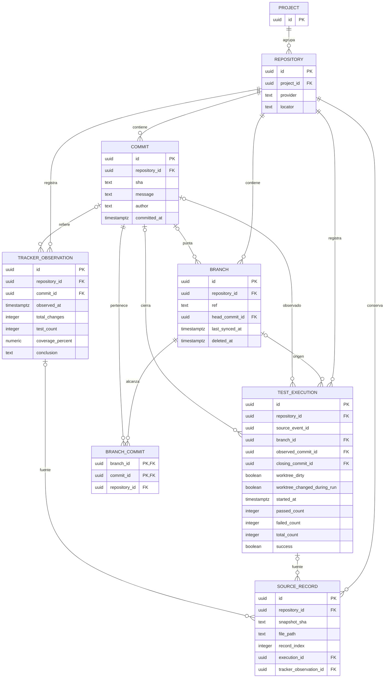

# 04 — Diseño de base de datos y API para ramas Git

## 1. Introducción y objetivo

Este informe propone cómo consultar y, cuando se requiera, persistir información de múltiples ramas sin alterar el comportamiento existente. El alcance directamente inspeccionado es `Cachuchines-TDDLabBaseProject`; la plataforma TDDLab no está presente en el directorio vecino de esta sesión. Se revisaron estáticamente scripts, logs, hooks, configuración, interfaz de ejemplo y documentos del equipo. No se ejecutaron pruebas ni migraciones.

**ESTADO ACTUAL** significa evidencia directa en este repositorio. **PROPUESTA** significa diseño futuro. **PENDIENTE DE VALIDACIÓN** identifica información de la plataforma conocida solo por documentación secundaria o decisiones que requieren acceso a ella. En particular, `docs/sprint-3/03-analisis-graficas.md` declara haber revisado otra copia de TDDLab y `docs/05-arquitectura-backlog.md` describe esa plataforma. Sus afirmaciones son útiles para orientar el diseño, pero no sustituyen la inspección de su código y esquema actuales.

## 2. Tecnologías y arquitectura actual

**ESTADO ACTUAL.** `package.json` define Node.js con módulos ES, Jest 29, Parcel, Cypress, Husky y ESLint. `npm test` ejecuta `script/tddScript.js`; Jest genera `script/report.json` y el script agrega resultados a `script/tdd_log.json`. Cypress tiene pruebas en `cypress/e2e/`; el workflow `.github/workflows/integrate.yml` ejecuta Jest con cobertura y publica un comentario, con `push` a `main` y `pull_request` hacia `main` o `master`. El README menciona `test-once`, pero no figura en los scripts de `package.json`.

`.husky/post-commit` ejecuta `commitScript.js` y `commit-tracker.js`, agrega ambos logs y hace `git commit --amend --no-edit`. Los scripts usan Git local y `fs`; el tracker obtiene opcionalmente `remote.origin.url` y construye enlaces, sin llamar a la API de GitHub. Los JSON se versionan en Git; no hay en este repositorio motor de base de datos, ORM, repositorios de datos, servicios o controladores HTTP, endpoints, autenticación ni autorización propios. `index.html` y `src/presenter.js` implementan un sumador, no gráficas.

**PENDIENTE DE VALIDACIÓN.** `docs/05-arquitectura-backlog.md` describe una plataforma separada con Express, PostgreSQL, `GithubRepository`, `TDDCyclesController`, React y tablas `submissions`, `commitstable`, `jobstable` y `commit_timeline`. No se puede confirmar aquí su esquema, ORM, claves, migraciones, autorización ni si esas tablas alimentan el flujo principal. No se deben presentar como entidades existentes del proyecto base. Antes de implementar deben revisarse directamente su esquema, migraciones, ORM, cardinalidad entre proyectos y repositorios, consultas, contratos, consumidores, autenticación y autorización. También debe acordarse si la persistencia central es obligatoria para aceptar esta historia.

## 3. Análisis del modelo de datos existente

**ESTADO ACTUAL.** Los modelos observables son estructuras JSON, no entidades relacionales:

| Archivo y productor | Estructura y responsabilidad |
|---|---|
| `script/tdd_log.json`; `tddScript.js::extractAndAddObject` | Arreglo de ejecuciones: `numPassedTests`, `failedTests`, `numTotalTests`, `timestamp` en milisegundos, `success`, `testId`. No registra duración, cobertura, errores detallados, rama ni SHA probado. |
| Mismo archivo; `commitScript.js::updateJsonFile` | Entrada de commit con `commitId`, `commitName`, `commitTimestamp` y `testId`. Mezclada con ejecuciones; `testId` agrupa entradas entre commits y no es identificador único. |
| `script/commit-history.json`; `commit-tracker.js::getCommitInfo` y `saveCommitData` | Arreglo con `sha`, `author`, `commit.date/message/url`, `stats.total/additions/deletions/date`, `coverage`, `test_count`, `failed_tests`, `conclusion`. Ordenado por fecha. |

El tracker ejecuta Jest nuevamente con cobertura; sus métricas resumen esa ejecución adicional, no necesariamente las ejecuciones intermedias. La cobertura calculada es de sentencias cuando hay `coverageMap`; valores iniciales cero pueden representar ausencia de información, por lo que no siempre se puede distinguir de 0 %. `tddScript.js::runCommand` ignora el código de salida y el tratamiento del reporte puede fallar o ser ambiguo; no se garantiza guardar errores ni un resultado fiable ante fallos de infraestructura.

**PENDIENTE DE VALIDACIÓN.** No se ha inspeccionado el esquema de plataforma ni su mecanismo de acceso a datos. Cualquier tabla relacional posterior en este informe es una propuesta conceptual, no una migración lista para ejecutar.

## 4. Almacenamiento de proyectos, commits y ejecuciones

**ESTADO ACTUAL — proyecto y repositorio.** No existe entidad `Project` ni identificador de proyecto en los logs. El contexto implícito es el directorio del repositorio. `commit-tracker.js::getCommitInfo` obtiene la URL de `remote.origin.url`, quita `.git` y convierte SSH habitual a HTTPS para formar un enlace por commit; no persiste una ficha de repositorio. Si no existe remoto usa una cadena vacía. No hay entidad GitHub.

**ESTADO ACTUAL — commits.** No hay entidad relacional de commit. Los dos logs registran identificadores y mensajes; solo `commit-history.json` registra autor y fecha Git. `commitTimestamp` es el instante local del hook, no necesariamente la fecha Git. Un registro nuevo usa literalmente `HEAD`; en la siguiente captura `commitScript.js::updateJsonFile` y `commit-tracker.js::saveCommitData` sustituyen el primer marcador anterior por `HEAD~1`. Como el hook hace amend, `HEAD` no es un SHA inmutable. Esta resolución y el `testId` pueden ser ambiguos entre ramas y tras merges. La expresión para construir `commit.url` parece invertida para SHA distintos de `HEAD`; la única llamada visible usa `HEAD`, por lo que no se ha demostrado impacto del caso alternativo.

**ESTADO ACTUAL — ejecuciones e historial.** Las ejecuciones se agregan al arreglo completo y se reescribe el archivo; la relación con una entrada posterior de commit es una agrupación secuencial por `testId`, no una clave foránea ni prueba del SHA ejecutado. Varias ejecuciones comparten `testId`; los datos reales muestran valores repetidos; el archivo no demuestra qué operaciones los originaron. Las ramas pueden incrementar la ambigüedad. El historial se recupera leyendo los JSON, no mediante API local. Las ejecuciones sobre cambios sin confirmar describen un árbol de trabajo que puede diferir de `HEAD`.

**Flujo comprobado:** Jest → `report.json` → ejecución en `tdd_log.json`; commit → hook → Git local y segunda ejecución Jest → entradas en ambos JSON → amend que versiona los archivos. Su publicación remota depende de una operación posterior del usuario; no existe en estos scripts ingesta hacia una base de datos ni consulta desde una API.

**PENDIENTE DE VALIDACIÓN — plataforma.** Según `docs/sprint-3/03-analisis-graficas.md`, `fetchTDDVisualizationData` pide `tdd_log.json` directamente a GitHub y `/TDDCycles/commits-history` y `/TDDCycles/commit-cycles` al servidor; las lecturas usan `main`. El documento identifica `TDDBoard`, `TDDLineChart` y `TDDCycleChart`: número de pruebas, cobertura, líneas modificadas y estados de ejecuciones. También informa una unión por posición y que `tdd_cycle` no lo produce el tracker actual. Esta descripción y las rutas deben verificarse en el código de plataforma disponible al implementar; no se observan en el presente repositorio.

## 5. Necesidades para soportar ramas Git

**PROPUESTA — dos etapas.** La etapa 1 consulta los JSON de una fotografía Git coherente: permite visualización por rama, pero no garantiza conservación tras borrar la ref ni atribución de origen de registros antiguos. La etapa 2 incorpora persistencia relacional, captura e ingesta para trazabilidad y gestión histórica. **PENDIENTE DE VALIDACIÓN:** el equipo debe confirmar si esta segunda etapa es obligatoria para aceptar la historia; la primera no satisface por sí sola la gestión histórica persistente.

| Concepto | Identidad propuesta |
|---|---|
| Proyecto | `project_id` de la plataforma, una vez identificada su entidad real. |
| Repositorio | `repository_id` interno, asociado a un proyecto; proveedor y localizador identifican el recurso remoto. No se asume un único repositorio por proyecto. |
| Rama | ID interno en etapa 2; `refs/heads/<nombre>` única dentro del repositorio, comparada exactamente y con sensibilidad a mayúsculas. Se aceptan nombres con `/`. |
| Commit | SHA completo válido para el formato de objetos del repositorio, único por repositorio. `HEAD` es marcador mutable. Un commit puede ser alcanzable desde varias ramas. |
| Ejecución | Identificador estable generado en origen para eventos nuevos; `testId`, fecha y posición no son identidades globales. |

El proveedor suministra refs, puntas y, si está disponible, rama por defecto. `last_synced_at` es una observación local, no la fecha de modificación de la rama. Al recibir commits, se actualiza la punta sin alterar eventos históricos. Solo un listado completo y exitoso puede justificar marcar una rama como eliminada; un error, permisos insuficientes o una página incompleta no demuestran ausencia.

En etapa 2, una ref recreada con el mismo nombre reutiliza su identidad y limpia `deleted_at` cuando se observa con éxito. Los eventos anteriores permanecen bajo esa identidad; no se distinguen encarnaciones sin ampliar el modelo. Un renombre se trata como desaparición y creación salvo evidencia explícita. La etapa 1 no garantiza recuperar la fotografía después del borrado: incluso el objeto por SHA puede dejar de estar disponible.

La **rama de ejecución** difiere de la **alcanzabilidad actual**. Para eventos nuevos, capturar al iniciar las pruebas ref, SHA observado y estado del árbol, incluyendo cambios rastreados y archivos no rastreados relevantes según una política explícita de exclusiones. Comparar el estado al finalizar y registrar si se detectaron cambios; esta comparación no demuestra ausencia de cambios intermedios. El SHA es una base observada, no necesariamente el contenido probado. En detached HEAD puede conocerse el SHA y no la rama; en datos antiguos pueden faltar ambos. El commit que cierra el ciclo es otro vínculo, asignado posteriormente solo con evidencia del SHA final tras el `amend`; en caso contrario queda nulo. La reproducibilidad exacta requeriría una instantánea del contenido.

## 6. Propuesta de modelo de base de datos

**ESTADO ACTUAL:** en este repositorio no hay tablas relacionales verificadas. SHA, autor, mensaje, fecha y contadores existen en JSON, no como columnas de plataforma comprobadas.

**PROPUESTA — etapa 1:** no requiere base de datos nueva. **PROPUESTA — etapa 2:** modelo conceptual sujeto a reconciliación con el esquema real; todos los atributos siguientes son columnas propuestas. UUID y tipos temporales son orientativos, no una afirmación sobre el motor de TDDLab. Reutilizar las entidades existentes cuando corresponda.

| Entidad y responsabilidad | Atributos, claves y restricciones propuestas |
|---|---|
| `Project`: ámbito de acceso | `id UUID PK`. Su correspondencia con proyecto o entrega real está pendiente. |
| `Repository`: repositorio | `id UUID PK`, `project_id UUID NOT NULL FK Project`, `provider TEXT NOT NULL`, `locator TEXT NOT NULL`. Es una hipótesis de una fila por proyecto y repositorio, no de un repositorio por proyecto. Si se comparte entre proyectos, reutilizar la entidad real y una tabla de asociación. Acordar normalización y unicidad del localizador. |
| `Branch`: ref y estado | `id UUID PK`, `repository_id UUID NOT NULL FK`, `ref TEXT NOT NULL`, `head_commit_id UUID NULL`, `last_synced_at TIMESTAMPTZ NULL`, `deleted_at TIMESTAMPTZ NULL`; `UNIQUE(repository_id, ref)` y `UNIQUE(repository_id, id)`. La FK compuesta de la punta apunta a un commit del mismo repositorio. El nombre visible se deriva de `ref`. |
| `Commit`: identidad Git | `id UUID PK`, `repository_id UUID NOT NULL FK`, `sha TEXT NOT NULL`, `message TEXT NULL`, `author TEXT NULL`, `committed_at TIMESTAMPTZ NULL`; `UNIQUE(repository_id, sha)` y `UNIQUE(repository_id, id)`. No guardar `HEAD` como SHA. |
| `TestExecution`: ejecución de suite | `id UUID PK` interno, `repository_id UUID NOT NULL FK`, `source_event_id UUID NULL`, `branch_id UUID NULL`, `observed_commit_id UUID NULL`, `closing_commit_id UUID NULL`, `worktree_dirty BOOLEAN NULL`, `worktree_changed_during_run BOOLEAN NULL`, `started_at TIMESTAMPTZ NOT NULL`, `passed_count INTEGER NULL`, `failed_count INTEGER NULL`, `total_count INTEGER NULL`, `success BOOLEAN NULL`, `duration_ms BIGINT NULL`, `coverage_percent NUMERIC(5,2) NULL`. Las referencias opcionales a rama y commits usan FK compuestas con `repository_id`. `UNIQUE(repository_id, source_event_id)` para identificadores no nulos. |
| `TrackerObservation`: medición adicional | `id UUID PK`, `repository_id UUID NOT NULL FK`, `commit_id UUID NULL`, `observed_at TIMESTAMPTZ NULL`, `additions INTEGER NULL`, `deletions INTEGER NULL`, `total_changes INTEGER NULL`, `test_count INTEGER NULL`, `failed_tests INTEGER NULL`, `coverage_percent NUMERIC(5,2) NULL`, `conclusion TEXT NULL`; FK compuesta al commit del mismo repositorio. Es una observación del tracker, no una propiedad inmutable del commit ni una medición de cada ejecución intermedia. |
| `SourceRecord`: procedencia importada | `id UUID PK`, `repository_id UUID NOT NULL FK`, `snapshot_sha TEXT NOT NULL`, `file_path TEXT NOT NULL`, `record_index INTEGER NOT NULL`, `execution_id UUID NULL`, `tracker_observation_id UUID NULL`; `UNIQUE(repository_id, snapshot_sha, file_path, record_index)`. Referencias compuestas al mismo repositorio y exactamente una referencia de destino por registro tipado. Cada observación importada del tracker tiene procedencia; puede haber varias fuentes que refieran a una misma observación solo con evidencia suficiente. |
| `BranchCommit`: alcanzabilidad materializada, opcional | `repository_id UUID NOT NULL`, `branch_id UUID NOT NULL`, `commit_id UUID NOT NULL`; PK `(branch_id, commit_id)`; FK compuestas al mismo repositorio. Es el conjunto alcanzable de la última sincronización completa, no el origen de los commits. Puede omitirse si se consulta Git bajo demanda. |

Para las FK compuestas se requieren claves `UNIQUE(repository_id, id)` en `Branch`, `Commit`, `TestExecution` y `TrackerObservation`. Para referencias opcionales, usar semántica `MATCH SIMPLE` o equivalente: si el identificador secundario es nulo, sigue siendo obligatoria la FK independiente al repositorio. Comprobarlo en el motor real. La regla de exactamente un destino de `SourceRecord` debe garantizarse transaccionalmente o mediante restricciones adecuadas. Validar las refs completas, colación exacta y formato de SHA según el repositorio y motor elegido.

Los conteos, duración y cambios son no negativos; cobertura entre 0 y 100; `NULL` significa desconocido. El cero heredado del tracker puede representar dato ausente: conservar el valor crudo y no presentarlo como medición confirmada cuando sea ambiguo. La cobertura de una ejecución solo se registra si se midió para esa ejecución. `success=NULL` evita clasificar un fallo de infraestructura como éxito.

**Ingesta:** eventos nuevos se insertan idempotentemente por `(repository_id, source_event_id)`. Para históricos, `(repository_id, snapshot_sha, file_path, record_index)` identifica una observación de una fotografía, no un evento universal. Reimportar esa misma fotografía no duplica la observación; fotografías diferentes pueden contener copias del mismo evento o eventos distintos idénticos. Sin evidencia, conservarlas separadas y señalar posible duplicación en agregados; no fusionar por contenido, tiempo o posición. Asignar ID interno a registros antiguos y dejar `source_event_id` nulo. Conservar la fuente original o acceso verificable y su procedencia según política de retención.

**Índices:** además de los únicos, `TestExecution(repository_id, branch_id, started_at, id)` para series y, si se materializa, `BranchCommit(repository_id, commit_id)` para consultas inversas. Evaluar índices de fecha con planes reales. FK restrictivas y borrado lógico preservan historial. La sincronización de `BranchCommit` calcula un conjunto completo para una punta concreta y publica atómicamente conjunto, punta y fecha; si falla conserva la última versión confirmada. La API informa esa punta y fecha.

## 7. Diagrama de relaciones ER

**PROPUESTA — etapa 2.** Vista de entidades, claves y atributos esenciales; las FK compuestas y restricciones se describen en la sección 6. `BRANCH_COMMIT` es opcional. Los dos vínculos de ejecución con commit tienen significados diferentes.



## 8. Propuesta de endpoints REST

**ESTADO ACTUAL / PENDIENTE DE VALIDACIÓN:** no hay endpoints en este repositorio. `docs/sprint-3/03-analisis-graficas.md` atribuye `/TDDCycles/commits-history`, `/TDDCycles/commit-cycles` y `/TDDCycles/commit-timeline` a la plataforma; sus contratos, permisos y consumidores requieren comprobación directa. Las rutas siguientes son propuestas, no existentes.

### Etapa 1 — fotografía Git

**PROPUESTA:** incorporar un contrato nuevo autocontenido que no modifique arrays legados. El servidor valida acceso, resuelve una vez `refs/heads/<branch>` a `resolvedSha` y lee **ambos** archivos exactamente en ese SHA. Historial, ejecuciones y métricas provienen de esa misma revisión. Si la ref se mueve durante la petición, la respuesta mantiene el SHA resuelto. Si un force-push o borrado hace inaccesible el objeto antes de leerlo, se informa error y se reintenta desde una nueva resolución; nunca se combinan revisiones ni se usa otra rama silenciosamente.

| Método y ruta propuestos | Objetivo y parámetros | Respuesta y relaciones |
|---|---|---|
| `GET /TDDCycles/branches` | Selector; `owner`, `repoName`, `cursor`, `limit`. | Página de refs, puntas observadas y rama por defecto si se conoce; repositorio → ramas. |
| `GET /TDDCycles/branch-snapshot` | Fotografía para gráficas; `owner`, `repoName`, `branch` obligatorio. | `ref`, `resolvedSha`, estado, procedencia y registros de ambos archivos. `commit-history.json` contiene registros del log, no necesariamente todos los commits alcanzables. |

Las rutas anteriores mantienen forma y comportamiento actuales; el nuevo consumidor usa la fotografía completa. No se requiere exponer un parámetro `revision` inconsistente entre rutas. Los nombres y parámetros definitivos deben contrastarse con la plataforma.

```json
{
  "branches": [
    { "name": "feature/login", "ref": "refs/heads/feature/login", "headSha": "a111111111111111111111111111111111111111", "isDefault": false }
  ],
  "nextCursor": null
}
```

### Etapa 2 — historial persistido

**PROPUESTA:** familia alternativa con IDs internos. El cliente obtiene `projectId` del recurso de proyecto o entrega real, aún no comprobado; después lista repositorios y ramas. Los identificadores de las dos etapas no son intercambiables automáticamente. Las rutas y autorización dependen de la cardinalidad real.

| Método y ruta propuestos | Objetivo y parámetros | Respuesta y relaciones |
|---|---|---|
| `GET /projects/{projectId}/repositories` | Descubrir repositorios autorizados; `limit`, `cursor`. | Página con `repositoryId`, proveedor y localizador; Project → Repository. |
| `GET /projects/{projectId}/repositories/{repositoryId}/branches` | Listar IDs de ramas; `includeDeleted`, `limit`, `cursor`. | Página con `branchId`, ref, punta y fechas; Repository → Branch → Commit. |
| `GET /projects/{projectId}/repositories/{repositoryId}/branches/{branchId}` | Detalle de rama, también eliminada si está autorizada. | Identidad, punta, sincronización y borrado lógico. |
| `GET /projects/{projectId}/repositories/{repositoryId}/branches/{branchId}/commits` | Consultar alcance actual vía Git o `BranchCommit`; `limit`, `cursor`. | Página de commits con SHA de punta y fecha de sincronización. |
| `GET /projects/{projectId}/repositories/{repositoryId}/branches/{branchId}/executions` | Historial y métricas de ejecuciones originadas en la rama; `from` inclusivo, `to` exclusivo UTC, `limit`, `cursor`. | Página `TestExecution` con commit observado y cierre. No incluye la cobertura del tracker como si fuera de cada ejecución. |
| `GET /projects/{projectId}/repositories/{repositoryId}/tracker-observations` | Obtener métricas de capturas del tracker; `snapshotSha`, `from`, `to`, `limit`, `cursor` opcionales. | Página de `TrackerObservation` con `SourceRecord`; una fotografía no demuestra rama de origen. |

Ejemplo de listado persistido, con IDs opacos ilustrativos:

```json
{
  "repositoryId": "r1",
  "items": [
    { "branchId": "b1", "ref": "refs/heads/feature/login", "headSha": "a111111111111111111111111111111111111111", "lastSyncedAt": "2026-11-03T04:00:00Z", "deletedAt": null }
  ],
  "nextCursor": null
}
```

Ejemplo de página de ejecuciones; `observedCommit`, `closingCommit` y valores desconocidos pueden ser nulos:

```json
{
  "repositoryId": "r1",
  "branchId": "b1",
  "items": [
    { "id": "e1", "startedAt": "2026-11-03T03:30:00Z", "observedCommit": { "sha": "a111111111111111111111111111111111111111" }, "closingCommit": null, "worktreeDirty": true, "worktreeChangedDuringRun": null, "passedCount": 6, "failedCount": 0, "totalCount": 6, "success": true, "durationMs": null, "coveragePercent": null }
  ],
  "nextCursor": null
}
```

Para comparación se consultan series separadas; un endpoint agregado se añade solo si se justifica. Ordenar ejecuciones por `(started_at, id)` ascendente, con cursor opaco y límite máximo; acordar orden y límites de los demás listados. Filtros de fecha no incluyen observaciones sin fecha salvo opción explícita.

### Errores del contrato nuevo

| Condición | HTTP orientativo | Código propuesto |
|---|---:|---|
| Parámetros o ref inválidos | 400 | `INVALID_ARGUMENT` |
| Rama inexistente o recurso inaccesible según política | 404 | `BRANCH_NOT_FOUND` o `RESOURCE_NOT_FOUND` |
| Acceso denegado cuando la política permite distinguirlo | 403 | `FORBIDDEN` |
| Archivo ausente en una fotografía accesible | 200 parcial | `status: "missing"` para ese archivo |
| Archivo presente y vacío | 200 | `status: "ok", records: []` |
| JSON inválido | 422 | `INVALID_LOG` |
| Revisión inaccesible o fallo temporal del proveedor | 503 | `SNAPSHOT_UNAVAILABLE` o `PROVIDER_UNAVAILABLE` |
| Límite del proveedor | 429 | `PROVIDER_RATE_LIMITED` |

```json
{ "error": { "code": "SNAPSHOT_UNAVAILABLE", "message": "No fue posible leer la revisión resuelta. Intente nuevamente.", "retryable": true } }
```

No convertir errores en listas vacías ni usar fallback silencioso a `main`. Validar segmentos de repositorio y ref por separado, codificarlos como datos, evitar interpolación en comandos y aplicar permisos tras verificarlos. Códigos definitivos y la distinción 403/404 dependen de la política real.

## 9. Obtención de datos para las gráficas

**ESTADO ACTUAL:** la interfaz local no implementa gráficas. Las vistas y fuentes de plataforma de la sección 4 provienen del informe 03 y requieren comprobación directa.

**PROPUESTA — flujo completo de etapa 1:**

1. El cliente obtiene el repositorio de su contexto y lista ramas con `/TDDCycles/branches`; selecciona `feature/login` sin asumir que es la rama por defecto.
2. Solicita `GET /TDDCycles/branch-snapshot?owner=equipo&repoName=ejemplo&branch=feature%2Flogin`. El servidor valida acceso, resuelve una vez la ref y lee ambos archivos en el SHA resultante.
3. El cliente usa registros del tracker para las series de `test_count`, `stats.total` y cobertura de esa captura; usa ejecuciones del log para la secuencia de resultados. Su `timestamp` está en milisegundos desde época Unix. No atribuye la cobertura del tracker a cada ejecución ni une por posición como si fuera una FK.
4. Si falta un archivo, muestra ausencia y puede usar el otro; si está presente y vacío, muestra historial vacío. Un error de lectura o JSON inválido se informa. Los registros heredados no prueban origen; `HEAD` se muestra como marcador, no como SHA.

Ejemplo de respuesta **propuesta**; ambos archivos se leen en el `resolvedSha` superior. La cobertura cero heredada puede ser ambigua, por lo que se conserva el valor crudo y se marca como desconocido:

```json
{
  "repository": { "owner": "equipo", "repoName": "ejemplo" },
  "ref": "refs/heads/feature/login",
  "resolvedSha": "a111111111111111111111111111111111111111",
  "commitHistory": {
    "status": "ok",
    "source": "script/commit-history.json",
    "records": [
      { "sha": "HEAD", "message": "feat: ejemplo", "date": "2026-11-03T03:30:00Z", "testCount": 6, "totalChanges": 12, "coverageRaw": 0, "coveragePercent": null, "coverageStatus": "unknown" }
    ]
  },
  "testLog": {
    "status": "ok",
    "source": "script/tdd_log.json",
    "records": [
      { "kind": "execution", "timestamp": 1793676600000, "passedCount": 6, "failedCount": 0, "totalCount": 6, "success": true, "branchOfOrigin": null, "observedCommitSha": null }
    ]
  }
}
```

La transformación conserva también los marcadores de commit del log, en orden, como `kind: "commit"`; se omiten en este ejemplo abreviado. `records` es una vista normalizada, no el archivo completo. Con `status: "missing"`, `records` es `null`; `[]` significa archivo válido vacío. Debe conservarse o exponerse la información cruda necesaria para los campos actuales y documentarse el mapeo. La coherencia de revisión no prueba la relación entre registros ni su rama de origen.

**PROPUESTA — etapa 2:** usar el endpoint de ejecuciones para eventos de origen demostrado y el de observaciones para métricas del tracker. Los desconocidos permanecen en la vista histórica general, no se asignan a una rama por defecto. Usar `startedAt` u `observedAt` conocido como eje temporal y tratar `null` como desconocido. Comparar ramas con series separadas; no sumar ancestros compartidos ni contar duplicados ambiguos como eventos distintos.

## 10. Estrategia de compatibilidad y migración

**PROPUESTA — etapa 1:** capturar pruebas de contrato del flujo existente y verificar respuestas y comportamiento reales. Añadir endpoints nuevos sin cambiar rutas anteriores, activar gradualmente el consumidor y conservar reversión. Sin selección de rama, el frontend antiguo mantiene el comportamiento verificado; no se añade fallback ni se atribuyen eventos a `main`. Una rama sin archivo muestra ausencia; si se elimina, la fotografía puede dejar de estar disponible.

**PROPUESTA — etapa 2:** (1) inspeccionar entidades, cardinalidades, migraciones, permisos y contratos reales; (2) acordar obligatoriedad de persistencia; (3) diseñar migración aditiva con claves opcionales y reutilización de entidades; (4) incorporar captura de ID de origen, rama, SHA y estado del árbol; (5) añadir ingesta idempotente con procedencia según sección 6; (6) migrar consumidores gradualmente y verificar regresión. El DDL y la herramienta de migración están pendientes; no se ejecuta ninguna migración en este análisis.

Los históricos conservan rama, commits y `source_event_id` nulos si faltan pruebas. Resolver `HEAD` exige evidencia inequívoca de su significado, no solo conocer el SHA de la fotografía; marcadores anteriores, merges y amend pueden invalidar la inferencia. Las observaciones de fotografías distintas pueden duplicar un evento: conservar la incertidumbre y fuente sin fusionarlas automáticamente. Mantener una vista histórica general para registros sin rama sin atribuirlos a una serie concreta. Los proyectos existentes conservan sus rutas y datos anteriores mientras no adopten el contrato nuevo.

## 11. Riesgos y consideraciones técnicas

| Riesgo | Consecuencia y tratamiento propuesto |
|---|---|
| Plataforma y esquema no disponibles | Verificar código, permisos, contratos, migraciones y entidades reales antes de decidir nombres o DDL. |
| `HEAD`, amend, merge, rebase y `testId` repetido | Identidad y asociación histórica inciertas; conservar desconocidos y capturar IDs estables en origen. |
| Árbol de trabajo modificado | SHA observado no identifica exactamente el contenido probado; registrar estado y no prometer reproducibilidad. |
| JSON versionados, escrituras completas y conflictos | Pérdida o duplicación; validar JSON y diseñar resolución de conflictos y procedencia antes de una ingesta automática. |
| Ramas eliminadas, force-push y recreación | Actualizar alcanzabilidad sin borrar eventos; marcar eliminación solo tras sincronización completa y exitosa. |
| Dos lecturas de ref mutable | Fijar ambas a un único SHA; comprobar acceso a esa revisión. |
| Cobertura ausente tratada como cero, fallos de proceso | Preservar desconocidos y distinguir errores de infraestructura; tracker actual no ofrece esa garantía. |
| Rendimiento | Paginación, índices y límites; `BranchCommit` puede crecer mucho; caché por repositorio y SHA solo tras medir, con invalidación al mover la ref. |
| Datos privados, abuso y proveedor | Aplicar autorización y credenciales del servidor existentes tras verificarlas; validar ref, evitar inyección, limitar peticiones y distinguir 403/404/429 y fallos de red según política. |

## 12. Plan recomendado de implementación

1. **Indispensable:** revisar repositorio real de plataforma, esquema, autenticación y contratos; acordar semántica de rama de origen frente a historia alcanzable y la identidad del proyecto. Establecer regresión del flujo sin rama.
2. **Indispensable para visualización MVP:** listar refs y usar la fotografía nueva para fijar las lecturas de ambos logs al mismo SHA y representar explícitamente ausencia y ambigüedad. Probar ramas con `/`, default diferente de `main`, sin archivo, errores y actualizaciones concurrentes.
3. **Indispensable para atribución fiable de nuevas ejecuciones:** capturar ID estable, rama, SHA observado y estado del árbol; definir de forma explícita cierre de ciclo y manejo de detached HEAD. Probar repetición de ingesta y commits compartidos.
4. **Etapa 2, necesaria si el criterio exige gestión histórica persistente:** reconciliar entidades existentes, migrar de forma aditiva, aplicar claves compuestas e índices, e ingerir con idempotencia. Probar datos antiguos nulos, borrado lógico, force-push y reconstrucción de pertenencia.
5. **Opcional posterior:** materializar `BranchCommit`, agregar duración/cobertura por ejecución con medición real, comparaciones agregadas, caché y distinción de encarnaciones de una ref; decidir con requisitos y mediciones.

## 13. Conclusiones

El proyecto base registra ejecuciones y commits en archivos Git, sin entidad de proyecto, base de datos ni API local. Los datos existentes no identifican de manera fiable la rama de origen ni el commit exacto probado. El camino mínimo es consultar una ref concreta fijando una revisión coherente y conservar los contratos previos; la persistencia relacional es una evolución condicionada a necesidades confirmadas y al esquema real de TDDLab. La atribución fiable requiere mejorar la captura futura y mantener como desconocidos los datos históricos ambiguos. La aceptación de gestión persistente depende de acordar el alcance de la etapa 2 con el equipo.
