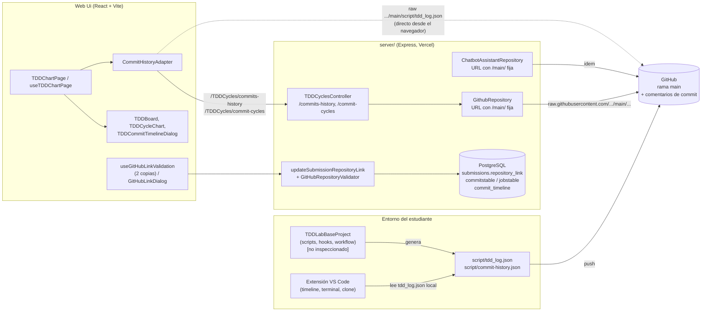
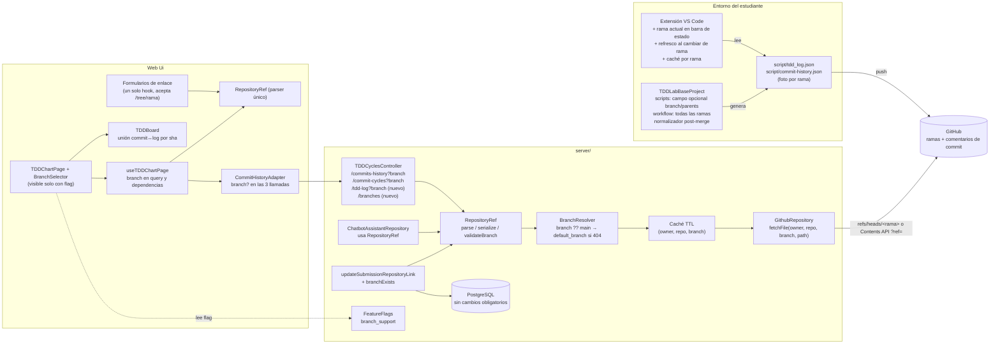
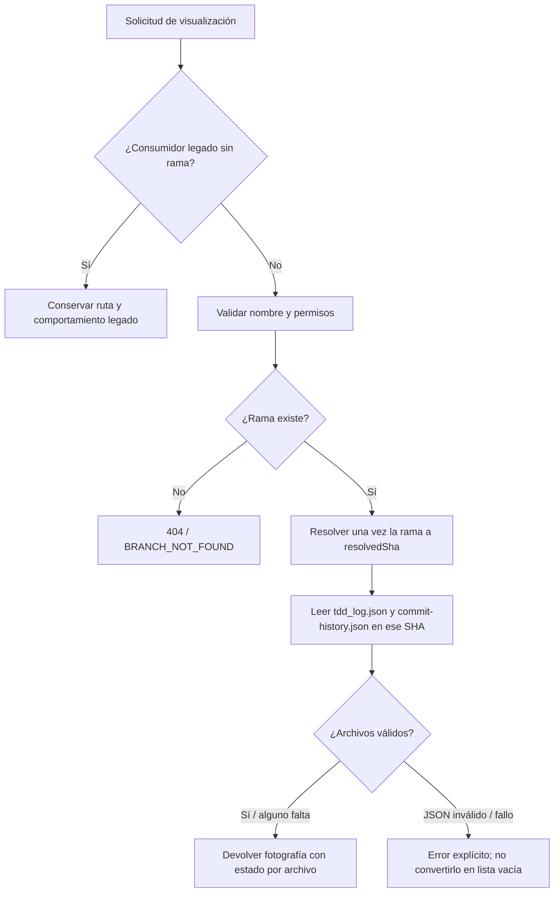

# 05 — Arquitectura y backlog: soporte de ramas Git en TDDLab

**Rol:** equipo de desarrollo responsable de la evolución de TDDLab
**Objetivo:** identificar los componentes afectados por el soporte de ramas Git, consolidar los análisis y definir un backlog priorizado, sin afectar el funcionamiento actual.
**Base de análisis:** repositorio `TDDLab` (carpetas `server/`, `Web Ui/`, `VSCodeExtension/`, `.github/`), rama `main`, estado al 02/11/2026.

---

## 0. Alcance y limitaciones de este análisis

Este documento integra la inspección de la plataforma TDDLab con los cuatro aportes complementarios disponibles en el paquete del Sprint 3. Se distingue entre **estado actual comprobado**, **resultado de prueba**, **propuesta** y **pendiente de validación** para no presentar diseños futuros como funcionalidades implementadas.

| Insumo | Estado y alcance | Cómo se utiliza aquí |
|---|---|---|
| Código de `server/`, `Web Ui/` y `VSCodeExtension/` | Revisado directamente en el análisis de arquitectura. | Sustenta el diagnóstico de la plataforma y sus componentes afectados. |
| Proyecto base `Cachuchines-TDDLabBaseProject` | Analizado por el integrante 2; incluye scripts, hooks, configuración Git y workflow. | Se incorporan sus hallazgos y la prueba de concepto de corrección de logs. |
| Análisis de gráficas y visualización por rama | Aporte del integrante 3, con inspección estática de la plataforma y del proyecto base. | Se incorporan el diagnóstico de las gráficas, los modos de consulta y las reglas para evitar comparaciones engañosas. |
| Diseño de base de datos y API | Aporte del integrante 4. El proyecto base fue inspeccionado; el esquema y los contratos reales de la plataforma requieren validación directa. | Se adopta como dirección la implementación en dos etapas: fotografía Git primero y persistencia relacional después, si el requisito lo exige. |
| Análisis del primer integrante | Incluido directamente en `SPRINT 3 CACHUCHINES.pdf`, no como archivo `.md`. | Se incorpora el experimento con `main`, `feature/restador` y `feature/multiplicador`, los resultados de 12 ejecuciones y 9 commits, y los problemas observados en gráficas y logs. |
| Ejecución integral de la plataforma | No realizada como parte de este documento. | Las pruebas de concepto del integrante 2 no equivalen a pruebas de integración de la plataforma completa. |

**Limitaciones que siguen vigentes:** el submódulo `VSCodeExtension/resources/TDDLabBaseProject` aparece vacío en el ZIP de la plataforma, por lo que no se pudo inspeccionar desde esa copia. Los análisis 02 y 04 sí aportan evidencia del proyecto base en sus propios repositorios/copia de trabajo. El esquema PostgreSQL, ORM, migraciones, cardinalidades y políticas de autorización de la plataforma deben confirmarse directamente antes de implementar cambios de persistencia o endpoints nuevos. Las propuestas de este documento no significan que ya estén implementadas.

---

## 1. Resumen ejecutivo

1. **Hoy TDDLab es de facto "solo `main`".** La rama está escrita a fuego en **tres** sitios que leen datos de GitHub, no en uno:
   - `server/.../GithubRepository.ts` → `fetchCommitHistoryJson` (`.../main/script/commit-history.json`).
   - `server/.../ChatbotAssistantRepository.ts` → `getCommitHistoryUrl` (mismo archivo, también `main`).
   - `Web Ui/.../CommitHistoryAdapter.ts` → `getTDDLogUrl` (`.../main/script/tdd_log.json`, leído **directamente desde el navegador**, sin pasar por el backend).

   Los componentes afectados van, por tanto, más allá de scripts, logs y gráficas: incluyen el **asistente de IA**, el **parseo del enlace del repositorio**, la **validación de entregas**, la **extensión de VS Code** y el **flujo de CI del proyecto base**.

2. **La rama no tiene dónde vivir en el modelo actual.** El enlace de entrega (`submissions.repository_link`) se interpreta cortando por `/` y tomando posiciones fijas (`useTDDChartPage.getRepoQuery`). Un enlace como `github.com/u/r/tree/feature-x` hoy **se acepta en la validación y la rama se ignora en silencio**.

3. **La mayor parte de la base de datos no necesita cambios.** Las tablas `commitstable`, `jobstable` y `commit_timeline` se identifican por `(owner, reponame, sha)`; el `sha` es único entre ramas. Además, los endpoints que las usan son en su mayoría código legado.

4. **Propuesta.** Introducir un concepto único y compartido, **`RepositoryRef = { owner, repo, branch? }`**, y propagarlo como parámetro **opcional** a lo largo de la cadena frontend → backend → GitHub. Si `branch` no viene, el comportamiento es **idéntico al actual** (`main`). La funcionalidad se activa tras un **feature flag** (el repo ya tiene módulo de feature flags) y se protege con una **suite de regresión "sin rama"** que se construye **antes** de tocar código.

5. **El riesgo de datos por rama ya fue demostrado en el proyecto base.** El integrante 2 comprobó que los logs no registran rama, que la resolución diferida de `HEAD` falla con operaciones no lineales y que el CI solo se dispara con el alcance configurado. En la batería comparativa, el código actual tuvo conflictos en 4 de 6 escenarios y 4 de 10 registros de `main` quedaron con SHA incorrecto. Una prueba de concepto de la propuesta resolvió esos seis escenarios sin conflictos ni registros incorrectos; falta integrar y validar esos cambios en el repositorio compartido y en la plataforma.

---

## 2. Arquitectura actual (as-is)

### 2.1 Vista general

### 2.2 Lo que ocurre hoy en la ruta de las gráficas

1. La entrega guarda un `repository_link` (texto libre validado solo en formato).
2. `useTDDChartPage` extrae `repoOwner` y `repoName` con `split("/")` por posición y los pone en la query string.
3. `fetchTDDVisualizationData` lanza **tres** peticiones en paralelo: `tdd_log.json` (directa a GitHub), `commits-history` y `commit-cycles` (vía backend).
4. El backend descarga `script/commit-history.json` de `main` y lo transforma (`getCommitHistoryData`, `getCommitCyclesData`).
5. `TDDBoard` combina commits y log **por posición** (`getTestsForCommit(commitIndex)`), no por identificador.

### 2.3 Hallazgos relevantes para ramas

| # | Hallazgo | Evidencia | Por qué importa |
|---|---|---|---|
| H1 | Rama `main` fija en 3 lugares | `GithubRepository.fetchCommitHistoryJson`, `ChatbotAssistantRepository.getCommitHistoryUrl`, `CommitHistoryAdapter.getTDDLogUrl` | Hay que cambiar los tres; olvidar uno produce datos inconsistentes entre gráfica e IA. |
| H2 | `tdd_log.json` se lee desde el navegador, sin backend | `CommitHistoryAdapter.obtainTDDLogs` | No hay punto central donde validar/cachear/resolver rama; y es el único dato que no pasa por el servidor. |
| H3 | El enlace se parsea con posiciones fijas y por separado en varios sitios | `getRepoQuery` (`split("/")`), dos copias de `useGitHubLinkValidation` (`shared/hooks` y `my-practices/hooks`), `updateSubmissionRepositoryLinkUseCase`, `ChatbotAssistantRepository` (regex), `TDDBoard` (regex sobre `html_url`) | Sin un parser único, la rama se interpretará distinto en cada sitio. |
| H4 | El validador de segmentos prohíbe `/` | `TDDCyclesController.isValidGithubSegment` usa `/^[A-Za-z0-9._-]+$/` | Los nombres de rama habituales (`feature/login`) no pasarían; hace falta un validador específico de rama (y no relajar el actual). |
| H5 | La unión commit↔log es por índice | `TDDBoard.getTestsForCommit`, `preprocessTDDLogs` | Con ramas, merges, rebases o commits ausentes del log, el índice se desalinea y las pruebas se asignan al commit equivocado. |
| H6 | Estado "sin cobertura" = color negro | `TDDBoard.getCommitColor` (`coverage` nulo → `"black"`) | Si el CI no corre en ramas ≠ `main`, todos sus commits aparecerán en negro aunque estén bien. |
| H7 | `GithubRepository.getCommits` no acepta rama ni pagina | `per_page: 100`, sin `sha` | Endpoints legados; si se reactivan, solo verían la rama por defecto. |
| H8 | Comentarios de "NO SE USA" desactualizados | `TDDCyclesController`: `getCommitTimeLine` está marcado "NO SE USA", pero `TDDBoard` lo invoca (`/TDDCycles/commit-timeline`) | Riesgo de que una limpieza elimine un endpoint que sí se consume. |
| H9 | `ExecuteCloneCommand` clona el repo base y marca `needsGitInit: true` | `VSCodeExtension/src/application/clone/ExecuteCloneCommand.ts` | El estudiante trabaja con un `git init` propio; la rama inicial depende de su configuración de Git (`init.defaultBranch`). Puede ser `master`. **[VERIFICAR]** |
| H10 | Timeline de la extensión cacheado con clave fija | `TimelineView.STORAGE_KEY = 'tddTimelineData'` (workspaceState) | Al cambiar de rama puede mostrarse el timeline de otra rama si falla la lectura del archivo. |
| H11 | Si el repo usa `master`, hoy falla | URL con `/main/` fija | Es un defecto actual; el soporte de rama lo corrige como efecto secundario. |

---

## 3. Componentes afectados y análisis de impacto

Leyenda de impacto: **Alto** (cambio de lógica o contrato), **Medio** (cambio localizado), **Bajo** (ajuste menor o ninguno).

### 3.1 Más allá de scripts, logs y gráficas

| Componente | Ruta | Impacto | Qué cambia |
|---|---|---|---|
| Parseo del enlace de repositorio | `Web Ui/src/shared/hooks/useGitHubLinkValidation.ts`, `.../my-practices/hooks/useGitHubLinkValidation.ts`, `useTDDChartPage.getRepoQuery`, `GitHubLinkDialog` | **Alto** | Pasar a un parser único que reconozca `/tree/<rama>`. Eliminar la duplicación. |
| Validación de entregas en servidor | `server/.../updateSubmissionRepositoryLinkUseCase.ts`, `GitHubRepositoryValidator.ts` | **Medio** | Hoy solo valida que el repo exista; añadir verificación opcional de que la rama exista. |
| Asistente de IA | `server/.../ChatbotAssistantRepository.ts` | **Medio** | Misma URL con `main` fija; debe usar la rama de la entrega para que la IA analice lo que el estudiante ve en la gráfica. |
| Vista docente (navegación entre estudiantes) | `useTDDChartPage` (`goToNext/PreviousStudent`), `shared/helpers/navigationHandlers.ts`, `DeliveriesTable` | **Medio** | Cada entrega puede tener una rama distinta; la rama debe viajar en la query y en el listado. |
| Feature flags | `Web Ui/src/modules/FeatureFlags`, `server/.../FeatureFlags` | **Bajo** | Reutilizar para activar/desactivar el soporte. En la Web Ui el consumo visible hoy está en Settings; hay que verificar el patrón de lectura antes de usarlo en la gráfica. |
| Extensión de VS Code | `TimelineView.ts`, `TimelineRepository.ts`, `GetLastPoint.ts`, `ExecuteCloneCommand.ts` | **Medio** | Mostrar rama actual, refrescar al cambiar de rama, clave de caché por rama. |
| CI del proyecto base | `TDDLabBaseProject/.github/workflows` **[VERIFICAR]** | **Alto (si hay restricción a `main`)** | Debe correr en todas las ramas; si no, no habrá cobertura/conclusión para commits de rama. |
| Base de datos | `commitstable`, `jobstable`, `commit_timeline`, `submissions` | **Bajo** | Sin cambios obligatorios (ver ADR-01). |
| Documentación | `README.md` de `server/`, `Web Ui/`, `VSCodeExtension/` | **Bajo** | Documentar el parámetro `branch`, el flag y la compatibilidad. |

### 3.2 Impacto por capa

**Frontend**
- *Alto:* `CommitHistoryAdapter`, `CommitHistoryRepositoryInterface`, casos de uso (`GetTDDLogs`, `GetCommitsOfRepo`, `GetCommitTddCycle`, `PortGetTDDCycles`), `fetchTDDVisualizationData`, `useTDDChartPage`, `TDDBoard` (unión por índice).
- *Medio:* `TDDChartPage` (selector de rama), `TDDCommitTimelineDialog`, `TDDCycleChart`, formularios de enlace.
- *Bajo:* componentes puramente presentacionales (`TDDCycleCard`, `TDDList`) siempre que reciban datos ya filtrados.

**Backend**
- *Alto:* `GithubRepository` (`fetchCommitHistoryJson`, `getCommitHistoryData`, `getCommitCyclesData`), contrato `IGithubRepository`.
- *Medio:* `TDDCyclesController` y `TDDCyclesRoutes` (parámetro opcional `branch`, endpoint nuevo de ramas), `ChatbotAssistantRepository`.
- *Bajo:* casos de uso `GetCommitHistoryUseCase` / `GetCommitCyclesUseCase` (solo propagan parámetros). Capa de BD sin cambios.

**Procesamiento de datos**
- Los JSON (`tdd_log.json`, `commit-history.json`) son la **única fuente** para las gráficas. Hay que decidir (a) si cada archivo es una "foto" por rama (ADR-02), (b) cómo reconciliar entradas tras merge/rebase/squash (los `commitId` del log pueden no existir en la historia de la rama), (c) añadir campos **opcionales** (`branch`, `parents`) sin romper a los lectores actuales.
- Los **comentarios de commit** con cobertura (`fetchCoverageDataForCommit`) dependen de que el CI corra en la rama.

**Configuración Git**
- Rama inicial del estudiante (`master` vs `main`), `git init` tras el clone, workflow con `on: push` para todas las ramas, `.gitattributes` y hooks (`post-merge`, `post-rewrite`) para el log. **Nota:** el driver de merge `union` **no es seguro** para arrays JSON (rompe la estructura de corchetes/comas); se propone en su lugar un normalizador (BR-16).

---

## 4. Arquitectura propuesta (to-be)

### 4.1 Principios

1. **Aditivo, nunca sustitutivo.** Todo cambio de contrato añade un parámetro opcional; ningún campo ni forma de respuesta existente cambia.
2. **Sin `branch` = comportamiento actual.** Misma URL (`main`), mismo resultado.
3. **Una sola definición de "referencia de repositorio"**, compartida por frontend y backend.
4. **Un solo punto de salida a GitHub.** Todos los archivos (`tdd_log.json` incluido) se obtienen vía backend.
5. **Tras feature flag** y con regresión automática "sin rama" como condición de merge.

### 4.2 Diagrama general de la arquitectura propuesta

### 4.3 Resolución de rama y compatibilidad

La consulta de una rama seleccionada no debe cambiar silenciosamente a otra rama. La recomendación consolidada es:

1. Si el consumidor antiguo no envía rama, conserva el comportamiento legado mientras se migra el flujo.
2. Si el consumidor nuevo envía `branch`, se valida y se resuelve exactamente `refs/heads/<branch>`.
3. Si la rama no existe o no es accesible, se devuelve un error explícito; no se sustituye por `main` ni por `default_branch`.
4. Si la rama existe, pero no contiene uno de los archivos de log, la respuesta identifica ese archivo como `missing`; un archivo válido vacío se representa como `ok` con `records: []`.
5. Para evitar leer dos estados diferentes de una rama que avanza mientras se consulta, el backend resuelve primero un SHA (`resolvedSha`) y obtiene **ambos JSON desde esa misma revisión**.

### 4.4 Decisiones de arquitectura (ADR resumidos)

**ADR-01 — ¿Dónde se guarda la rama de una entrega?**

| Opción | Pros | Contras |
|---|---|---|
| **A. En el propio enlace** (`https://github.com/u/r/tree/<rama>`) | Sin migración de BD; las entregas existentes siguen siendo válidas; un solo campo. | Exige un parser único y robusto (ramas con `/`). |
| B. Columna nueva `repository_branch` (nullable) | Modelo explícito; consulta fácil. | Migración en `submissions` y `practice_submissions`; dos campos que mantener coherentes; no hay carpeta de migraciones visible en el repo. |

**Recomendación:** **A** para la primera entrega (cero migración, cero riesgo para datos existentes). Reevaluar **B** si se necesitan consultas por rama o filtros docentes. El parser (BR-04) aísla la decisión: cambiar de A a B no tocaría a los consumidores.

**ADR-02 — Semántica de los archivos de log por rama**

| Opción | Descripción | Evaluación |
|---|---|---|
| **A. Foto por rama** | Cada rama contiene su propio `tdd_log.json` / `commit-history.json` (lo que ya ocurre al versionarlos); el backend lee ambos archivos desde un mismo SHA de esa rama. | Compatible con el formato actual; sin migración. Los conflictos de integración se abordan con el driver JSON de tres vías y la protección de hooks (BR-16). |
| B. Archivos por rama (`script/branches/<slug>/…`) | Evita conflictos de merge. | Cambia el contrato de archivos del proyecto base y de la extensión; rompe a los lectores actuales. |

**Recomendación:** **A** para el MVP de consulta. La prueba de concepto del integrante 2 aborda los conflictos del formato versionado; pasar a B solo si la integración demuestra que el driver no es suficiente.

**ADR-03 — Cómo se consulta una rama y sus archivos**

Se recomienda que el backend utilice una operación de fotografía de rama: valida la ref, resuelve una vez el SHA y lee `tdd_log.json` y `commit-history.json` en esa revisión. El mecanismo interno (Contents API u otra API de GitHub) se decide durante la implementación y debe probar nombres con `/`, permisos, límites de tasa y acceso al SHA resuelto. No se debe concatenar el nombre de rama sin codificación ni permitir que el cliente determine rutas arbitrarias.

**ADR-04 — Contrato de API para la fotografía de rama**

Se recomienda añadir `GET /TDDCycles/branches` para el selector y `GET /TDDCycles/branch-snapshot?owner=...&repoName=...&branch=...` para la consulta coherente. Son endpoints **propuestos**, no existentes. La respuesta de fotografía incluye `ref`, `resolvedSha` y estado independiente de cada archivo. Las rutas legadas se conservan durante la migración; no se cambia su forma de respuesta sin una decisión explícita. La lectura directa desde navegador puede retirarse gradualmente cuando el nuevo consumidor esté validado.

### 4.5 Estrategia de compatibilidad con proyectos que no usan ramas

1. **Contrato aditivo para rutas existentes.** `branch` se propaga como parámetro opcional y las respuestas legadas conservan su forma. El endpoint nuevo `branch-snapshot` tiene un contrato propio, con `resolvedSha` y estados por archivo.
2. **Sin fallback silencioso.** Los consumidores legados conservan temporalmente su comportamiento actual. Cuando se solicita una rama explícita, se consulta esa rama y, si no existe o no contiene logs, se informa el estado; no se cambia a `main` ni a `default_branch` sin que el usuario lo solicite.
3. **Campos nuevos opcionales** (`branch`, `recordId`, `headSha`, `parents`, `authorTimestamp` y, cuando aplique, `rewrittenFrom`) en los JSON. Los lectores actuales pueden ignorarlos; su incorporación debe mantener compatibilidad con registros históricos.
4. **Enlaces existentes** (`github.com/u/r`) se interpretan sin rama; no se reescriben ni se migran. Los enlaces con `/tree/<rama>` requieren parser único y validación de rama.
5. **Feature flag `branch_support`.** Apagado: la UI no muestra selector y se conserva el flujo legado. Se activa por etapas (equipo → un grupo → todos).
6. **UI sin cambios visibles** cuando el repositorio solo tiene una rama (el selector se oculta).
7. **Fotografía coherente:** el endpoint nuevo resuelve `resolvedSha` una sola vez y lee ambos JSON desde esa revisión; no atribuye a una rama registros históricos cuyo origen no se conoce.
8. **Red de seguridad:** suite de regresión "sin rama" (BR-27) que debe estar en verde **antes y después** de cada PR de este épico.
9. **Reversión:** apagar el flag restaura el comportamiento anterior sin despliegue.

### 4.6 Seguridad y rendimiento

- **Validación de nombre de rama** (reglas de `git check-ref-format`: sin `..`, sin caracteres de control, sin espacios, sin `~^:?*[\`, sin empezar por `-` o `/`, sin terminar en `.lock` ni `/`, longitud máxima 255). No se relaja `isValidGithubSegment`.
- **Codificación por segmento** al construir URLs; nunca concatenar texto del usuario.
- **Límite de tasa de GitHub:** el backend ya usa token (`REACT_APP_AUTH_TOKEN`); el listado de ramas debe paginar. Añadir caché TTL por `(owner, repo, branch)` (en Vercel es por instancia; basta como mitigación).
- **Autorización:** los endpoints de TDDCycles no pasan hoy por `authMiddleware` de forma visible en `TDDCyclesRoutes`; no es nuevo de este épico, pero conviene dejarlo anotado como deuda al exponer endpoints adicionales. **[VERIFICAR]** en `app.ts`.

---

## 5. Consolidación de análisis y propuestas

### 5.1 Estado de la consolidación

Los cinco aportes ya están disponibles: el primero está integrado en la presentación PDF y los cuatro restantes están en documentos Markdown. La siguiente tabla resume qué evidencia aporta cada uno y qué decisión modifica en esta arquitectura.

| Aporte | Hallazgos/evidencia relevante | Consecuencia para la arquitectura | Ítems afectados |
|---|---|---|---|
| **Integrante 1 — experimento con ramas** (presentación PDF) | Se probaron `main`, `feature/restador` y `feature/multiplicador`: 12 ejecuciones y 9 commits. Los logs no incluyen rama; ambas features reutilizan `testId 2`; al volver a `main` el log baja de 10 a 5 entradas; ambos JSON presentan conflictos al fusionar. La presentación también reporta que las gráficas leen `main` y mezclan ramas, que `npm test` devuelve 0 aun con fallos y que una transformación omite 2 de 12 ejecuciones. | Confirma el problema de trazabilidad, pérdida/conflicto de registros y visualización no aislada por rama. Se debe separar rama de origen, commit observado e identidad de ejecución. | BR-14, BR-16, BR-19, BR-22, BR-27, BR-28 |
| **Integrante 2 — scripts y logs** (`02-analisis-scripts-logs.md`) | Identifica productores, estructura y hooks. El código actual tuvo conflictos en 4/6 escenarios y 4/10 registros de `main` con SHA incorrecto. La prueba de concepto con `recordId`, `branch`, `headSha`, `parents`, resolución de reescrituras, driver JSON de tres vías y protección de hooks completó los seis escenarios sin conflictos y con cero registros incorrectos. También detectó ejecución duplicada de Jest y registros falsamente verdes si falla antes de generar el reporte. | La propuesta de origen no debe limitarse a añadir `branch`: necesita identidad estable, SHA observado y manejo de reescrituras/merges. El workflow debe ejecutarse en todas las ramas. La prueba de concepto está validada en copia aislada, no integrada aún. | BR-01, BR-14, BR-15, BR-16, BR-27, BR-28 |
| **Integrante 3 — gráficas** (`03-analisis-graficas.md`) | Las gráficas leen datos de `main`; hay unión por índice/orden que puede desalinearse. Propone tres modos: una rama, todas las ramas y comparación. Advierte que `testId` no es identidad global, que commits compartidos no deben contarse dos veces y que cobertura/ausencia/errores deben diferenciarse. | MVP: visualización de una rama con identidad de datos y estado explícito. Después, todas las ramas y comparación, con reglas semánticas y series separadas. La comparación no debe sumar porcentajes ni convertir datos ausentes en cero. | BR-19 a BR-24, BR-31, BR-32 |
| **Integrante 4 — base de datos y API** (`04-diseno-base-datos-api.md`) | El proyecto base no contiene API ni BD local; la plataforma y su esquema relacional no pudieron validarse desde ese repositorio. Recomienda dos etapas: fotografía Git coherente y, si el alcance lo exige, persistencia relacional posterior. Ambos JSON deben leerse desde el mismo SHA; registros históricos ambiguos permanecen con origen desconocido. | Se adopta fotografía por rama como primera etapa. La migración de BD no es requisito técnico automático: primero se inspeccionan esquema, cardinalidades, ORM, migraciones, permisos y criterio de aceptación. | BR-02, BR-09, BR-10, BR-12, BR-31 |
| **Integrante 5 — arquitectura y backlog** (este documento) | Identifica puntos de lectura fija en `main`, parser de enlaces duplicado, lectura directa del log desde frontend, asistente IA, vista docente y extensión. | Centralizar `RepositoryRef`, mantener compatibilidad legada y coordinar backend, frontend, extensión y asistente. | BR-04 a BR-13, BR-17 a BR-30 |

**Aclaración de evidencia:** los experimentos de los integrantes 1 y 2 son pruebas sobre el proyecto base/copia aislada. El análisis de gráficas del integrante 3 es principalmente inspección estática y propuesta visual. El integrante 4 formula un diseño de API/BD; no ejecutó migraciones ni validó el esquema real de la plataforma. Ninguno de estos aportes demuestra que el soporte multi-rama esté implementado en TDDLab.

### 5.2 Propuestas consolidadas

| Propuesta consolidada | Origen | Estado y decisión |
|---|---|---|
| Introducir `RepositoryRef = { owner, repo, branch? }` y un parser único | Integrante 5 | Propuesta de arquitectura; requiere implementación y pruebas compartidas frontend/backend. |
| Mantener el comportamiento legado cuando no se envía rama | Integrante 5 + 4 | Recomendado para compatibilidad; no usar fallback silencioso cuando se solicita una rama explícita. |
| Registrar `branch`, `recordId`, `headSha`, `parents`, `authorTimestamp` y trazabilidad de reescrituras | Integrante 2; respaldado por 1 y 3 | Diseño y prueba de concepto en copia aislada; pendiente integrar en el proyecto base. |
| Resolver conflictos JSON con driver de tres vías y proteger hooks durante rebase/cherry-pick | Integrante 2 | Prueba de concepto positiva; requiere revisión e integración en el repositorio compartido. No usar `merge=union` para arrays JSON. |
| Ejecutar CI en `push` de todas las ramas | Integrante 2 | Cambio propuesto con evidencia del workflow actual; pendiente integración. |
| Unir ejecuciones y commits por identidad/SHA, no por índice ni solo por `testId` | Integrantes 2 y 3 | Requisito funcional para evitar cruces; requiere definir tratamiento de datos históricos sin identidad. |
| Consultar una rama mediante fotografía con `resolvedSha` común para ambos JSON | Integrante 4 | Dirección recomendada para API nueva; contrato y permisos pendientes de validar en plataforma. |
| Selector de rama y modos una/todas/comparar | Integrante 3 | Selector de una rama para MVP; todos/comparar quedan como evolución posterior. |
| Persistencia relacional de proyectos, ramas, commits y ejecuciones | Integrante 4 | Segunda etapa condicional; no aprobar migración hasta inspeccionar esquema y confirmar requisito de historial persistente. |
| Mantener coherencia entre gráficas, asistente IA, vista docente y extensión | Integrante 5 | Requisito transversal; implementación por épicos y feature flag. |

### 5.3 Decisiones que requieren acuerdo del equipo

1. Confirmar si el criterio de aceptación exige únicamente consulta por rama o también historial persistente tras borrar una rama. Esta decisión determina si la etapa 2 de base de datos es obligatoria.
2. Definir qué significa exactamente una ejecución: rama donde se ejecutó, SHA observado, estado del árbol de trabajo y si cambió durante la ejecución. Un SHA por sí solo no describe cambios no commiteados.
3. Definir la política de deduplicación de registros heredados. Los registros antiguos sin `recordId` ni SHA fiable no deben fusionarse ni atribuirse automáticamente a `main`.
4. Acordar si el MVP incluye solo una rama por consulta. Se recomienda dejar “todas las ramas” y “comparar ramas” para una iteración posterior.
5. Verificar el contrato real de autenticación/autorización y la estructura de la base de datos de la plataforma antes de añadir endpoints o migraciones.

---

## 6. Funcionalidades necesarias (épicos)

| Épico | Funcionalidad | Resultado observable |
|---|---|---|
| **E0** Descubrimiento y decisiones | Verificar la integración de la prueba de concepto, el acceso a archivos por rama y cerrar ADR-01/02/03/04 | Contratos de datos y decisiones documentadas |
| **E1** Núcleo compartido | `RepositoryRef`, validador de rama, feature flag | Un único lugar que entiende "repositorio + rama" |
| **E2** Backend | Listado de ramas y endpoint de fotografía; resolución única a `resolvedSha`; lectura de ambos JSON en la misma revisión; caché y validación | API capaz de servir una fotografía coherente por rama, con estados explícitos por archivo |
| **E3** Scripts, CI y extensión | Registrar rama en logs, CI en todas las ramas, normalizador, rama visible en VS Code | Datos fiables por rama en origen |
| **E4** Frontend | Selector de rama, consumo de fotografía, unión por identidad/SHA, formularios de enlace y vista docente | El usuario elige una rama y ve sus gráficas sin mezclar registros; modos avanzados se planifican aparte |
| **E5** Asistente de IA | Análisis sobre la rama de la entrega | La IA y la gráfica muestran los mismos datos |
| **E6** Calidad y despliegue | Regresión "sin rama", pruebas por capa, e2e, rollout y documentación | Cambio seguro y reversible |

---

## 7. Backlog priorizado

**Convenciones.** Prioridad MoSCoW: **M** = Must, **S** = Should, **C** = Could. Tamaño relativo: XS, S, M, L (estimación **propuesta**, a calibrar con el equipo). "Dep." = dependencias. Los ítems que dependen del proyecto base están marcados con ◆ **[VERIFICAR]**.

### 7.1 Tabla del backlog

| ID | Épico | Historia / tarea | Pri. | Tam. | Dep. | Criterio de aceptación (resumen) |
|---|---|---|---|---|---|---|
| **BR-27** | E6 | Suite de regresión "sin rama": pruebas de contrato de `/commits-history` y `/commit-cycles` y snapshot del flujo de gráficas sin `branch` | **M** | M | — | Corre en CI; pasa en `main` actual; es requisito de merge de todo el épico. |
| **BR-01** | E0 | ◆ Spike: inspeccionar `TDDLabBaseProject` (scripts, hooks, workflow) y documentar formato real de los JSON | **M** | S | — | Documento con formato, eventos que escriben cada archivo, disparadores del workflow y comportamiento con merge/rebase. |
| **BR-02** | E0 | Spike: acceso por rama a GitHub (raw con `refs/heads/` vs Contents API `?ref=`), nombres con `/`, límites de tasa | **M** | S | — | Prueba con rama `feature/x`; decisión ADR-03 registrada. |
| **BR-03** | E0 | Cerrar ADR-01, ADR-02, ADR-03 y ADR-04 con el equipo | **M** | S | BR-01, BR-02 | Decisiones y contrato de fotografía aprobados por el equipo. |
| **BR-04** | E1 | Módulo `RepositoryRef` (parse/serialize de `github.com/o/r[/tree/<rama>]`), versión backend y frontend con los mismos casos de prueba | **M** | M | BR-03 | Casos: sin rama, rama simple, rama con `/`, URL con `.git`, trailing slash, `/tree/` sin rama → error claro. |
| **BR-05** | E1 | Validador de nombre de rama (`check-ref-format`) separado de `isValidGithubSegment` | **M** | S | — | Rechaza `..`, espacios, `-x`, `a.lock`, longitud > 255; acepta `feature/login`. |
| **BR-06** | E1 | Feature flag `branch_support` (BD + lectura en Web Ui) | **M** | S | — | Apagado por defecto; alternarlo cambia la UI sin despliegue. |
| **BR-07** | E2 | `GithubRepository`: resolver y leer archivos por ref/SHA; actualizar `IGithubRepository` para propagar la rama y la revisión | **M** | M | BR-02, BR-04, BR-05 | Sin rama, el flujo legado se conserva. Con rama explícita, se consulta esa rama; si no existe, se informa error sin fallback silencioso. |
| **BR-08** | E2 | `TDDCyclesController`/rutas: query `branch` opcional en `/commits-history` y `/commit-cycles` | **M** | S | BR-07 | 400 si el nombre es inválido; respuesta con la misma forma. |
| **BR-09** | E2 | Endpoint `GET /TDDCycles/branches?owner&repoName` (paginado; devuelve `default` y lista) | **M** | M | BR-02 | Repos con más de 100 ramas paginan; error claro si el repo no existe. |
| **BR-10** | E2 | Endpoint nuevo `GET /TDDCycles/branch-snapshot?owner&repoName&branch` que resuelve un `resolvedSha` y obtiene ambos JSON desde esa revisión | **M** | L | BR-07, BR-09 | La respuesta informa `ref`, `resolvedSha` y estado independiente de `tdd_log.json` y `commit-history.json`; nunca mezcla revisiones ni convierte errores en arrays vacíos. |
| **BR-11** | E2 | Caché TTL por `(owner, repo, branch)` | **S** | S | BR-07 | Segunda petición en TTL no llama a GitHub. |
| **BR-12** | E2 | Entregas: validar que la rama exista al guardar el enlace | **S** | M | BR-04, BR-09 | Enlace sin rama: comportamiento actual. Con rama inexistente: error legible. |
| **BR-13** | E2 | Endpoints legados (`getCommits`): parámetro `sha`/rama y paginación | **C** | S | BR-07 | Solo si se reactivan; no usados hoy. |
| **BR-14** | E3 | ◆ Scripts de logs: agregar campos opcionales `branch`, `recordId`, `headSha`, `parents`, `authorTimestamp` y trazabilidad de reescrituras (`rewrittenFrom` cuando aplique) | **M** | M | BR-01, BR-03 | Los registros nuevos tienen identidad estable y contexto de ejecución/commit; los lectores antiguos siguen procesando logs históricos. |
| **BR-15** | E3 | ◆ Workflow del proyecto base: ejecutar en `push` de todas las ramas | **M** | S | BR-01 | Commit en rama `feature/x` genera cobertura/conclusión visible. |
| **BR-16** | E3 | ◆ Integrar y revisar la prueba de concepto: driver JSON de tres vías para ambos logs, deduplicación por `recordId`, protección del hook durante rebase/cherry-pick y resincronización post-rewrite | **M** | L | BR-01, BR-14 | En la batería acordada, merge/rebase/cherry-pick/stash pop conservan JSON válido y no duplican ni reasignan registros; la prueba de concepto existente se reproduce en el repositorio compartido. |
| **BR-17** | E3 | Extensión: rama actual en la barra de estado, refresco al cambiar `.git/HEAD`, clave de caché del timeline por rama | **S** | M | — | Cambiar de rama actualiza el timeline sin recargar VS Code. |
| **BR-18** | E3 | Extensión: acceso rápido a comandos de rama (crear/cambiar) y aviso si la rama inicial no es `main` | **C** | S | BR-17 | Menú/atajos; sin impacto en el flujo actual. |
| **BR-19** | E4 | Puerto/adaptador y casos de uso con `branch?` (`CommitHistoryRepository`, `CommitHistoryAdapter`, `GetTDDLogs`, `GetCommitsOfRepo`, `GetCommitTddCycle`, `PortGetTDDCycles`, `fetchTDDVisualizationData`) | **M** | M | BR-08 | Llamadas sin `branch` idénticas a las actuales. |
| **BR-20** | E4 | `useTDDChartPage`: leer `branch` de la query, incluirlo en dependencias del `useEffect` y conservarlo al navegar entre estudiantes | **M** | M | BR-04, BR-19 | Cambiar rama recarga datos; los botones anterior/siguiente respetan la rama de cada entrega. |
| **BR-21** | E4 | Componente `BranchSelector` en `TDDChartPage` (oculto con flag apagado o una sola rama) | **M** | M | BR-06, BR-09, BR-20 | Muestra rama por defecto preseleccionada; accesible por teclado. |
| **BR-22** | E4 | `TDDBoard`: unir commits y registros por `recordId`/`headSha`/`sha`/`commitId` según tipo; eliminar la unión posicional y revisar la regex sobre `html_url` | **M** | M | BR-14 | Los registros identificados no se cruzan aunque falten commits en la historia; los históricos ambiguos se muestran como origen desconocido y no se fuerzan a una asociación. |
| **BR-23** | E4 | Formularios de enlace: un único `useGitHubLinkValidation`, aceptar `/tree/<rama>` | **S** | M | BR-04 | Eliminada la duplicación; enlaces sin rama siguen aceptados igual. |
| **BR-25** | E4 | Vista docente: mostrar la rama en `DeliveriesTable`/resumen de entrega | **S** | S | BR-04 | Entregas sin rama no muestran columna vacía confusa. |
| **BR-24** | E4 | Modos avanzados "todas las ramas" y "comparar dos ramas", con commits comunes/exclusivos y reglas de agregación explícitas | **C** | L | BR-09, BR-14, BR-22, BR-31 | Series separadas; ancestros compartidos no se cuentan dos veces; no se promedian coberturas incompatibles ni se convierten ausencias en cero. Fuera del MVP. |
| **BR-26** | E5 | `ChatbotAssistantRepository`: usar `RepositoryRef` y rama de la entrega; mencionar la rama en el prompt | **S** | S | BR-04, BR-07 | Sin rama: URL idéntica a la actual. |
| **BR-28** | E6 | Pruebas unitarias por capa (backend, adaptador, hook, parser) y e2e Cypress "elegir rama → ver gráfica" | **M** | M | BR-07…BR-21 | Cobertura de los archivos tocados no baja respecto al estado previo. |
| **BR-29** | E6 | Rollout por etapas del flag, monitoreo de errores 404/429 y actualización de READMEs | **S** | S | BR-28 | Plan de activación documentado y reversible. |
| **BR-30** | E6 | Corregir comentarios obsoletos "NO SE USA" en `TDDCyclesController` (p. ej. `commit-timeline`) | **C** | XS | — | Comentarios coherentes con el uso real. |
| **BR-31** | E4 | Implementar el consumo frontend de la fotografía de rama: estados `ok`, `missing`, JSON inválido y error; mostrar SHA consultado y procedencia | **M** | M | BR-10, BR-19, BR-20 | La interfaz no mezcla datos de consultas anteriores y diferencia archivo ausente, archivo vacío, error y datos parciales. |
| **BR-32** | E4 | Definir y diseñar el selector de modos (una rama en MVP; todas/comparación en iteración posterior) y sus reglas semánticas | **S** | M | BR-21, BR-22, BR-24 | MVP permite consultar una rama; el diseño documenta cómo se cuentan eventos comunes, exclusivos, ejecuciones y cobertura en modos futuros. |

### 7.2 Orden sugerido (hitos)

| Hito | Contenido | Condición de salida |
|---|---|---|
| **H0 — Red de seguridad y descubrimiento** | BR-27, BR-01, BR-02, BR-03 | Regresión en verde; ADR-01 a ADR-04 cerrados; contrato de archivos del proyecto base documentado. |
| **H1 — Núcleo y backend** | BR-04, BR-05, BR-06, BR-07, BR-08, BR-09, BR-10 | API devuelve una fotografía coherente por rama; el flujo legado sin rama se conserva. |
| **H2 — Datos en origen y frontend MVP** | BR-14, BR-15, BR-16, BR-19, BR-20, BR-21, BR-22, BR-28, BR-31 | Un estudiante consulta una rama y ve datos consistentes, con identidad y estados explícitos. |
| **H3 — Robustez** | BR-11, BR-12, BR-17, BR-23, BR-25, BR-26, BR-29 | Merges no corrompen datos; vista docente y asistente coherentes; rollout controlado. |
| **H4 — Evolución** | BR-13, BR-18, BR-24, BR-30, BR-32 | A demanda; incluye todas las ramas, comparación y persistencia si se confirma como requisito. |

> Orden de dependencia crítica: **BR-27 → BR-01/02 → BR-03 → BR-04/05 → BR-07/09/10 → BR-19/20/21/31.** En paralelo, una vez revisado BR-01, pueden integrarse BR-14/15/16. La persistencia relacional no bloquea el MVP de fotografía Git salvo que el criterio de aceptación del equipo la exija.

---

## 8. Riesgos y mitigaciones

| Riesgo | Prob. | Impacto | Mitigación |
|---|---|---|---|
| Los logs actuales no registran rama y el workflow limita `push` a `main` (datos incompletos en features) | Alta, demostrado en análisis 02 | Alto | Integrar BR-14/15; no habilitar visualización de rama hasta verificar datos de origen. |
| Merges/rebases/cherry-pick pueden generar conflictos, pérdida o SHA incorrectos en los logs | Alta, demostrado en análisis 02 | Alto | Integrar driver de tres vías y post-rewrite (BR-16); la prueba de concepto aún debe reproducirse en el repo compartido. |
| Regresión en proyectos sin ramas | Media | Alto | BR-27 como requisito de merge; flag apagado por defecto. |
| Nombre de rama malicioso o con `/` rompe la URL (H4) | Media | Medio | BR-05 + codificación por segmento. |
| Límite de tasa de GitHub al listar ramas o leer por rama | Media | Medio | Caché (BR-11), paginación, token del servidor. |
| Dos parsers del enlace divergen | Alta si no se unifica | Medio | BR-04 + BR-23: un único parser con la misma batería de pruebas en front y back. |
| Una limpieza elimina un endpoint "NO SE USA" que sí se consume (H8) | Media | Medio | BR-30 y revisión previa de referencias. |
| Rama seleccionada no existe, fue eliminada o no contiene logs | Media | Medio | Respuesta explícita por rama/archivo; sin fallback silencioso; permitir seleccionar otra rama. |

---

## 9. Estrategia de pruebas

- **Backend (Jest, ya presente):** ampliar `GithubRepository.*.test.ts`, `TDDCyclesController.test.ts`; casos con y sin `branch`, rama inválida, 404 de archivo, paginación de ramas.
- **Frontend (Jest, ya presente):** pruebas del parser, `CommitHistoryAdapter`, `useTDDChartPage`; conservar `CommitHistoryAdapter.test.ts` y `.spec.ts` existentes sin modificarlos como parte de la regresión.
- **E2E (Cypress, ya presente):** escenario "sin rama" (idéntico al actual) y "con rama".
- **Contrato:** respuesta de `/commits-history` y `/commit-cycles` sin `branch` debe ser byte a byte equivalente a la actual para un mismo repositorio de prueba.
- **Proyecto base:** reproducir la batería del análisis 02 en una copia aislada: cambio de rama con/sin ejecuciones no commiteadas, stash/pop, merge local y PR, amend, rebase, cherry-pick, fallo de Jest y commits de documentación. Comparar el código actual con la propuesta integrada.
- **Identidad y datos:** verificar `recordId` único, `branch` de origen, `headSha`, padres y reescrituras; comprobar que `testId` repetido en ramas distintas no cruza ejecuciones y que los históricos ambiguos permanecen desconocidos.
- **API:** rama con `/`, rama inexistente, default distinto de `main`, archivo ausente, archivo vacío, JSON inválido, permisos insuficientes, rate limit y actualización de ref durante la consulta. Confirmar que ambos archivos usan el mismo `resolvedSha`.
- **Gráficas:** una rama en MVP; posteriormente ramas compartidas/exclusivas, comparación con mismo período/escala, cobertura ausente frente a cero, ejecuciones fallidas y datos parciales.

---

## 10. Trazabilidad con los criterios de confirmación

| Criterio | Dónde se atiende | Estado |
|---|---|---|
| Revisar la arquitectura general de TDDLab | Secciones 2.1–2.3 | Completo, con la limitación del submódulo (sección 0) |
| Identificar componentes afectados además de scripts, logs y gráficas | Sección 3.1 (parseo de enlace, validación de entregas, IA, vista docente, feature flags, extensión, CI, documentación) | Completo |
| Analizar impactos en frontend, backend, procesamiento de datos y configuración Git | Sección 3.2 | Completo; configuración Git con puntos **[VERIFICAR]** |
| Proponer la integración sin afectar lo actual | Secciones 4.1, 4.2, 4.4 | Completo |
| Estrategia de compatibilidad con proyectos sin ramas | Sección 4.5 y diagrama 4.3 | Completo |
| Diagrama general de la arquitectura propuesta | Sección 4.2 (y 4.3) | Completo |
| Revisar los resultados de los análisis de los demás integrantes | Sección 5.1 | **Completo a nivel documental:** se incorporan el PDF del integrante 1 y los análisis 02, 03 y 04; quedan validaciones de integración y esquema real |
| Consolidar las propuestas de solución | Sección 5.2 y 5.3 | **Completo como propuesta:** se identifican acuerdos y decisiones pendientes del equipo |
| Definir las funcionalidades necesarias | Sección 6 | Completo |
| Organizar y priorizar el backlog | Secciones 7.1 y 7.2 | Completo (estimaciones a calibrar) |
| Documentar la propuesta final | Este documento | Completo como análisis y diseño; la implementación y decisiones pendientes se detallan en 5.3 y backlog |

---

## 11. Próximos pasos inmediatos

1. **Acordar alcance:** confirmar si la historia exige fotografía por rama o también persistencia histórica después de eliminar una rama. Si exige persistencia, activar la etapa 2 del diseño del integrante 4.
2. **Asegurar regresión:** implementar/ejecutar BR-27 y reproducir la batería de BR-01 en el repositorio compartido antes de integrar cambios.
3. **Integrar datos de origen:** revisar la prueba de concepto del integrante 2 y acordar la incorporación de `recordId`, `branch`, `headSha`, padres, resolución de reescrituras, driver de merge y CI para todas las ramas.
4. **Cerrar contrato de API:** implementar BR-09/10 con fotografía por `resolvedSha`; validar autenticación, autorización, rate limits y esquema real de plataforma.
5. **Construir el MVP frontend:** parser `RepositoryRef`, selector de una rama, consumo de fotografía y unión por identidad/SHA; mostrar claramente datos ausentes o históricos sin procedencia.
6. **Validar transversalmente:** comprobar coherencia con asistente IA, vista docente y extensión; activar el feature flag gradualmente.
7. **Dejar para evolución:** modos todas las ramas/comparación y persistencia relacional, salvo que el equipo confirme que forman parte de la aceptación del Sprint.

---

**Conclusión de integración:** el análisis de arquitectura ya no se apoya en supuestos sobre los scripts y gráficas: incorpora resultados y evidencia de los otros integrantes. La recomendación técnica es implementar primero una consulta de una rama con fotografía Git coherente y trazabilidad fiable en origen, preservando el flujo legado. Las comparaciones avanzadas y la persistencia relacional deben depender de decisiones explícitas de alcance, no asumirse como necesarias sin validar los criterios de aceptación.

---

## 12. Ejemplo del flujo completo de funcionamiento de TDDLab

### 12.1 Escenario

Una estudiante abre el proyecto base en VS Code, trabaja en una función de ejemplo llamada `restar`, ejecuta sus pruebas, realiza un commit y sube los cambios a GitHub. Después, el docente abre la entrega en TDDLab para consultar las ejecuciones, los commits y la evolución del trabajo.

### 12.2 Flujo paso a paso

1. La estudiante abre el proyecto y prepara las dependencias.
2. Escribe o modifica una prueba.
3. Ejecuta `npm test`.
4. `tddScript.js` ejecuta Jest y lee el reporte.
5. Se actualiza `script/tdd_log.json` con el resultado de la ejecución.
6. La estudiante realiza `git commit`.
7. Se ejecuta el hook `post-commit` de Husky.
8. `commitScript.js` y `commit-tracker.js` registran información del commit, pruebas y cobertura.
9. Se actualizan `tdd_log.json` y `commit-history.json`.
10. El hook agrega los archivos JSON y ejecuta `git commit --amend --no-edit` para versionarlos junto al commit.
11. La estudiante ejecuta `git push`.
12. GitHub almacena el código y los archivos de log versionados.
13. El docente abre la entrega en TDDLab.
14. **Propuesta multirrama:** el docente selecciona el repositorio y la rama que desea revisar.
15. **Propuesta multirrama:** el backend valida la rama y la resuelve a un SHA concreto.
16. **Propuesta multirrama:** el backend obtiene `tdd_log.json` y `commit-history.json` desde esa misma revisión SHA.
17. **Propuesta multirrama:** TDDLab relaciona ejecuciones y commits mediante identificadores estables y SHA, evitando depender únicamente de la posición de los registros.
18. La Web UI presenta las gráficas y el timeline correspondientes.
19. El asistente de IA analiza el contexto de esa misma rama.

### 12.3 Diagrama del flujo

La imagen complementaria `flujo-tddlab.png` representa visualmente estos pasos. También se entrega en SVG para mantenerla escalable y en formato Graphviz (`.dot`) para poder modificar el diagrama.

### 12.4 Qué ocurre hoy y qué se propone

- **Comportamiento actual analizado:** los scripts generan y versionan los archivos JSON; TDDLab consulta el historial y los logs, pero las rutas identificadas están orientadas a `main`.
- **Mejora propuesta:** permitir seleccionar una rama, resolverla a un SHA y consultar ambos JSON desde esa misma revisión.
- **Mejora propuesta:** asociar registros mediante identificadores estables y SHA para evitar desalineaciones al trabajar con ramas y operaciones Git no lineales.
- **Compatibilidad:** si no se especifica una rama, se mantiene el comportamiento legado durante la transición.

### 12.5 Relación con el backlog

| Paso del flujo | Trabajo relacionado |
|---|---|
| Generar y mantener registros de pruebas y commits | BR-01, BR-14 y BR-16 |
| Cubrir operaciones Git y consistencia de logs | BR-16 y BR-27 |
| Ejecutar CI en ramas | BR-15 |
| Consultar ambos JSON desde una misma revisión | BR-31 — API de fotografía de rama |
| Seleccionar rama y visualizar datos | BR-21, BR-24 y BR-32 |
| Relacionar correctamente ejecuciones y commits | BR-22 |
| Mantener el comportamiento existente | BR-27 |

**Mensaje para la exposición:** el flujo empieza cuando el estudiante escribe y ejecuta sus pruebas. TDDLab registra los resultados en archivos JSON. Cuando realiza un commit, los hooks actualizan también el historial y la cobertura, y esos archivos se versionan junto con el proyecto. Después, el estudiante sube los cambios a GitHub y el docente consulta la actividad desde TDDLab. La limitación actual es que las consultas analizadas están orientadas a `main`. La propuesta es permitir seleccionar una rama, resolverla a un SHA y leer desde esa misma revisión los registros de pruebas y commits, para que las gráficas y el asistente trabajen con información consistente.