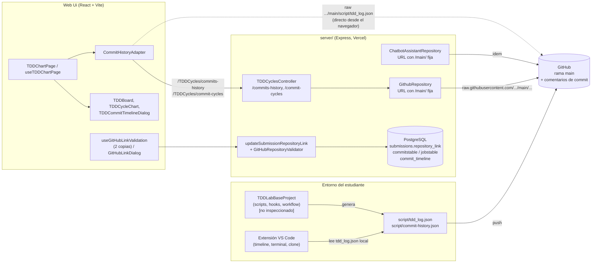
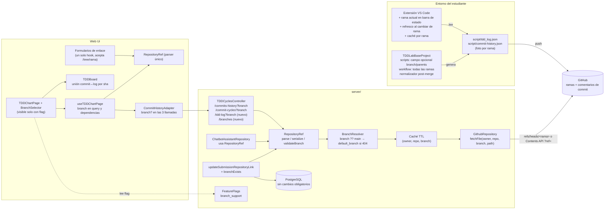
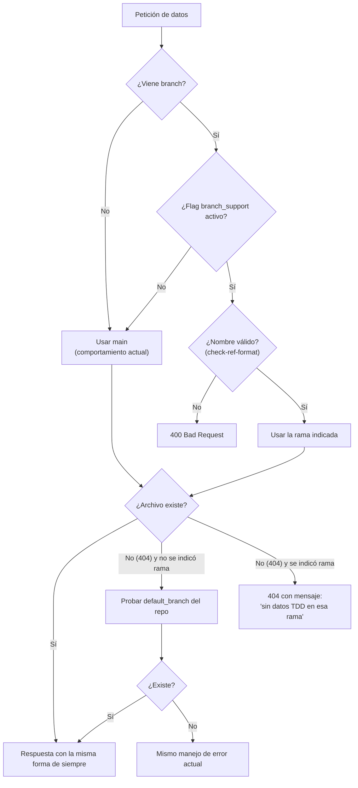

# 05 — Arquitectura y backlog: soporte de ramas Git en TDDLab

**Rol:** equipo de desarrollo responsable de la evolución de TDDLab
**Objetivo:** identificar los componentes afectados por el soporte de ramas Git, consolidar los análisis y definir un backlog priorizado, sin afectar el funcionamiento actual.
**Base de análisis:** repositorio `TDDLab` (carpetas `server/`, `Web Ui/`, `VSCodeExtension/`, `.github/`), rama `main`, estado al 02/11/2026.

---

## 0. Alcance y limitaciones de este análisis

Antes de leer las conclusiones, conviene saber qué se pudo y qué no se pudo verificar.

| Tema | Estado | Consecuencia |
|---|---|---|
| Código de `server/`, `Web Ui/` y `VSCodeExtension/` | Revisado directamente | Los hallazgos de las secciones 2 y 3 están respaldados por archivo y símbolo concretos. |
| Submódulo `VSCodeExtension/resources/TDDLabBaseProject` | **Vacío en el ZIP** (solo se ve el puntero al commit `deafd137`) | No se pudieron leer los scripts que generan `script/tdd_log.json` y `script/commit-history.json`, ni los hooks ni el workflow de GitHub Actions del proyecto base. Todo lo que dependa de ellos se marca **[VERIFICAR]**. |
| Análisis de los demás integrantes (scripts, logs, gráficas) | **No incluidos en el ZIP** | La sección 5 deja definidos los insumos que se esperan y los supuestos con los que se trabajó. No se inventaron conclusiones ajenas; falta contrastarlas. |
| Ejecución del sistema | No realizada | No hay medición de rendimiento ni pruebas de ejecución; las estimaciones son relativas. |

---

## 1. Resumen ejecutivo

1. **Hoy TDDLab es de facto "solo `main`".** La rama está escrita a fuego en **tres** sitios que leen datos de GitHub, no en uno:
   - `server/.../GithubRepository.ts` → `fetchCommitHistoryJson` (`.../main/script/commit-history.json`).
   - `server/.../ChatbotAssistantRepository.ts` → `getCommitHistoryUrl` (mismo archivo, también `main`).
   - `Web Ui/.../CommitHistoryAdapter.ts` → `getTDDLogUrl` (`.../main/script/tdd_log.json`, leído **directamente desde el navegador**, sin pasar por el backend).

   Los componentes afectados van, por tanto, más allá de scripts, logs y gráficas: incluyen el **asistente de IA**, el **parseo del enlace del repositorio**, la **validación de entregas**, la **extensión de VS Code** y el **flujo de CI del proyecto base**.

2. **La rama no tiene dónde vivir en el modelo actual.** El enlace de entrega (`submissions.repository_link`) se interpreta cortando por `/` y tomando posiciones fijas (`useTDDChartPage.getRepoQuery`). Un enlace como `github.com/u/r/tree/feature-x` hoy **se acepta en la validación y la rama se ignora en silencio**.

3. **La mayor parte de la base de datos no necesita cambios.** Las tablas `commitstable`, `jobstable` y `commit_timeline` se identifican por `(owner, reponame, sha)`; el `sha` es único entre ramas. Además, los endpoints que las usan son en su mayoría código legado.

4. **Propuesta.** Introducir un concepto único y compartido, **`RepositoryRef = { owner, repo, branch? }`**, y propagarlo como parámetro **opcional** a lo largo de la cadena frontend → backend → GitHub. Si `branch` no viene, el comportamiento es **idéntico al actual** (`main`). La funcionalidad se activa tras un **feature flag** (el repo ya tiene módulo de feature flags) y se protege con una **suite de regresión "sin rama"** que se construye **antes** de tocar código.

5. **Riesgo principal (a validar, no a suponer):** la calidad de los datos por rama. Si el script/hook del proyecto base no registra la rama, no se dispara el workflow en ramas distintas de `main`, o los merges/rebases corrompen `tdd_log.json`, la interfaz podrá seleccionar rama pero mostrará datos vacíos o engañosos. Por eso el backlog empieza con spikes sobre el proyecto base.

---

## 2. Arquitectura actual (as-is)

### 2.1 Vista general

### 2.2 Lo que ocurre hoy en la ruta de las gráficas

1. La entrega guarda un `repository_link` (texto libre validado solo en formato).
2. `useTDDChartPage` extrae `repoOwner` y `repoName` con `split("/")` por posición y los pone en la query string.
3. `fetchTDDVisualizationData` lanza **tres** peticiones en paralelo: `tdd_log.json` (directa a GitHub), `commits-history` y `commit-cycles` (vía backend).
4. El backend descarga `script/commit-history.json` de `main` y lo transforma (`getCommitHistoryData`, `getCommitCyclesData`).
5. `TDDBoard` combina commits y log **por posición** (`getTestsForCommit(commitIndex)`), no por identificador.

### 2.3 Hallazgos relevantes para ramas

| # | Hallazgo | Evidencia | Por qué importa |
|---|---|---|---|
| H1 | Rama `main` fija en 3 lugares | `GithubRepository.fetchCommitHistoryJson`, `ChatbotAssistantRepository.getCommitHistoryUrl`, `CommitHistoryAdapter.getTDDLogUrl` | Hay que cambiar los tres; olvidar uno produce datos inconsistentes entre gráfica e IA. |
| H2 | `tdd_log.json` se lee desde el navegador, sin backend | `CommitHistoryAdapter.obtainTDDLogs` | No hay punto central donde validar/cachear/resolver rama; y es el único dato que no pasa por el servidor. |
| H3 | El enlace se parsea con posiciones fijas y por separado en varios sitios | `getRepoQuery` (`split("/")`), dos copias de `useGitHubLinkValidation` (`shared/hooks` y `my-practices/hooks`), `updateSubmissionRepositoryLinkUseCase`, `ChatbotAssistantRepository` (regex), `TDDBoard` (regex sobre `html_url`) | Sin un parser único, la rama se interpretará distinto en cada sitio. |
| H4 | El validador de segmentos prohíbe `/` | `TDDCyclesController.isValidGithubSegment` usa `/^[A-Za-z0-9._-]+$/` | Los nombres de rama habituales (`feature/login`) no pasarían; hace falta un validador específico de rama (y no relajar el actual). |
| H5 | La unión commit↔log es por índice | `TDDBoard.getTestsForCommit`, `preprocessTDDLogs` | Con ramas, merges, rebases o commits ausentes del log, el índice se desalinea y las pruebas se asignan al commit equivocado. |
| H6 | Estado "sin cobertura" = color negro | `TDDBoard.getCommitColor` (`coverage` nulo → `"black"`) | Si el CI no corre en ramas ≠ `main`, todos sus commits aparecerán en negro aunque estén bien. |
| H7 | `GithubRepository.getCommits` no acepta rama ni pagina | `per_page: 100`, sin `sha` | Endpoints legados; si se reactivan, solo verían la rama por defecto. |
| H8 | Comentarios de "NO SE USA" desactualizados | `TDDCyclesController`: `getCommitTimeLine` está marcado "NO SE USA", pero `TDDBoard` lo invoca (`/TDDCycles/commit-timeline`) | Riesgo de que una limpieza elimine un endpoint que sí se consume. |
| H9 | `ExecuteCloneCommand` clona el repo base y marca `needsGitInit: true` | `VSCodeExtension/src/application/clone/ExecuteCloneCommand.ts` | El estudiante trabaja con un `git init` propio; la rama inicial depende de su configuración de Git (`init.defaultBranch`). Puede ser `master`. **[VERIFICAR]** |
| H10 | Timeline de la extensión cacheado con clave fija | `TimelineView.STORAGE_KEY = 'tddTimelineData'` (workspaceState) | Al cambiar de rama puede mostrarse el timeline de otra rama si falla la lectura del archivo. |
| H11 | Si el repo usa `master`, hoy falla | URL con `/main/` fija | Es un defecto actual; el soporte de rama lo corrige como efecto secundario. |

---

## 3. Componentes afectados y análisis de impacto

Leyenda de impacto: **Alto** (cambio de lógica o contrato), **Medio** (cambio localizado), **Bajo** (ajuste menor o ninguno).

### 3.1 Más allá de scripts, logs y gráficas

| Componente | Ruta | Impacto | Qué cambia |
|---|---|---|---|
| Parseo del enlace de repositorio | `Web Ui/src/shared/hooks/useGitHubLinkValidation.ts`, `.../my-practices/hooks/useGitHubLinkValidation.ts`, `useTDDChartPage.getRepoQuery`, `GitHubLinkDialog` | **Alto** | Pasar a un parser único que reconozca `/tree/<rama>`. Eliminar la duplicación. |
| Validación de entregas en servidor | `server/.../updateSubmissionRepositoryLinkUseCase.ts`, `GitHubRepositoryValidator.ts` | **Medio** | Hoy solo valida que el repo exista; añadir verificación opcional de que la rama exista. |
| Asistente de IA | `server/.../ChatbotAssistantRepository.ts` | **Medio** | Misma URL con `main` fija; debe usar la rama de la entrega para que la IA analice lo que el estudiante ve en la gráfica. |
| Vista docente (navegación entre estudiantes) | `useTDDChartPage` (`goToNext/PreviousStudent`), `shared/helpers/navigationHandlers.ts`, `DeliveriesTable` | **Medio** | Cada entrega puede tener una rama distinta; la rama debe viajar en la query y en el listado. |
| Feature flags | `Web Ui/src/modules/FeatureFlags`, `server/.../FeatureFlags` | **Bajo** | Reutilizar para activar/desactivar el soporte. En la Web Ui el consumo visible hoy está en Settings; hay que verificar el patrón de lectura antes de usarlo en la gráfica. |
| Extensión de VS Code | `TimelineView.ts`, `TimelineRepository.ts`, `GetLastPoint.ts`, `ExecuteCloneCommand.ts` | **Medio** | Mostrar rama actual, refrescar al cambiar de rama, clave de caché por rama. |
| CI del proyecto base | `TDDLabBaseProject/.github/workflows` **[VERIFICAR]** | **Alto (si hay restricción a `main`)** | Debe correr en todas las ramas; si no, no habrá cobertura/conclusión para commits de rama. |
| Base de datos | `commitstable`, `jobstable`, `commit_timeline`, `submissions` | **Bajo** | Sin cambios obligatorios (ver ADR-01). |
| Documentación | `README.md` de `server/`, `Web Ui/`, `VSCodeExtension/` | **Bajo** | Documentar el parámetro `branch`, el flag y la compatibilidad. |

### 3.2 Impacto por capa

**Frontend**
- *Alto:* `CommitHistoryAdapter`, `CommitHistoryRepositoryInterface`, casos de uso (`GetTDDLogs`, `GetCommitsOfRepo`, `GetCommitTddCycle`, `PortGetTDDCycles`), `fetchTDDVisualizationData`, `useTDDChartPage`, `TDDBoard` (unión por índice).
- *Medio:* `TDDChartPage` (selector de rama), `TDDCommitTimelineDialog`, `TDDCycleChart`, formularios de enlace.
- *Bajo:* componentes puramente presentacionales (`TDDCycleCard`, `TDDList`) siempre que reciban datos ya filtrados.

**Backend**
- *Alto:* `GithubRepository` (`fetchCommitHistoryJson`, `getCommitHistoryData`, `getCommitCyclesData`), contrato `IGithubRepository`.
- *Medio:* `TDDCyclesController` y `TDDCyclesRoutes` (parámetro opcional `branch`, endpoint nuevo de ramas), `ChatbotAssistantRepository`.
- *Bajo:* casos de uso `GetCommitHistoryUseCase` / `GetCommitCyclesUseCase` (solo propagan parámetros). Capa de BD sin cambios.

**Procesamiento de datos**
- Los JSON (`tdd_log.json`, `commit-history.json`) son la **única fuente** para las gráficas. Hay que decidir (a) si cada archivo es una "foto" por rama (ADR-02), (b) cómo reconciliar entradas tras merge/rebase/squash (los `commitId` del log pueden no existir en la historia de la rama), (c) añadir campos **opcionales** (`branch`, `parents`) sin romper a los lectores actuales.
- Los **comentarios de commit** con cobertura (`fetchCoverageDataForCommit`) dependen de que el CI corra en la rama.

**Configuración Git**
- Rama inicial del estudiante (`master` vs `main`), `git init` tras el clone, workflow con `on: push` para todas las ramas, `.gitattributes` y hooks (`post-merge`, `post-rewrite`) para el log. **Nota:** el driver de merge `union` **no es seguro** para arrays JSON (rompe la estructura de corchetes/comas); se propone en su lugar un normalizador (BR-16).

---

## 4. Arquitectura propuesta (to-be)

### 4.1 Principios

1. **Aditivo, nunca sustitutivo.** Todo cambio de contrato añade un parámetro opcional; ningún campo ni forma de respuesta existente cambia.
2. **Sin `branch` = comportamiento actual.** Misma URL (`main`), mismo resultado.
3. **Una sola definición de "referencia de repositorio"**, compartida por frontend y backend.
4. **Un solo punto de salida a GitHub.** Todos los archivos (`tdd_log.json` incluido) se obtienen vía backend.
5. **Tras feature flag** y con regresión automática "sin rama" como condición de merge.

### 4.2 Diagrama general de la arquitectura propuesta

### 4.3 Resolución de rama y compatibilidad

### 4.4 Decisiones de arquitectura (ADR resumidos)

**ADR-01 — ¿Dónde se guarda la rama de una entrega?**

| Opción | Pros | Contras |
|---|---|---|
| **A. En el propio enlace** (`https://github.com/u/r/tree/<rama>`) | Sin migración de BD; las entregas existentes siguen siendo válidas; un solo campo. | Exige un parser único y robusto (ramas con `/`). |
| B. Columna nueva `repository_branch` (nullable) | Modelo explícito; consulta fácil. | Migración en `submissions` y `practice_submissions`; dos campos que mantener coherentes; no hay carpeta de migraciones visible en el repo. |

**Recomendación:** **A** para la primera entrega (cero migración, cero riesgo para datos existentes). Reevaluar **B** si se necesitan consultas por rama o filtros docentes. El parser (BR-04) aísla la decisión: cambiar de A a B no tocaría a los consumidores.

**ADR-02 — Semántica de los archivos de log por rama**

| Opción | Descripción | Evaluación |
|---|---|---|
| **A. Foto por rama** | Cada rama contiene su propio `tdd_log.json` / `commit-history.json` (lo que ya ocurre al versionarlos); el backend lee el archivo **de esa rama**. | Compatible con el formato actual; sin migración. Riesgo: conflictos al fusionar → mitigado con normalizador (BR-16). |
| B. Archivos por rama (`script/branches/<slug>/…`) | Evita conflictos de merge. | Cambia el contrato de archivos del proyecto base y de la extensión; rompe a los lectores actuales. |

**Recomendación:** **A**, y pasar a B solo si el spike BR-01 muestra una tasa alta de conflictos.

**ADR-03 — Cómo se pide el archivo a GitHub por rama**

Candidatos: (1) `raw.githubusercontent.com/<o>/<r>/refs/heads/<rama>/script/…` y (2) Contents API `GET /repos/<o>/<r>/contents/script/…?ref=<rama>` (con el token ya configurado en el servidor). Los nombres con `/` hacen ambigua la URL "corta" de raw. **Decisión pendiente del spike BR-02**; en ambos casos se codifica cada segmento y se rechaza cualquier nombre que no pase la validación (BR-05) para evitar manipulación de la ruta.

**ADR-04 — `tdd_log.json` pasa por el backend**

Eliminar la lectura directa desde el navegador (H2) para tener un único punto de validación, resolución de rama y caché. Se mantiene la ruta directa como *fallback* con flag apagado, de modo que el comportamiento actual no cambia hasta activar la funcionalidad.

### 4.5 Estrategia de compatibilidad con proyectos que no usan ramas

1. **Contrato aditivo.** `branch` es siempre opcional en query string. La forma de la respuesta (array) **no cambia**; no se envuelve en un objeto.
2. **Valor por defecto = hoy.** Sin `branch` se usa `main`, igual que ahora. Solo si responde 404 se intenta `default_branch` (esto únicamente puede **mejorar** casos que hoy fallan, como repos con `master`).
3. **Campos nuevos opcionales** (`branch`, `parents`) en los JSON. Los lectores actuales los ignoran; si faltan, la entrada se considera de la rama por defecto.
4. **Enlaces existentes** (`github.com/u/r`) se interpretan sin rama; no se reescriben ni se migran.
5. **Feature flag `branch_support`.** Apagado: la UI no muestra selector y el adaptador usa exactamente las rutas actuales. Se activa por etapas (equipo → un grupo → todos).
6. **UI sin cambios visibles** cuando el repositorio solo tiene una rama (el selector se oculta).
7. **Red de seguridad:** suite de regresión "sin rama" (BR-27) que debe estar en verde **antes y después** de cada PR de este épico.
8. **Reversión:** apagar el flag restaura el comportamiento anterior sin despliegue.

### 4.6 Seguridad y rendimiento

- **Validación de nombre de rama** (reglas de `git check-ref-format`: sin `..`, sin caracteres de control, sin espacios, sin `~^:?*[\`, sin empezar por `-` o `/`, sin terminar en `.lock` ni `/`, longitud máxima 255). No se relaja `isValidGithubSegment`.
- **Codificación por segmento** al construir URLs; nunca concatenar texto del usuario.
- **Límite de tasa de GitHub:** el backend ya usa token (`REACT_APP_AUTH_TOKEN`); el listado de ramas debe paginar. Añadir caché TTL por `(owner, repo, branch)` (en Vercel es por instancia; basta como mitigación).
- **Autorización:** los endpoints de TDDCycles no pasan hoy por `authMiddleware` de forma visible en `TDDCyclesRoutes`; no es nuevo de este épico, pero conviene dejarlo anotado como deuda al exponer endpoints adicionales. **[VERIFICAR]** en `app.ts`.

---

## 5. Consolidación de análisis y propuestas

### 5.1 Estado de la consolidación

Los análisis de los demás integrantes **no estaban en el material entregado**. Para no bloquear la planificación, se fijan aquí los **insumos esperados**, el **supuesto de trabajo** y la **decisión que depende de ellos**. Cada fila debe cerrarse (confirmar o corregir) en la próxima reunión de equipo.

| Análisis esperado | Qué debe aportar | Decisión que depende de él | Supuesto usado en este documento | Ítems afectados |
|---|---|---|---|---|
| **Scripts** (generación de `tdd_log.json`, `commit-history.json`, hooks) | Formato real de entradas; qué hook/evento escribe cada archivo; si captura rama; comportamiento con rebase/merge | ADR-02, campos nuevos opcionales | Los scripts viven en el proyecto base y no registran rama hoy. | BR-01, BR-14, BR-16 |
| **Logs** (estructura y ciclo de vida de los archivos) | Cómo se acumulan entradas, qué pasa en conflictos, tamaño | Política de normalización y caché | `tdd_log.json` es un array que solo crece y se versiona en Git. | BR-16, BR-11 |
| **Gráficas** (qué se calcula y cómo se agrupa) | Qué métricas dependen del orden/índice; qué esperan ver con varias ramas | Modo de visualización (una rama vs. todas) | Una rama a la vez es suficiente para el MVP. | BR-22, BR-24 |
| **CI / GitHub Actions** | Disparadores del workflow del proyecto base; dónde se publica la cobertura | Si hay datos de cobertura por rama | El workflow hoy no corre en ramas distintas de `main`. | BR-15 |

### 5.2 Propuestas consolidadas

| Propuesta | Origen | Estado |
|---|---|---|
| Introducir `RepositoryRef` compartido | Análisis de arquitectura (este documento) | Propuesta principal |
| Parámetro `branch` opcional + fallback a `main` | Arquitectura | Propuesta principal |
| Rama dentro del enlace (`/tree/<rama>`) | Arquitectura | Pendiente de confirmar (ADR-01) |
| Campo `branch`/`parents` en JSON | Scripts/Logs | **Pendiente de los demás análisis** |
| Normalizador post-merge | Scripts/Logs | **Pendiente de los demás análisis** |
| Modo "todas las ramas" en gráficas | Gráficas | **Pendiente**; se deja como backlog *Could* |

---

## 6. Funcionalidades necesarias (épicos)

| Épico | Funcionalidad | Resultado observable |
|---|---|---|
| **E0** Descubrimiento y decisiones | Verificar el proyecto base, el acceso a archivos por rama y cerrar ADR-01/02/03 | Contratos de datos y decisiones documentadas |
| **E1** Núcleo compartido | `RepositoryRef`, validador de rama, feature flag | Un único lugar que entiende "repositorio + rama" |
| **E2** Backend | Resolución de rama, endpoints con `branch`, listado de ramas, proxy de `tdd_log`, caché, validación de entrega | API capaz de servir datos por rama sin cambiar la forma de respuesta |
| **E3** Scripts, CI y extensión | Registrar rama en logs, CI en todas las ramas, normalizador, rama visible en VS Code | Datos fiables por rama en origen |
| **E4** Frontend | Selector de rama, hooks/adapter con `branch`, unión por `sha`, formularios de enlace, vista docente | El usuario elige rama y ve sus gráficas |
| **E5** Asistente de IA | Análisis sobre la rama de la entrega | La IA y la gráfica muestran los mismos datos |
| **E6** Calidad y despliegue | Regresión "sin rama", pruebas por capa, e2e, rollout y documentación | Cambio seguro y reversible |

---

## 7. Backlog priorizado

**Convenciones.** Prioridad MoSCoW: **M** = Must, **S** = Should, **C** = Could. Tamaño relativo: XS, S, M, L (estimación **propuesta**, a calibrar con el equipo). "Dep." = dependencias. Los ítems que dependen del proyecto base están marcados con ◆ **[VERIFICAR]**.

### 7.1 Tabla del backlog

| ID | Épico | Historia / tarea | Pri. | Tam. | Dep. | Criterio de aceptación (resumen) |
|---|---|---|---|---|---|---|
| **BR-27** | E6 | Suite de regresión "sin rama": pruebas de contrato de `/commits-history` y `/commit-cycles` y snapshot del flujo de gráficas sin `branch` | **M** | M | — | Corre en CI; pasa en `main` actual; es requisito de merge de todo el épico. |
| **BR-01** | E0 | ◆ Spike: inspeccionar `TDDLabBaseProject` (scripts, hooks, workflow) y documentar formato real de los JSON | **M** | S | — | Documento con formato, eventos que escriben cada archivo, disparadores del workflow y comportamiento con merge/rebase. |
| **BR-02** | E0 | Spike: acceso por rama a GitHub (raw con `refs/heads/` vs Contents API `?ref=`), nombres con `/`, límites de tasa | **M** | S | — | Prueba con rama `feature/x`; decisión ADR-03 registrada. |
| **BR-03** | E0 | Cerrar ADR-01 y ADR-02 con el equipo | **M** | S | BR-01 | Decisiones firmadas en este documento. |
| **BR-04** | E1 | Módulo `RepositoryRef` (parse/serialize de `github.com/o/r[/tree/<rama>]`), versión backend y frontend con los mismos casos de prueba | **M** | M | BR-03 | Casos: sin rama, rama simple, rama con `/`, URL con `.git`, trailing slash, `/tree/` sin rama → error claro. |
| **BR-05** | E1 | Validador de nombre de rama (`check-ref-format`) separado de `isValidGithubSegment` | **M** | S | — | Rechaza `..`, espacios, `-x`, `a.lock`, longitud > 255; acepta `feature/login`. |
| **BR-06** | E1 | Feature flag `branch_support` (BD + lectura en Web Ui) | **M** | S | — | Apagado por defecto; alternarlo cambia la UI sin despliegue. |
| **BR-07** | E2 | `GithubRepository`: `branch?` en `fetchCommitHistoryJson`, `getCommitHistoryData`, `getCommitCyclesData`; actualizar `IGithubRepository`; fallback `main → default_branch` | **M** | M | BR-02, BR-04, BR-05 | Sin `branch` la URL es idéntica a la actual (test de BR-27). Con `branch` usa esa rama. |
| **BR-08** | E2 | `TDDCyclesController`/rutas: query `branch` opcional en `/commits-history` y `/commit-cycles` | **M** | S | BR-07 | 400 si el nombre es inválido; respuesta con la misma forma. |
| **BR-09** | E2 | Endpoint `GET /TDDCycles/branches?owner&repoName` (paginado; devuelve `default` y lista) | **M** | M | BR-02 | Repos con más de 100 ramas paginan; error claro si el repo no existe. |
| **BR-10** | E2 | Endpoint proxy `GET /TDDCycles/tdd-log?…&branch` y uso desde el adaptador (fallback directo con flag apagado) | **S** | M | BR-07, BR-06 | Con flag apagado, el adaptador usa la ruta actual; con flag encendido, el backend. |
| **BR-11** | E2 | Caché TTL por `(owner, repo, branch)` | **S** | S | BR-07 | Segunda petición en TTL no llama a GitHub. |
| **BR-12** | E2 | Entregas: validar que la rama exista al guardar el enlace | **S** | M | BR-04, BR-09 | Enlace sin rama: comportamiento actual. Con rama inexistente: error legible. |
| **BR-13** | E2 | Endpoints legados (`getCommits`): parámetro `sha`/rama y paginación | **C** | S | BR-07 | Solo si se reactivan; no usados hoy. |
| **BR-14** | E3 | ◆ Scripts de logs: campo opcional `branch` (y `parents`) en `commit-history.json` / `tdd_log.json` | **M** | M | BR-01, BR-03 | Los lectores actuales siguen funcionando con archivos viejos y nuevos. |
| **BR-15** | E3 | ◆ Workflow del proyecto base: ejecutar en `push` de todas las ramas | **M** | S | BR-01 | Commit en rama `feature/x` genera cobertura/conclusión visible. |
| **BR-16** | E3 | ◆ Normalizador de `tdd_log.json` tras merge/rebase (deduplicar por identificador, ordenar por timestamp, validar JSON) | **S** | M | BR-01, BR-03 | Merge de dos ramas con entradas distintas deja JSON válido y sin duplicados. |
| **BR-17** | E3 | Extensión: rama actual en la barra de estado, refresco al cambiar `.git/HEAD`, clave de caché del timeline por rama | **S** | M | — | Cambiar de rama actualiza el timeline sin recargar VS Code. |
| **BR-18** | E3 | Extensión: acceso rápido a comandos de rama (crear/cambiar) y aviso si la rama inicial no es `main` | **C** | S | BR-17 | Menú/atajos; sin impacto en el flujo actual. |
| **BR-19** | E4 | Puerto/adaptador y casos de uso con `branch?` (`CommitHistoryRepository`, `CommitHistoryAdapter`, `GetTDDLogs`, `GetCommitsOfRepo`, `GetCommitTddCycle`, `PortGetTDDCycles`, `fetchTDDVisualizationData`) | **M** | M | BR-08 | Llamadas sin `branch` idénticas a las actuales. |
| **BR-20** | E4 | `useTDDChartPage`: leer `branch` de la query, incluirlo en dependencias del `useEffect` y conservarlo al navegar entre estudiantes | **M** | M | BR-04, BR-19 | Cambiar rama recarga datos; los botones anterior/siguiente respetan la rama de cada entrega. |
| **BR-21** | E4 | Componente `BranchSelector` en `TDDChartPage` (oculto con flag apagado o una sola rama) | **M** | M | BR-06, BR-09, BR-20 | Muestra rama por defecto preseleccionada; accesible por teclado. |
| **BR-22** | E4 | `TDDBoard`: unir commits y log por `sha`/`commitId` en vez de por índice; revisar la regex sobre `html_url` | **M** | M | BR-14 (parcial) | Con log que contiene commits ausentes de la historia, no se desalinean las pruebas. |
| **BR-23** | E4 | Formularios de enlace: un único `useGitHubLinkValidation`, aceptar `/tree/<rama>` | **S** | M | BR-04 | Eliminada la duplicación; enlaces sin rama siguen aceptados igual. |
| **BR-25** | E4 | Vista docente: mostrar la rama en `DeliveriesTable`/resumen de entrega | **S** | S | BR-04 | Entregas sin rama no muestran columna vacía confusa. |
| **BR-24** | E4 | Modo "todas las ramas" en las gráficas (series por rama, indicador de merges) | **C** | L | BR-14, BR-22 | Solo tras validar con usuarios; fuera del MVP. |
| **BR-26** | E5 | `ChatbotAssistantRepository`: usar `RepositoryRef` y rama de la entrega; mencionar la rama en el prompt | **S** | S | BR-04, BR-07 | Sin rama: URL idéntica a la actual. |
| **BR-28** | E6 | Pruebas unitarias por capa (backend, adaptador, hook, parser) y e2e Cypress "elegir rama → ver gráfica" | **M** | M | BR-07…BR-21 | Cobertura de los archivos tocados no baja respecto al estado previo. |
| **BR-29** | E6 | Rollout por etapas del flag, monitoreo de errores 404/429 y actualización de READMEs | **S** | S | BR-28 | Plan de activación documentado y reversible. |
| **BR-30** | E6 | Corregir comentarios obsoletos "NO SE USA" en `TDDCyclesController` (p. ej. `commit-timeline`) | **C** | XS | — | Comentarios coherentes con el uso real. |

### 7.2 Orden sugerido (hitos)

| Hito | Contenido | Condición de salida |
|---|---|---|
| **H0 — Red de seguridad y descubrimiento** | BR-27, BR-01, BR-02, BR-03 | Regresión en verde; ADR-01/02/03 cerrados; contrato de archivos del proyecto base documentado. |
| **H1 — Núcleo y backend** | BR-04, BR-05, BR-06, BR-07, BR-08, BR-09 | API devuelve datos por rama; sin `branch` es idéntica a hoy. |
| **H2 — Datos en origen y frontend MVP** | BR-14, BR-15, BR-19, BR-20, BR-21, BR-22, BR-28 | Un estudiante con una rama de trabajo ve su gráfica con el flag encendido. |
| **H3 — Robustez** | BR-10, BR-11, BR-12, BR-16, BR-17, BR-23, BR-25, BR-26, BR-29 | Merges no corrompen datos; vista docente y asistente coherentes; rollout controlado. |
| **H4 — Evolución** | BR-13, BR-18, BR-24, BR-30 | A demanda. |

> Orden de dependencia crítica: **BR-27 → (BR-01, BR-02) → BR-03 → BR-04/05 → BR-07 → BR-08 → BR-19 → BR-20 → BR-21.** Lo que depende del proyecto base (BR-14, BR-15, BR-16) puede avanzar en paralelo una vez cerrado BR-01.

---

## 8. Riesgos y mitigaciones

| Riesgo | Prob. | Impacto | Mitigación |
|---|---|---|---|
| El proyecto base no registra rama ni corre CI en ramas ≠ `main` (datos vacíos o en negro, H6) | Alta **[VERIFICAR]** | Alto | BR-01 primero; BR-14/15 en el mismo hito que la UI; mensaje explícito "sin datos TDD en esa rama". |
| Merges/rebases/squash desalinean `tdd_log.json` y commits (H5) | Alta | Alto | BR-22 (unión por `sha`) y BR-16 (normalizador). |
| Regresión en proyectos sin ramas | Media | Alto | BR-27 como requisito de merge; flag apagado por defecto. |
| Nombre de rama malicioso o con `/` rompe la URL (H4) | Media | Medio | BR-05 + codificación por segmento. |
| Límite de tasa de GitHub al listar ramas o leer por rama | Media | Medio | Caché (BR-11), paginación, token del servidor. |
| Dos parsers del enlace divergen | Alta si no se unifica | Medio | BR-04 + BR-23: un único parser con la misma batería de pruebas en front y back. |
| Una limpieza elimina un endpoint "NO SE USA" que sí se consume (H8) | Media | Medio | BR-30 y revisión previa de referencias. |
| Rama inicial del estudiante distinta de `main` (H9) | Media | Medio | BR-18 (aviso) y fallback a `default_branch`. |

---

## 9. Estrategia de pruebas

- **Backend (Jest, ya presente):** ampliar `GithubRepository.*.test.ts`, `TDDCyclesController.test.ts`; casos con y sin `branch`, rama inválida, 404 de archivo, paginación de ramas.
- **Frontend (Jest, ya presente):** pruebas del parser, `CommitHistoryAdapter`, `useTDDChartPage`; conservar `CommitHistoryAdapter.test.ts` y `.spec.ts` existentes sin modificarlos como parte de la regresión.
- **E2E (Cypress, ya presente):** escenario "sin rama" (idéntico al actual) y "con rama".
- **Contrato:** respuesta de `/commits-history` y `/commit-cycles` sin `branch` debe ser byte a byte equivalente a la actual para un mismo repositorio de prueba.
- **Datos:** repositorio de ejemplo con `main`, una rama de feature, un merge y un rebase, para validar BR-16 y BR-22.

---

## 10. Trazabilidad con los criterios de confirmación

| Criterio | Dónde se atiende | Estado |
|---|---|---|
| Revisar la arquitectura general de TDDLab | Secciones 2.1–2.3 | Completo, con la limitación del submódulo (sección 0) |
| Identificar componentes afectados además de scripts, logs y gráficas | Sección 3.1 (parseo de enlace, validación de entregas, IA, vista docente, feature flags, extensión, CI, documentación) | Completo |
| Analizar impactos en frontend, backend, procesamiento de datos y configuración Git | Sección 3.2 | Completo; configuración Git con puntos **[VERIFICAR]** |
| Proponer la integración sin afectar lo actual | Secciones 4.1, 4.2, 4.4 | Completo |
| Estrategia de compatibilidad con proyectos sin ramas | Sección 4.5 y diagrama 4.3 | Completo |
| Diagrama general de la arquitectura propuesta | Sección 4.2 (y 4.3) | Completo |
| Revisar los resultados de los análisis de los demás integrantes | Sección 5.1 | **Parcial:** no estaban en el material; se dejaron insumos esperados y supuestos para contrastar |
| Consolidar las propuestas de solución | Sección 5.2 | **Parcial:** consolidada la parte de arquitectura; faltan scripts/logs/gráficas |
| Definir las funcionalidades necesarias | Sección 6 | Completo |
| Organizar y priorizar el backlog | Secciones 7.1 y 7.2 | Completo (estimaciones a calibrar) |
| Documentar la propuesta final | Este documento | Completo, sujeto al cierre de las filas pendientes de la sección 5.1 |

---

## 11. Próximos pasos inmediatos

1. Incorporar al repositorio (o compartir) el contenido de `TDDLabBaseProject` y los análisis de scripts, logs y gráficas, y cerrar la tabla 5.1.
2. Ejecutar BR-27, BR-01 y BR-02 (H0) y registrar ADR-01/02/03.
3. Revisar este backlog con el equipo para calibrar tamaños y confirmar la prioridad de BR-10 y BR-12.
