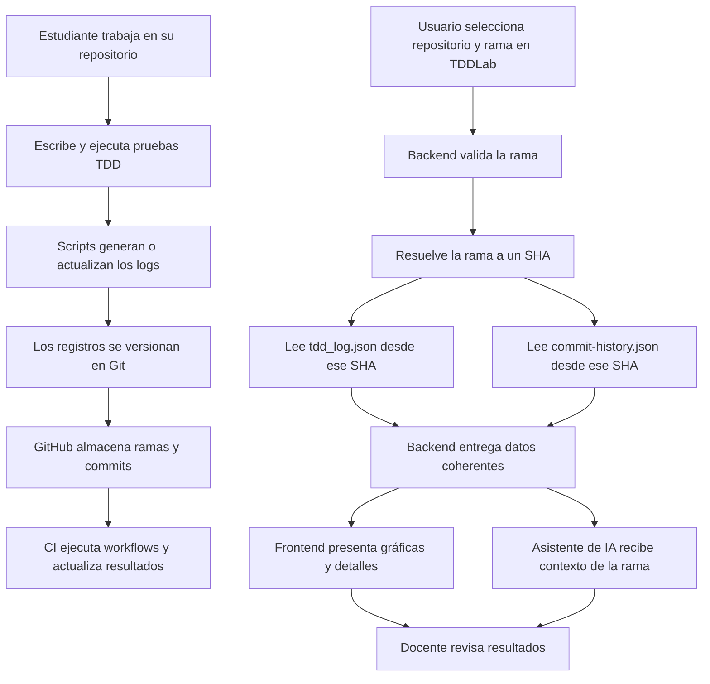

# 06 — Análisis final consolidado: arquitectura, backlog y flujo de funcionamiento de TDDLab

**Proyecto:** TDDLab  
**Sprint:** 3  
**Tipo de documento:** análisis integrador del equipo  
**Versión:** 1.0 — documento de consolidación  
**Estado:** propuesta técnica; implementación e integración sujetas a validación del equipo

---

## 1. Objetivo

El presente documento consolida los aportes realizados por los cinco integrantes del equipo durante el Sprint 3. Integra los hallazgos relacionados con el funcionamiento de TDDLab, la generación y persistencia de logs, la visualización de resultados, el diseño de API y almacenamiento, y la arquitectura propuesta para incorporar soporte para múltiples ramas de Git.

El propósito es presentar una visión común del problema, relacionar los resultados de los análisis individuales y establecer una propuesta de solución, un backlog de trabajo, los riesgos y las pruebas necesarias para avanzar hacia una implementación compatible con el funcionamiento actual de la plataforma.

Este documento no reemplaza los análisis individuales: los sintetiza y sirve como referencia común para comprender la solución integral.

## 2. Alcance y criterios de lectura

La consolidación considera los siguientes aportes:

1. **Andrés Revollo:** análisis incorporado directamente en la presentación del equipo.
2. **Carlos Iriarte:** análisis de scripts y logs.
3. **Henry Rivera:** análisis de gráficas y visualización.
4. **Lucas Rodriguez:** diseño de base de datos y API.
5. **Isabella Montes:** análisis de arquitectura, impacto y backlog.

Para evitar confusiones, el documento distingue cuatro estados:

- **Funcionamiento actual:** comportamiento descrito como existente en la plataforma.
- **Hallazgo o evidencia:** problema observado o resultado reportado en los análisis y pruebas de concepto.
- **Propuesta:** solución técnica recomendada, todavía sujeta a integración.
- **Pendiente de validación:** aspecto que debe comprobarse en el proyecto integrado o confirmarse con el equipo.

Los resultados de pruebas de concepto no deben interpretarse como prueba de que la funcionalidad ya está integrada en TDDLab.

## 3. Resumen ejecutivo

El análisis del equipo identifica una limitación central: el funcionamiento actual de TDDLab está orientado a consultar información asociada a la rama `main`. La referencia a esa rama aparece distribuida entre distintos componentes, por lo que incorporar soporte multirrama no consiste únicamente en cambiar un nombre o una URL.

La solución propuesta consiste en centralizar la referencia al repositorio y a la rama, propagar esa información a los componentes que la necesitan y hacer que el backend resuelva la rama a un SHA concreto. A partir de esa revisión, el backend debe obtener los archivos de registros y de historial de commits desde el mismo SHA, evitando combinar datos de revisiones diferentes.

Los análisis de scripts, logs y gráficas muestran que también es necesario asegurar la identidad y trazabilidad de los registros. Operaciones Git como merge, rebase, cherry-pick o `git commit --amend` pueden modificar la relación entre commits y registros si el diseño depende únicamente de posiciones o del SHA anterior. Por ello, se propone utilizar identificadores estables para los registros y asociar las ejecuciones con los commits mediante información de procedencia verificable.

La propuesta se organiza en etapas: primero habilitar la consulta coherente de una rama y conservar la compatibilidad; después integrar la experiencia de selección y visualización; finalmente fortalecer la comparación, persistencia y otras mejoras según el alcance aprobado.

## 4. Problema identificado

### 4.1. Dependencia de `main`

El sistema actual consulta información de GitHub utilizando `main` en distintos puntos de la solución. En el análisis se identifican como componentes involucrados:

- Interfaz web.
- Backend.
- Asistente de inteligencia artificial.
- Scripts y procesos que generan o actualizan información.
- Componentes de visualización y consulta.

Esta distribución puede producir resultados inconsistentes si un componente consulta una rama y otro continúa consultando `main`.

### 4.2. Consecuencias

- No se puede seleccionar de manera uniforme la rama cuyos datos se desean consultar.
- Las gráficas pueden mostrar información de `main` aunque el usuario esté trabajando en otra rama.
- La asociación entre ejecuciones y commits puede ser incorrecta si se basa en posiciones, orden o referencias que cambian.
- Los archivos consultados podrían pertenecer a revisiones Git diferentes.
- Los registros históricos que no contienen información suficiente de procedencia no deben asignarse arbitrariamente a una rama.

### 4.3. Necesidad principal

TDDLab debe poder identificar el repositorio y la rama seleccionada, consultar datos coherentes de esa rama y presentar resultados trazables, sin alterar el comportamiento de los proyectos que utilizan el flujo actual.

## 5. Síntesis de los cinco aportes

### 5.1. Isabella Montes — análisis incorporado en la presentación

El primer integrante incorporó su análisis directamente en la presentación del equipo. Ese aporte forma parte de la consolidación y debe mantenerse como referencia del análisis inicial y del contexto del proyecto.

**Nota de trazabilidad:** como el análisis se encuentra dentro de la presentación y no en un archivo Markdown independiente, se recomienda conservar la diapositiva o sección correspondiente como respaldo. Antes de la entrega final, el equipo debe verificar que sus hallazgos y términos estén representados fielmente en esta síntesis.

### 5.2. Carlos Iriarte — scripts y logs

El análisis de scripts y logs identifica problemas de trazabilidad y actualización de registros ante determinadas operaciones Git, incluyendo `HEAD`, `git commit --amend`, merge, rebase y cherry-pick.

El documento reporta pruebas de concepto realizadas en una copia aislada. Según esos resultados, la propuesta de modificación resolvió los escenarios evaluados en dicha prueba. También se reportaron conflictos en parte de los escenarios del comportamiento original y registros cuyo SHA no coincidía con el commit esperado.

**Implicaciones para la solución:**

- Incorporar información de rama y procedencia en los registros.
- Evitar depender únicamente del SHA mutable o de la posición de un elemento.
- Utilizar identificadores estables, por ejemplo `recordId`.
- Mantener la trazabilidad del commit asociado, por ejemplo mediante `headSha`.
- Evaluar un mecanismo de merge de tres vías para los archivos JSON.
- Probar la resincronización después de rebase y otras operaciones que reescriben el historial.

Los campos y el mecanismo definitivo deben confirmarse contra el esquema real de los archivos y la implementación del proyecto.

### 5.3. Henry Rivera — gráficas y visualización

El análisis de gráficas identifica que la visualización está orientada a los datos de `main` y que no existe todavía una experiencia completa para seleccionar y comparar ramas.

También advierte que la relación entre ejecuciones y commits debe basarse en identificadores confiables, no en índices o posiciones que pueden cambiar.

**Implicaciones para la solución:**

- Incorporar un selector de rama.
- Mostrar claramente qué rama se está visualizando.
- Considerar modos de visualización: una rama, todas las ramas y comparación entre dos ramas.
- Diferenciar información compartida y exclusiva cuando se comparen ramas.
- Indicar cuándo un registro no tiene procedencia suficiente para asociarlo a una rama.
- Mantener las gráficas consistentes con los datos devueltos por el backend.

### 5.4. Lucas Rodriguez — diseño de base de datos y API

El análisis de base de datos y API propone separar la primera entrega de una eventual migración de persistencia.

**Primera etapa propuesta:**

- Consultar una rama específica.
- Resolver la rama a una revisión Git concreta.
- Leer `tdd_log.json` y `commit-history.json` desde el mismo SHA.
- Devolver datos coherentes y su información de procedencia.

**Segunda etapa propuesta:**

- Evaluar persistencia relacional si los requisitos de consulta, histórico, rendimiento o comparación la justifican.
- Definir entidades, relaciones y migraciones después de validar el esquema y las necesidades reales.

Esta separación permite avanzar con soporte multirrama sin asumir que una migración de base de datos es un requisito previo.

### 5.5. Isabella Montes — arquitectura y backlog

El análisis de arquitectura reúne los componentes afectados, propone centralizar la referencia al repositorio y a la rama, plantea decisiones de compatibilidad y organiza el trabajo en épicos, tareas, riesgos y pruebas.

Su aporte conecta las necesidades detectadas en scripts, logs, gráficas y API con una propuesta de implementación progresiva.

## 6. Propuesta de arquitectura consolidada

### 6.1. Referencia centralizada: `RepositoryRef`

Se propone una estructura común denominada `RepositoryRef` para representar el repositorio y, cuando corresponda, la rama seleccionada.

Como mínimo, debe permitir identificar:

- Propietario del repositorio.
- Nombre del repositorio.
- Rama solicitada, cuando exista.
- Referencia o URL de origen, si es necesaria para compatibilidad.

La estructura definitiva debe ajustarse a los modelos y convenciones ya utilizados por el proyecto.

### 6.2. Resolución de rama a SHA

El backend recibe la referencia del repositorio y la rama. Luego:

1. Valida que el repositorio y la rama puedan consultarse.
2. Resuelve la rama a un SHA concreto.
3. Obtiene `tdd_log.json` desde ese SHA.
4. Obtiene `commit-history.json` desde ese mismo SHA.
5. Devuelve los datos y metadatos necesarios para identificar la revisión consultada.

**Regla de consistencia:** ambos archivos deben proceder de la misma revisión Git. No se deben combinar silenciosamente archivos obtenidos desde revisiones diferentes.

### 6.3. Comportamiento cuando no se especifica una rama

Para conservar compatibilidad:

- Si el usuario no especifica una rama, se mantiene el comportamiento anterior basado en la rama predeterminada configurada por el sistema, actualmente descrita como `main`.
- Si el usuario especifica una rama, se consulta esa rama.
- Si la rama solicitada no existe o no puede consultarse, se informa el error.
- Si la rama existe pero no contiene los archivos de registros, se informa que no hay datos disponibles para esa rama.
- No se debe cambiar silenciosamente a otra rama cuando el usuario solicitó una rama concreta.

### 6.4. Caché

Se propone que la caché tenga en cuenta, como mínimo, el repositorio, la rama y el SHA resuelto. De esta forma, una respuesta almacenada para una revisión no se reutiliza como si correspondiera a otra.

### 6.5. Flujo general de datos

Este flujo es conceptual. La consulta por rama, la lectura desde una misma revisión y la experiencia multirrama forman parte de la solución propuesta y deben validarse mediante integración.

## 7. Ejemplo de funcionamiento

### Escenario: estudiante trabaja en `feature/restador`

1. El estudiante abre su proyecto y crea o cambia a la rama `feature/restador`.
2. Escribe una prueba para verificar el comportamiento de una función de resta.
3. Ejecuta Jest desde el flujo de trabajo de TDDLab.
4. Los scripts registran el resultado de la ejecución en el archivo de logs correspondiente.
5. El estudiante realiza un commit y los archivos de seguimiento quedan versionados en Git.
6. GitHub almacena los cambios dentro de `feature/restador`.
7. El proceso de CI ejecuta los workflows configurados para esa rama, según las reglas del repositorio.
8. En TDDLab, el usuario selecciona `feature/restador`.
9. El backend resuelve esa rama a un SHA concreto.
10. El backend obtiene los dos archivos de seguimiento desde ese mismo SHA.
11. La interfaz muestra las gráficas y los detalles correspondientes a `feature/restador`.
12. El docente puede revisar los resultados de esa rama.
13. El asistente de IA puede responder utilizando el contexto de la rama consultada, si esa integración está habilitada.
14. Si el usuario compara `feature/restador` con `main`, TDDLab debe distinguir los datos de cada rama y evitar asociar incorrectamente ejecuciones o commits.
15. El resultado esperado es una visualización trazable y coherente de la actividad del proyecto.

**Importante:** los pasos 8 a 14 describen el comportamiento objetivo de la propuesta multirrama. No deben presentarse como funcionalidades ya implementadas hasta que el equipo complete las pruebas de integración.

## 8. Decisiones de arquitectura

| ID | Decisión | Criterio |
|---|---|---|
| ADR-01 | Centralizar repositorio y rama en `RepositoryRef` | Evitar interpretaciones distintas entre componentes. |
| ADR-02 | Resolver la rama a un SHA antes de leer los archivos | Garantizar consistencia entre logs e historial de commits. |
| ADR-03 | Mantener compatibilidad cuando no se especifica rama | No romper proyectos existentes. |
| ADR-04 | No realizar fallback silencioso si se solicitó una rama concreta | Evitar mostrar información de una rama diferente. |
| ADR-05 | Identificar registros mediante claves estables | Reducir duplicaciones y asociaciones incorrectas. |
| ADR-06 | Separar consulta por rama de una eventual migración relacional | Entregar valor sin introducir una migración prematura. |
| ADR-07 | Identificar la caché por repositorio, rama y SHA | Evitar respuestas obsoletas o cruzadas. |

Estas decisiones son propuestas para revisión y aprobación del equipo; deben contrastarse con la implementación y las restricciones reales del proyecto.

## 9. Backlog consolidado

El backlog de implementación debe conservar la numeración y trazabilidad del documento de arquitectura. A continuación se resumen las líneas de trabajo principales y las tareas de integración añadidas.

| ID / grupo | Trabajo | Resultado esperado |
|---|---|---|
| BR-01 | Revisar e integrar los cambios de scripts y logs | Comportamiento validado en el proyecto real. |
| BR-02 | Validar el acceso a archivos por rama | Consulta correcta de la rama solicitada. |
| BR-14 | Ampliar el modelo de registros con información de trazabilidad | Registros identificables y asociables a su procedencia. |
| BR-15 | Validar ejecución de CI en las ramas requeridas | Workflows ejecutados según la configuración del repositorio. |
| BR-16 | Manejar merges y resincronización de registros | Menos conflictos, duplicaciones y desalineaciones. |
| BR-20 | Incorporar modos de visualización por rama | Consulta de una rama y evolución hacia vistas globales. |
| BR-21 | Incorporar selector de rama | Selección visible y consistente en la interfaz. |
| BR-22 | Relacionar ejecuciones y commits mediante identificadores estables | Trazabilidad correcta en las gráficas. |
| BR-24 | Incorporar comparación entre ramas | Diferenciar elementos compartidos y exclusivos. |
| BR-27 | Ejecutar pruebas de regresión | Compatibilidad con el flujo anterior. |
| BR-31 | Implementar API de fotografía de rama | Lectura de ambos JSON desde el mismo SHA. |
| BR-32 | Implementar modos de visualización por rama | Una rama, todas las ramas y comparación, según alcance aprobado. |

**Nota:** BR-31 y BR-32 son tareas propuestas en la consolidación. La descripción, estimación, prioridad, responsable y dependencias de todas las tareas deben validarse con el backlog oficial del equipo. No se debe asumir que todos los identificadores intermedios están incluidos o completados únicamente por la numeración.

### 9.1. Hitos sugeridos

- **H0 — Validación y regresión:** establecer línea base, revisar el comportamiento actual y validar pruebas de concepto.
- **H1 — Núcleo y backend:** centralizar la referencia, resolver la rama y consultar los archivos desde un mismo SHA.
- **H2 — Frontend:** incorporar el selector y mostrar la información de la rama.
- **H3 — Robustez:** resolver trazabilidad, operaciones Git, datos históricos y pruebas de integración.
- **H4 — Evolución:** comparación avanzada, persistencia u otras mejoras aprobadas.

## 10. Riesgos y mitigaciones

| Riesgo | Probabilidad | Impacto | Mitigación |
|---|---|---|---|
| Pérdida o duplicación de registros durante merge, rebase o cherry-pick | Alta | Alto | Identificadores estables, estrategia de merge y pruebas de resincronización. |
| Asociación incorrecta entre ejecuciones y commits | Alta | Alto | Relacionar por SHA e identidad del registro, no por posición. |
| Registros históricos sin información de rama | Alta | Medio | Marcar procedencia desconocida; no asignar una rama arbitrariamente. |
| Lectura de archivos desde revisiones diferentes | Media | Alto | Resolver un único SHA y leer ambos archivos desde esa revisión. |
| Rama inexistente o eliminada | Media | Medio | Validación y respuesta de error explícita. |
| Comparación de ramas con datos incompletos | Media | Alto | Indicar datos faltantes y limitar las conclusiones de comparación. |
| Regresión del comportamiento actual | Media | Alto | Pruebas de regresión y activación progresiva de la funcionalidad. |
| Caché con información desactualizada | Media | Medio | Incluir SHA en la clave y definir invalidación adecuada. |

## 11. Estrategia de pruebas

### 11.1. Pruebas funcionales

- Consultar `main` sin seleccionar una rama y comprobar la compatibilidad.
- Seleccionar una rama existente con archivos de logs.
- Seleccionar una rama existente sin archivos de logs.
- Solicitar una rama inexistente.
- Cambiar de rama y verificar que la interfaz actualice todos los datos.
- Comprobar que el asistente de IA reciba el contexto correcto, si corresponde.

### 11.2. Pruebas de integridad Git

- Crear dos ramas con ejecuciones independientes.
- Realizar merge entre ramas con registros diferentes.
- Ejecutar `git commit --amend`.
- Ejecutar rebase y verificar la resincronización.
- Ejecutar cherry-pick.
- Probar cambios de rama con modificaciones pendientes y operaciones de stash.
- Comprobar que no se dupliquen registros ni se pierda su identidad.

### 11.3. Pruebas de consistencia

- Confirmar que `tdd_log.json` y `commit-history.json` se leen desde el mismo SHA.
- Confirmar que los commits y ejecuciones se relacionan mediante identificadores confiables.
- Comprobar que las gráficas corresponden a la rama seleccionada.
- Verificar que la comparación no atribuya datos desconocidos a una rama.
- Verificar que la caché no mezcle respuestas de distintas ramas o revisiones.

### 11.4. Pruebas de regresión

- Ejecutar el flujo anterior sin especificar rama.
- Comprobar que los proyectos existentes continúen funcionando.
- Verificar que los componentes que no utilizan la nueva funcionalidad no sufran cambios de comportamiento.

**Criterio de aceptación general:** los resultados deben ser coherentes, trazables y atribuibles a la rama y revisión consultadas; el flujo anterior debe continuar funcionando cuando no se solicita una rama específica.

## 12. Trazabilidad entre hallazgos y solución

| Hallazgo | Componente afectado | Respuesta propuesta |
|---|---|---|
| Dependencia de `main` | Frontend, backend y asistente | `RepositoryRef` y rama explícita. |
| Desalineación de logs por operaciones Git | Scripts y archivos JSON | Identidad estable y estrategia de merge/resincronización. |
| Gráficas asociadas incorrectamente | Frontend y modelo de datos | Relación por SHA e identificadores estables. |
| Lectura de datos de revisiones distintas | API | Fotografía de rama resuelta a un único SHA. |
| Riesgo de afectar proyectos actuales | Plataforma completa | Compatibilidad, pruebas de regresión y activación progresiva. |
| Necesidad de comparar ramas | Frontend y backend | Modos de visualización y consulta definidos por alcance. |

## 13. Próximos pasos

1. Revisar esta consolidación con los cinco integrantes.
2. Contrastar el resumen del primer integrante con su análisis original dentro de la presentación.
3. Confirmar los hallazgos y resultados de las pruebas de concepto con sus autores.
4. Validar el esquema real de `tdd_log.json` y `commit-history.json`.
5. Acordar el contrato de `RepositoryRef` y de la API.
6. Confirmar el alcance del MVP y decidir si la persistencia relacional queda fuera de la primera etapa.
7. Validar prioridades, estimaciones, responsables y dependencias del backlog.
8. Integrar las pruebas de concepto en el proyecto base.
9. Ejecutar las pruebas funcionales, de integridad y de regresión.
10. Actualizar el documento con los resultados reales de la integración.

## 14. Conclusión

Los cinco aportes del Sprint 3 permiten comprender el problema desde distintas perspectivas: generación de registros, comportamiento de Git, visualización, acceso a datos y arquitectura general.

La conclusión común es que el soporte multirrama requiere una solución coordinada. No es suficiente con cambiar la referencia `main`: es necesario centralizar la selección de rama, garantizar que los archivos consultados correspondan a una misma revisión, conservar la trazabilidad de las ejecuciones y asegurar que las gráficas y el asistente utilicen el contexto correcto.

La arquitectura propuesta establece una ruta progresiva: primero asegurar la consulta coherente por rama y la compatibilidad con el flujo actual; luego integrar la selección y visualización; finalmente fortalecer la comparación, la persistencia y las capacidades avanzadas según las necesidades confirmadas.

Este documento funciona como **análisis final consolidado del Sprint 3** y como referencia para la planificación de la implementación. Los análisis individuales deben conservarse como respaldo, y las propuestas aquí descritas deben considerarse pendientes hasta que se integren y validen en el proyecto.

---

**Fin del documento.**
